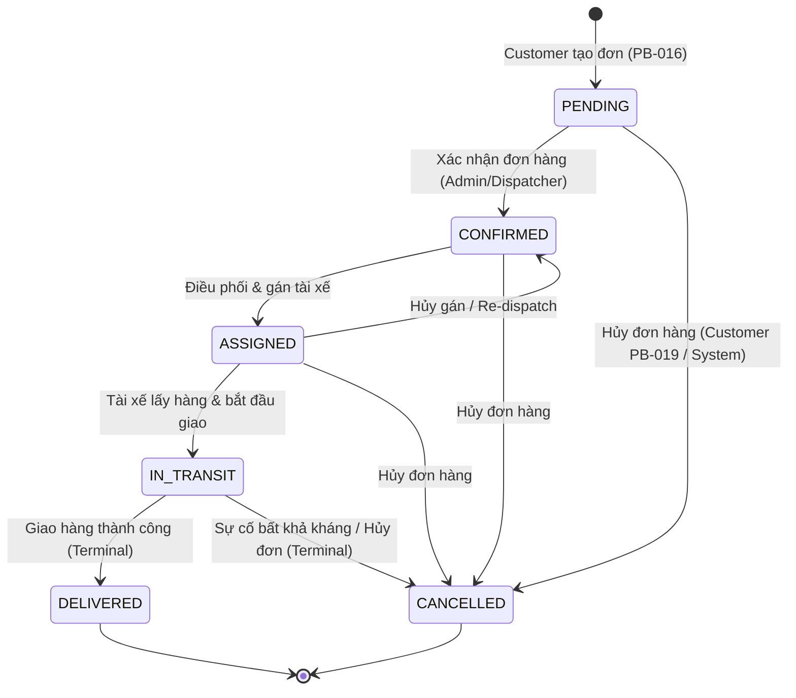
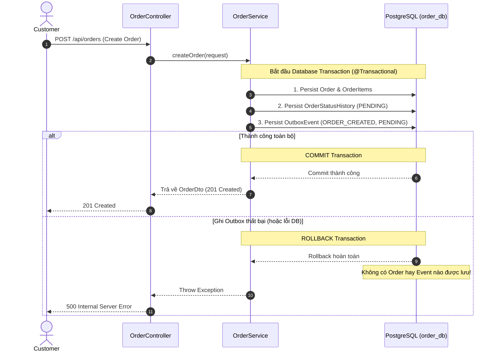

# Logistics Platform

A cloud-native **logistics management system** built on a microservice architecture.  
This repository is a Maven multi-module monorepo containing all platform services, shared libraries, local infrastructure orchestration, isolated persistence layers, event-driven messaging, and in-memory caching.

---

## Table of Contents

1. [Architecture Overview](#architecture-overview)  
2. [Service Decomposition](#service-decomposition)  
3. [Database-per-Service Architecture (PostgreSQL)](#database-per-service-architecture-postgresql)  
4. [Event-Driven Architecture (Apache Kafka)](#event-driven-architecture-apache-kafka)  
5. [In-Memory Store & Caching (Redis)](#in-memory-store--caching-redis)  
6. [Infrastructure Stack (Docker Compose)](#infrastructure-stack-docker-compose)  
7. [Repository Structure](#repository-structure)  
8. [Prerequisites](#prerequisites)  
9. [Build & Run](#build--run)  
10. [API Gateway](#api-gateway)  
11. [Testing](#testing)  
12. [Configuration](#configuration)  
13. [Architecture Decisions (ADRs)](#architecture-decisions-adrs)  
14. [Roadmap](#roadmap)

---

## Architecture Overview

```
┌───────────────────────────────────────────────────────────────────┐
│                        Client Applications                        │
│                 (Web / Mobile / Third-party APIs)                 │
└─────────────────────────────────┬─────────────────────────────────┘
                                  │  HTTP/REST  (port 8080)
                    ┌─────────────▼─────────────┐
                    │       API Gateway         │  ← PB-002 ✅
                    │   Quarkus & Vert.x Proxy  │
                    │   /api/<resource>/**      │
                    └──────┬──────┬──────┬──────┘
                           │      │      │
                 ┌─────────┘  ┌───┘  ┌──┘
                 ▼            ▼      ▼
           ┌──────────┐ ┌──────────┐ ┌──────────────┐ ┌──────────────────┐
           │  user-   │ │  order-  │ │  shipment-   │ │  notification-   │
           │ service  │ │ service  │ │   service    │ │     service      │
           │ :8081    │ │  :8082   │ │    :8083     │ │      :8084       │
           └────┬─────┘ └────┬─────┘ └──────┬───────┘ └────────┬─────────┘
                │            │              │                  │
════════════════╪════════════╪══════════════╪══════════════════╪═════════════════════════
   PERSISTENCE LAYER — Database-per-Service Isolation (PostgreSQL 16 — PB-004 ✅)
                │            │              │                  │
                ▼            ▼              ▼                  ▼
           ┌──────────┐ ┌──────────┐ ┌──────────────┐ ┌──────────────────┐
           │ user_db  │ │ order_db │ │ shipment_db  │ │ notification_db  │
           │ (user_   │ │ (order_  │ │ (shipment_   │ │ (notification_   │
           │  user)   │ │  user)   │ │  user)       │ │  user)           │
           └──────────┘ └──────────┘ └──────────────┘ └──────────────────┘
            [NO CROSS-DATABASE ACCESS ALLOWED — ENFORCED AT DB ROLE LEVEL]
═════════════════════════════════════════════════════════════════════════════════════════
   ASYNC EVENT BUS — Apache Kafka 3.8 KRaft (PB-005 ✅)
                │            │              │                  │
                └────────────┴──────────────┴──────────────────┘
                 ▲ (publish events)           │ (consume events)
                 │                            ▼
  ┌──────────────────────────────────────────────────────────────────────────┐
  │                 Apache Kafka 3.8 (KRaft Mode :9092)                      │
  │  Topics:                                                                 │
  │    • logistics.order.events        • logistics.shipment.events           │
  │    • logistics.notification.events • logistics.user.events               │
  │                   + Kafka UI Dashboard (:8090)                           │
  └──────────────────────────────────────────────────────────────────────────┘
═════════════════════════════════════════════════════════════════════════════════════════
   IN-MEMORY STORE & CACHE — Redis 7 (PB-006 ✅)
  ┌──────────────────────────────────────────────────────────────────────────┐
  │                 Redis 7 (Standalone, AOF Enabled :6379)                  │
  │  Used for session tokens, distributed caching, and rate limiting        │
  └──────────────────────────────────────────────────────────────────────────┘
═════════════════════════════════════════════════════════════════════════════════════════
   INFRASTRUCTURE LAYER (Docker Compose — PB-003 ✅)
  ┌──────────────────────────────────────────────────────────────────────────┐
  │                 Mailpit (SMTP :1025 | Web UI :8025)                      │
  └──────────────────────────────────────────────────────────────────────────┘
```

**External clients talk ONLY to the API Gateway (port 8080). Backend services are internal.**

Each service is **independently deployable**, has its own isolated database schema (Database-per-Service pattern), communicates asynchronously via Apache Kafka, and utilizes Redis for high-speed in-memory state.

---

## Service Decomposition

| Service | Port | Purpose | Database | Messaging | In-Memory Cache |
|---|---|---|---|---|---|
| **`api-gateway`** | **8080** | **Single entry point for all external clients. Routes requests to backend services by path prefix.** | – *(Stateless)* | – | Optional Rate Limiting |
| `user-service` | 8081 | User accounts, roles (`admin / dispatcher / driver / customer`), authentication identity | `user_db` (`user_service_user`) | Producer (`logistics.user.events`) | Session & Token Cache (`Redis 7`) |
| `order-service` | 8082 | Order lifecycle: create → assign → in-transit → delivered / cancelled | `order_db` (`order_service_user`) | Producer (`logistics.order.events`) | – |
| `shipment-service` | 8083 | Physical shipment runs: vehicle & driver assignment, real-time location, proof-of-delivery | `shipment_db` (`shipment_service_user`) | Producer / Consumer (`logistics.shipment.events`) | – |
| `notification-service` | 8084 | Outbound notifications (email, SMS, push) triggered by platform events | `notification_db` (`notification_service_user`) | Consumer (`logistics.*.events`) | – |
| `common-lib` | – | Shared library: `ApiResponse<T>`, `LogisticsPlatformException`, `DomainEvent<T>`, `KafkaTopics`, `CommonUtils`, `JwtTokenProvider` | – | Shared envelopes | – |

---

## Database-per-Service Architecture (PostgreSQL)

To preserve loose coupling and strict bounded contexts, the persistence layer implements the **Database-per-Service** pattern with physical and logical role isolation.

### Service Credentials & Access Isolation

| Service | Database Name | Dedicated Role | Default Password | Default JDBC URL |
|---|---|---|---|---|
| `user-service` | `user_db` | `user_service_user` | `user_password` | `jdbc:postgresql://localhost:5432/user_db` |
| `order-service` | `order_db` | `order_service_user` | `order_password` | `jdbc:postgresql://localhost:5432/order_db` |
| `shipment-service` | `shipment_db` | `shipment_service_user` | `shipment_password` | `jdbc:postgresql://localhost:5432/shipment_db` |
| `notification-service` | `notification_db` | `notification_service_user` | `notification_password` | `jdbc:postgresql://localhost:5432/notification_db` |

### Strict Cross-Service Access Control
- `REVOKE CONNECT ON DATABASE <db> FROM PUBLIC` is executed on all databases.
- Only the owning role is granted `CONNECT` privilege on its database.
- Attempting cross-service access (e.g. `user_service_user` trying to connect to `order_db`) results in an immediate PostgreSQL rejection:
  ```
  FATAL: permission denied for database "order_db"
  DETAIL: User does not have CONNECT privilege.
  ```

---

## Event-Driven Architecture (Apache Kafka)

Asynchronous inter-service communication and event broadcasting are managed via Apache Kafka 3.8 running in native **KRaft mode** (no ZooKeeper required).

### Foundation Topic Structure

All topic names follow the standard domain hierarchy convention defined in `KafkaTopics`:

| Topic Name | Purpose | Producers | Consumers |
|---|---|---|---|
| `logistics.order.events` | Order status changes (`OrderCreated`, `OrderCancelled`, etc.) | `order-service` | `shipment-service`, `notification-service` |
| `logistics.shipment.events` | Shipment tracking updates (`ShipmentDispatched`, `DeliveryCompleted`) | `shipment-service` | `order-service`, `notification-service` |
| `logistics.notification.events` | Notification triggers and audit records | Domain services | `notification-service` |
| `logistics.user.events` | User lifecycle events (`UserRegistered`, `DriverAssigned`) | `user-service` | `notification-service` |

### Standard Domain Event Envelope

All events share the universal `DomainEvent<T>` envelope defined in `common-lib`:
```json
{
  "eventId": "c86a7d55-7fc7-458b-967b-12d8a39a7b93",
  "eventType": "OrderCreated",
  "aggregateId": "ORD-10023",
  "timestamp": "2026-10-07T03:58:00Z",
  "payload": { ... }
}
```

---

## In-Memory Store & Caching (Redis)

Redis 7 is deployed as the foundational in-memory store for low-latency operations, temporary state, distributed session management, and upcoming rate-limiting capabilities.

### Redis Configuration & Port
- **Host Port**: `6379`
- **Internal Port**: `6379`
- **Volume**: `logistics_redis_data` (AOF persistence enabled: `redis-server --appendonly yes`)
- **Container Name**: `logistics-redis`

### Spring Boot Data Redis Integration
- Microservices connect via Spring Data Redis (`Lettuce` driver).
- Environment variables:
  - `spring.data.redis.host: ${REDIS_HOST:localhost}`
  - `spring.data.redis.port: ${REDIS_PORT:6379}`
  - `spring.data.redis.password: ${REDIS_PASSWORD:}`
- Actuator Health check enabled: `management.health.redis.enabled=true`.
- Bean `RedisTemplate<String, Object>` is pre-configured with JSON serialization (`GenericJackson2JsonRedisSerializer`).

### How to Inspect & Test Redis
```bash
# 1. Ping Redis container
docker exec logistics-redis redis-cli ping
# Output: PONG

# 2. Test SET & GET via CLI
docker exec logistics-redis redis-cli set sample_key "Hello Redis"
docker exec logistics-redis redis-cli get sample_key
# Output: Hello Redis

# 3. Check Redis Health via Actuator
curl http://localhost:8081/actuator/health | grep redis
```

---

## Infrastructure Stack (Docker Compose)

All foundational infrastructure required for local development is containerized using Docker Compose (`docker-compose.yml`) under the dedicated bridge network `logistics-network`.

### Services & Port Mappings

| Component | Container Name | Host Port | Internal Port | Persistent Volume | Description |
|---|---|---|---|---|---|
| **PostgreSQL 16** | `logistics-postgres` | `5432` | `5432` | `logistics_postgres_data` | Relational DB; auto-provisions `user_db`, `order_db`, `shipment_db`, `notification_db` |
| **Apache Kafka 3.8** | `logistics-kafka` | `9092` | `9092`, `29092` | `logistics_kafka_data` | Distributed event streaming in native **KRaft mode** (no ZooKeeper) |
| **Kafka UI** | `logistics-kafka-ui` | `8090` | `8080` | – | Web dashboard for managing Kafka topics, consumer groups & messages |
| **Redis 7** | `logistics-redis` | `6379` | `6379` | `logistics_redis_data` | High-performance in-memory cache and session store (AOF enabled) |
| **Mailpit** | `logistics-mailpit` | `1025` (SMTP)<br>`8025` (UI) | `1025`<br>`8025` | – | Mock SMTP server and webmail inspector for notification-service testing |

### Infrastructure Management Commands

```bash
# Start all infrastructure
docker compose up -d

# Check status & health
docker compose ps

# View logs
docker compose logs -f [service]

# Stop infrastructure
docker compose down

# Reset and delete all data
docker compose down -v
```

---

## Repository Structure

```
logistics-platform/
├── pom.xml                               # Parent POM (multi-module build root)
├── docker-compose.yml                    # Infrastructure orchestration (Postgres, Kafka KRaft, Redis, Mailpit)
├── .env.example                          # Environment variables template (no secrets)
├── .gitignore
├── README.md
│
├── docker/
│   └── postgres/
│       └── init-databases.sql            # Role & DB provisioning per service
│
├── shared/
│   └── common-lib/                       # Shared library
│       ├── pom.xml
│       └── src/
│           ├── main/java/com/logistics/common/
│           │   ├── dto/ApiResponse.java
│           │   ├── event/DomainEvent.java           # Universal event envelope
│           │   ├── event/KafkaTopics.java           # Foundation topic constants
│           │   ├── exception/LogisticsPlatformException.java
│           │   └── util/CommonUtils.java
│           └── test/java/com/logistics/common/
│               ├── event/DomainEventTest.java
│               └── util/CommonUtilsTest.java
│
└── services/
    ├── api-gateway/                      # API Gateway (Spring Cloud Gateway)
    │   ├── pom.xml
    │   └── src/
    │       ├── main/java/com/logistics/gateway/ApiGatewayApplication.java
    │       ├── main/resources/application.yml        ← route definitions
    │       ├── test/java/com/logistics/gateway/ApiGatewayApplicationTest.java
    │       ├── test/java/com/logistics/gateway/GatewayRoutesConfigTest.java
    │       └── test/resources/application-test.yml
    │
    ├── user-service/                     # PostgreSQL + Kafka + Redis 7 + Liquibase
    │   ├── pom.xml
    │   └── src/
    │       ├── main/java/com/logistics/user/
    │       │   ├── UserServiceApplication.java
    │       │   └── config/RedisConfig.java
    │       ├── main/resources/
    │       │   ├── application.yml
    │       │   └── db/changelog/
    │       │       ├── db.changelog-master.yaml
    │       │       └── changes/001-create-users-table.yaml
    │       └── test/
    │           ├── java/com/logistics/user/
    │           │   ├── UserServiceApplicationTest.java
    │           │   ├── UserDatabaseConnectionTest.java
    │           │   ├── UserLiquibaseMigrationTest.java
    │           │   └── RedisSmokeIntegrationTest.java
    │           └── resources/application-test.yml
    │
    ├── order-service/                    # order_db persistence + Kafka + Liquibase
    │   ├── pom.xml
    │   └── src/
    │       ├── main/java/com/logistics/order/
    │       │   ├── OrderServiceApplication.java
    │       │   └── config/KafkaTopicConfig.java
    │       ├── main/resources/
    │       │   ├── application.yml
    │       │   └── db/changelog/
    │       │       ├── db.changelog-master.yaml
    │       │       └── changes/001-create-orders-table.yaml
    │       └── test/
    │           ├── java/com/logistics/order/
    │           │   ├── OrderServiceApplicationTest.java
    │           │   ├── OrderDatabaseConnectionTest.java
    │           │   ├── OrderLiquibaseMigrationTest.java
    │           │   └── KafkaProducerConsumerIntegrationTest.java
    │           └── resources/application-test.yml
    │
    ├── shipment-service/                 # shipment_db persistence + Kafka + Liquibase
    │   ├── pom.xml
    │   └── src/  (includes db/changelog/ & ShipmentLiquibaseMigrationTest)
    │
    └── notification-service/             # notification_db persistence + Kafka + Liquibase
        ├── pom.xml
        └── src/  (includes db/changelog/ & NotificationLiquibaseMigrationTest)
```

---

## Prerequisites

| Tool | Minimum version | Purpose |
|---|---|---|
| Java (JDK) | 21 | Microservices runtime |
| Apache Maven | 3.9 | Multi-module build system |
| Docker & Docker Compose | Docker 24+, Compose v2+ | Local infrastructure orchestration |

---

## Build & Run

### Build all modules from the repository root

```bash
mvn clean package -DskipTests
```

### Run local development environment

1. **Start infrastructure (PostgreSQL, Kafka, Redis, Mailpit):**
   ```bash
   docker compose up -d
   ```
2. **Start microservices (in individual terminals or IDE):**
   ```bash
   mvn spring-boot:run -pl services/user-service
   mvn spring-boot:run -pl services/order-service
   mvn spring-boot:run -pl services/shipment-service
   mvn spring-boot:run -pl services/notification-service
   mvn spring-boot:run -pl services/api-gateway
   ```

---

## Database Migrations (Liquibase)

Every service with persistent storage manages its database schema migrations independently using Liquibase:

- **Isolated Master Changelog**: Located at `classpath:db/changelog/db.changelog-master.yaml`.
- **Modular Changeset Directory**: Granular changesets reside in `db/changelog/changes/<seq>-<description>.yaml` and are included by the master.
- **Automated Startup Migration**: Spring Boot runs pending migrations at service startup (`spring.liquibase.enabled: true`).
- **DDL Governance**: Hibernate `ddl-auto` is set to `validate` to guarantee Liquibase is the single source of truth for DDL changes.
- **Repeatable & Version Controlled**: Re-running migrations on fresh instances creates the exact schema with checksum tracking.

### Inspect Migration Status

1. **Via Spring Boot Actuator**:
   ```bash
   curl http://localhost:8081/actuator/liquibase | jq .
   ```
2. **Via PostgreSQL Metadata Tables**:
   ```bash
   docker exec -e PGPASSWORD=user_password logistics-postgres psql -U user_service_user -d user_db \
     -c "SELECT id, author, exectype, orderexecuted FROM databasechangelog;"
   ```

---

## Testing

### Run all tests from the root

```bash
mvn test
```

### Test coverage per module

| Module | Tests | Descriptions |
|---|---|---|
| `common-lib` | 12 unit tests | `CommonUtilsTest` (6) + `DomainEventTest` (1) + `JwtTokenProviderTest` (5) |
| `api-gateway` | 10 tests | 1 context smoke test + 6 route configuration tests + 3 routing integration tests (`GatewayAuthRoutingIntegrationTest`) |
| `user-service` | 17 tests | 1 context smoke test + 1 DB connection + 1 Redis smoke + 1 Liquibase migration (3 changesets) + 5 auth service unit tests + 8 auth controller integration tests |
| `order-service` | 4 tests | 1 context smoke test + 1 DB connection + 1 Kafka integration test + 1 Liquibase migration test |
| `shipment-service` | 3 tests | 1 context smoke test + 1 DB connection + 1 Liquibase migration test |
| `notification-service` | 3 tests | 1 context smoke test + 1 DB connection + 1 Liquibase migration test |

**Total: 49 tests passing 100%.**

---

## Continuous Integration (CI)

The repository is configured with an automated Continuous Integration pipeline using **GitHub Actions** ([`.github/workflows/ci.yml`](.github/workflows/ci.yml)):

- **Triggers**:
  - `push` to the `main` branch.
  - `pull_request` targeting the `main` branch.
  - `workflow_dispatch` for manual triggering from the GitHub Actions console.
- **Environment**:
  - Runner: `ubuntu-latest`.
  - Runtime: Eclipse Temurin JDK 21 LTS (`actions/setup-java@v4`).
  - Dependency Caching: Automated Maven cache (`cache: 'maven'`) for rapid feedback loops.
- **Pipeline Stages**:
  1. **Checkout Repository**: Full workspace fetch (`actions/checkout@v4`).
  2. **Environment Verification**: Verifies `java -version` and `mvn -version`.
  3. **Multi-module Reactor Build & Test**: Runs `mvn -B clean verify --file pom.xml`, ensuring clean builds and executing all unit/integration tests across all 7 modules (`parent`, `common-lib`, `api-gateway`, `user-service`, `order-service`, `shipment-service`, `notification-service`).
  4. **Strict Gating**: Any failure during compilation, package packaging, or test assertions exits with non-zero code, failing the CI run and blocking Pull Request merge.
  5. **Step Summary**: Automatically generates a Markdown summary of the build run in the GitHub Actions summary tab.

---

## Configuration

All configuration is managed via `application.yml` in each service's `src/main/resources/` and overridable via environment variables.  
**No secrets are hard-coded.** Every sensitive value uses safe local defaults or environment overrides.

Copy `.env.example` to `.env` and fill in your values:

```bash
cp .env.example .env
```

### Key environment variables

| Variable | Default | Description |
|---|---|---|
| `GATEWAY_PORT` | `8080` | HTTP port for the API Gateway |
| `USER_SERVICE_PORT` | `8081` | HTTP port for user-service |
| `ORDER_SERVICE_PORT` | `8082` | HTTP port for order-service |
| `SHIPMENT_SERVICE_PORT` | `8083` | HTTP port for shipment-service |
| `NOTIFICATION_SERVICE_PORT` | `8084` | HTTP port for notification-service |
| `POSTGRES_PORT` | `5432` | PostgreSQL host port |
| `REDIS_PORT` | `6379` | Redis host port |
| `REDIS_HOST` | `localhost` | Redis host address |
| `KAFKA_PORT` | `9092` | Kafka external broker port |
| `KAFKA_BOOTSTRAP_SERVERS` | `localhost:9092` | Kafka cluster bootstrap servers address |
| `MAILPIT_SMTP_PORT` | `1025` | Mailpit SMTP server port |
| `MAILPIT_UI_PORT` | `8025` | Mailpit Web inbox UI port |

---

## Architecture Decisions (ADRs)

### ADR-001: Maven Multi-module Monorepo
**Decision**: Use a single Git repository with Maven multi-module build.  
**Rationale**: Simplifies cross-service refactoring, enforces single dependency version governance, and enables atomic commits across services.

### ADR-002: Java 21 + Quarkus 3.15 LTS
**Decision**: All platform services use Java 21 LTS and Quarkus 3.15.x LTS.  
**Rationale**: Java 21 LTS provides modern language capabilities and virtual threads. Quarkus brings supersonic subatomic execution, near-instantaneous startup, minimal RSS memory footprint, and build-time optimization (ArC CDI synthesis, Panache ORM) ideal for high-density container environments.

### ADR-003: Quarkus & Vert.x Reactive Reverse Proxy for API Gateway
**Decision**: `api-gateway` is built on Quarkus with Vert.x Web Reactive Core and asynchronous streaming proxy.  
**Rationale**: Non-blocking asynchronous event loop delivers maximum throughput with minimal thread and memory overhead, offering superior efficiency over legacy servlet or Spring gateways. Dynamic path forwarding and prefix stripping are managed natively via Vert.x handlers.

### ADR-004: Path-prefix Routing with StripPrefix
**Decision**: Routes are defined by `/api/<resource>/**` prefix; `StripPrefix=1` removes `/api` before forwarding.  
**Rationale**: Clean, unified public namespace for clients. Backend microservices retain clean domain paths without gateway coupling.

### ADR-005: Local Infrastructure via Docker Compose
**Decision**: Centralize all backing infrastructure in a root `docker-compose.yml` with named volumes and dedicated bridge network.  
**Rationale**: Developers can spin up the full infrastructure stack (databases, message broker, cache, mock SMTP) with a single command without installing heavy native daemons on their host machines.

### ADR-006: Apache Kafka in Native KRaft Mode
**Decision**: Deploy Kafka 3.8 in KRaft (Kafka Raft Metadata) mode without ZooKeeper.  
**Rationale**: KRaft eliminates ZooKeeper management overhead, accelerates metadata propagation, reduces container footprint, and represents the modern production standard for Apache Kafka.

### ADR-007: Strict Database-per-Service Isolation & Role Access Control
**Decision**: Each microservice is assigned its own PostgreSQL database and dedicated database user with password. Direct access across services is explicitly revoked (`REVOKE CONNECT ON DATABASE FROM PUBLIC`).  
**Rationale**: Prevents data coupling, enforces domain boundary integrity, and eliminates hidden dependencies across bounded contexts.

### ADR-008: Kubernetes-ready Liveness & Readiness Probes
**Decision**: Actuator probes are enabled with database health verification attached to readiness state.  
**Rationale**: Ensures traffic is only routed to application instances when the database connection pool is healthy and responsive.

### ADR-009: Standard Event Envelope & Domain Topic Hierarchy
**Decision**: Microservices exchange asynchronous events using the typed `DomainEvent<T>` envelope across hierarchical topic channels (`logistics.<domain>.events`).  
**Rationale**: Standardizes event payload headers (`eventId`, `eventType`, `aggregateId`, `timestamp`) and simplifies auditing, tracing, and dead-letter queue routing without leaking service-internal data models.

### ADR-010: Redis In-Memory Store Foundation
**Decision**: Redis 7 is adopted as the dedicated in-memory key-value store using Lettuce client, JSON serializer, and Actuator health indicator.  
**Rationale**: Provides single-digit millisecond read/write latency for ephemeral session state, tokens, distributed cache, and rate-limiting counters.

### ADR-011: Liquibase Schema Versioning & Isolation
**Decision**: Each persistent service manages its own database schema versioning via Liquibase changelogs (`db.changelog-master.yaml` with modular changesets under `changes/`). Migrations run automatically on application startup, and Hibernate DDL generation is restricted to `validate`.  
**Rationale**: Guarantees reproducible, auditable database schemas, prevents cross-service schema coupling, enables zero-downtime evolutionary database design, and eliminates desynchronization between code and database state.

### ADR-012: Continuous Integration via GitHub Actions
**Decision**: Automate repository-level build and test execution via GitHub Actions (`ci.yml`) on Ubuntu runners with Temurin JDK 21 and Maven caching.  
**Rationale**: Guarantees that every Push and Pull Request triggers a clean reactor verification (`mvn clean verify`) covering all 7 modules without depending on developer-local machine state. Any regression or test failure immediately fails the CI pipeline.

### ADR-013: BCrypt Password Hashing & Stateless JWT Authentication
**Decision**: Authentication is implemented in `user-service` with BCrypt password hashing (`BCryptPasswordEncoder`, cost factor 10) and signed JSON Web Tokens (`io.jsonwebtoken` HMAC-SHA256). All authentication requests route through the API Gateway via `/api/auth/**` (stripped to `/auth/**`) or `/auth/**`.
**Rationale**:
- Passwords are never stored in plaintext and never leaked in responses or logs (`LoginRequest.toString()` masks credentials).
- Tokens are cryptographically signed with HMAC-SHA256 and include essential claims (`userId`, `username`, `email`, `role`, `issuedAt`, `expiration`) without requiring stateful session lookups on downstream services.
- Secret and expiration settings are externalized to environment variables (`JWT_SECRET`, `JWT_EXPIRATION_MS`, `JWT_ISSUER`) with safe local development defaults.
- Database-per-service isolation is preserved: `user_db` maintains user identity and credentials via Liquibase migrations (`001`, `002`, `003`), completely decoupled from other bounded contexts.

### ADR-014: Tech Stack Migration to Quarkus 3.x (Java 21 LTS)
**Decision**: Migrate the microservices architecture stack from Spring Boot to Quarkus 3.x (LTS) on Java 21, adopting a step-by-step phased approach starting with `common-lib` and `user-service`.  
**Rationale**:
- **Resource Footprint**: Quarkus reduces runtime heap memory consumption (typically ~40-80MB RSS on JVM vs ~250-400MB in Spring Boot), allowing multiple microservices to run efficiently on low-resource dev/prod nodes.
- **Fast Startup**: Near-instantaneous cold start (< 1-2s JVM, < 0.05s Native), ideal for containerized scaling and serverless workloads.
- **Build-Time Metadata**: Eliminates runtime reflection through build-time CDI synthesis (ArC), compile-time Panache ORM enhancements, and Ahead-Of-Time (AOT) optimizations.
- **Standards-Based**: Employs Jakarta EE 10 standards (Jakarta REST, CDI, Bean Validation, Hibernate Panache) avoiding heavy framework-specific lock-in.

---

## Authentication & Development Accounts (PB-009)

External clients send authentication requests to the API Gateway on port `8080`:

### Endpoints
- **Login**: `POST /api/auth/login` (or `POST /auth/login`)
  ```json
  {
    "username": "admin",
    "password": "Admin@123"
  }
  ```
  **Success Response (200 OK)**:
  ```json
  {
    "success": true,
    "message": "Login successful",
    "data": {
      "accessToken": "eyJhbGciOiJIUzI1NiIsIn...",
      "tokenType": "Bearer",
      "expiresIn": 86400,
      "user": {
        "id": "00000000-0000-0000-0000-000000000001",
        "username": "admin",
        "email": "admin@logistics.com",
        "role": "ADMIN",
        "status": "ACTIVE"
      }
    }
  }
  ```
  **Failure Response (401 Unauthorized)**:
  ```json
  {
    "success": false,
    "message": "Invalid username or password",
    "data": null
  }
  ```
- **Verify Token**: `GET /api/auth/verify` (Header: `Authorization: Bearer <token>`)
- **Get Current User Profile (PB-010)**: `GET /api/auth/me` or `GET /api/users/me` (Header: `Authorization: Bearer <token>`)  
  Extracts identity strictly from the cryptographically verified JWT claims without allowing arbitrary userId parameters.
  **Success Response (200 OK)**:
  ```json
  {
    "success": true,
    "message": "User profile retrieved successfully",
    "data": {
      "userId": "00000000-0000-0000-0000-000000000001",
      "username": "admin",
      "email": "admin@logistics.com",
      "role": "ADMIN",
      "status": "ACTIVE",
      "createdAt": "2026-10-09T08:00:51.670Z",
      "updatedAt": "2026-10-09T08:00:51.670Z"
    }
  }
  ```
  **Unauthenticated / Invalid Token Response (401 Unauthorized)**:
  ```json
  {
    "success": false,
    "message": "Missing or invalid Authorization header",
    "data": null
  }
  ```

### Seeded Sample Accounts for Local Development
Seeded automatically via Liquibase changeset `003-seed-sample-users.yaml`:

| Username | Email | Password | Role | Status |
|---|---|---|---|---|
| `admin` | `admin@logistics.com` | `Admin@123` | `ADMIN` | `ACTIVE` |
| `dispatcher` | `dispatcher@logistics.com` | `Dispatcher@123` | `DISPATCHER` | `ACTIVE` |
| `driver` | `driver@logistics.com` | `Driver@123` | `DRIVER` | `ACTIVE` |
| `customer` | `customer@logistics.com` | `Customer@123` | `CUSTOMER` | `ACTIVE` |

---

## User Management: Administrator APIs (PB-011)

All endpoints require an active `ADMIN` token (`Authorization: Bearer <token>`). Requests from non-admin roles are rejected with `403 Forbidden`. Requests without a token are rejected with `401 Unauthorized`.

| Method | Endpoint (via Gateway) | Description |
|---|---|---|
| `GET` | `/api/users?page=0&size=10&role=DRIVER&status=ACTIVE` | View user list with pagination & optional filtering |
| `GET` | `/api/users/{id}` | View user details (no password/hash exposed) |
| `POST` | `/api/users` | Create new user (body: `username`, `email`, `password`, `role`, optional `status`) |
| `PATCH` | `/api/users/{id}` | Update user fields (`email`, `role`, `status`) |
| `PATCH` | `/api/users/{id}/status` | Lock or unlock user account (`status`: `"LOCKED"` or `"ACTIVE"`) |

### Key Business Rules
- **BCrypt Hashing**: Passwords submitted via `POST /api/users` are hashed using BCrypt (cost factor 10) before persisting; plaintext is never saved or returned.
- **Uniqueness**: Duplicate `username` or `email` rejections return `409 Conflict`.
- **Locked Accounts Blocked**: Accounts set to `LOCKED` cannot log in (`403 Forbidden` on login attempt) and existing tokens cannot retrieve profiles.
- **Last Admin Protection**: The system strictly prevents locking, deactivating, or demoting the last remaining active Administrator (`400 Bad Request`).
- **No Hard Deletes**: User management enforces soft-lock / state deactivation rather than destructive row deletion.

## Role and Permission Management: RBAC (PB-012)

The logistics platform implements a robust, backend-enforced **Role-Based Access Control (RBAC)** mechanism designed to secure all administrative and business operations across all microservices.

### Supported Roles
The system defines 4 core roles tailored to logistics operations:
1. **`ADMIN` (Administrator)**: Toàn quyền quản trị hệ thống, quản lý người dùng, thay đổi vai trò, giám sát vận hành toàn diện.
2. **`DISPATCHER` (Điều phối viên)**: Quản lý và điều phối đơn hàng, gán tài xế, quản lý chuyến hàng, gửi thông báo.
3. **`DRIVER` (Tài xế giao vận)**: Xem chuyến hàng được phân công, cập nhật trạng thái giao hàng, chia sẻ tọa độ GPS thời gian thực.
4. **`CUSTOMER` (Khách hàng)**: Tạo đơn hàng, theo dõi hành trình đơn, hủy đơn và nhận thông báo trạng thái.

### Permission Matrix

| Permission Code | Permission Name | Description | ADMIN | DISPATCHER | DRIVER | CUSTOMER |
|---|---|---|:---:|:---:|:---:|:---:|
| `user:read` | `USER_READ` | Xem danh sách/chi tiết người dùng | ✅ | ✅ | ❌ | ❌ |
| `user:create` | `USER_CREATE` | Tạo tài khoản người dùng mới | ✅ | ❌ | ❌ | ❌ |
| `user:update` | `USER_UPDATE` | Sửa thông tin tài khoản | ✅ | ❌ | ❌ | ❌ |
| `user:status_change` | `USER_STATUS_CHANGE` | Khóa hoặc mở khóa tài khoản | ✅ | ❌ | ❌ | ❌ |
| `role:read` | `ROLE_READ` | Xem danh sách vai trò & quyền hạn | ✅ | ❌ | ❌ | ❌ |
| `role:update` | `ROLE_UPDATE` | Thay đổi vai trò người dùng | ✅ | ❌ | ❌ | ❌ |
| `order:create` | `ORDER_CREATE` | Tạo đơn hàng mới | ✅ | ❌ | ❌ | ✅ |
| `order:read` | `ORDER_READ` | Xem thông tin đơn hàng | ✅ | ✅ | ❌ | ✅ |
| `order:update` | `ORDER_UPDATE` | Cập nhật đơn hàng | ✅ | ✅ | ❌ | ❌ |
| `order:cancel` | `ORDER_CANCEL` | Hủy đơn hàng | ✅ | ❌ | ❌ | ✅ |
| `shipment:read` | `SHIPMENT_READ` | Xem thông tin chuyến hàng | ✅ | ✅ | ✅ | ❌ |
| `shipment:assign` | `SHIPMENT_ASSIGN` | Điều phối & phân công tài xế | ✅ | ✅ | ❌ | ❌ |
| `shipment:update_status` | `SHIPMENT_UPDATE_STATUS` | Cập nhật trạng thái giao hàng | ✅ | ✅ | ✅ | ❌ |
| `shipment:location_ping` | `SHIPMENT_LOCATION_PING` | Cập nhật GPS chuyến hàng | ✅ | ❌ | ✅ | ❌ |
| `notification:read` | `NOTIFICATION_READ` | Xem thông báo | ✅ | ✅ | ✅ | ✅ |
| `notification:send` | `NOTIFICATION_SEND` | Gửi thông báo hệ thống | ✅ | ✅ | ❌ | ❌ |

### Role Management APIs

| Method | Endpoint (via Gateway) | Direct Endpoint | Required Privilege | Description |
|---|---|---|---|---|
| `GET` | `/api/users/roles` | `/users/roles` | `ADMIN` / `ROLE_READ` | Xem danh sách 4 vai trò kèm toàn bộ quyền hạn chi tiết |
| `PATCH` | `/api/users/{id}/role` | `/users/{id}/role` | `ADMIN` / `ROLE_UPDATE` | Thay đổi vai trò của người dùng (`body`: `{"role": "DRIVER"}`) |

### Security & Invalidation Rules
- **Backend-Enforced**: Quyền và vai trò được kiểm tra nghiêm ngặt tại backend; không tin tưởng bất kỳ thông tin role/permission nào do client gửi lên.
- **Immediate Role Revocation Effect**: Khi một Administrator bị hạ quyền (demoted) trong cơ sở dữ liệu, token JWT cũ dù chưa hết hạn sẽ **ngay lập tức bị từ chối với mã lỗi `403 Forbidden`** ("Administrator privileges revoked"). Tránh hoàn toàn rủi ro token cũ giữ quyền cao hơn ngoài dự kiến.
- **Last Administrator Protection**: Hệ thống kiểm tra số lượng active admin trước khi cho phép hạ quyền (`demote`). Nếu tài khoản là Admin hoạt động duy nhất còn lại, thao tác bị từ chối ngay với `400 Bad Request` ("Cannot demote the last remaining active Administrator in the system").
- **Reusable Architecture**: Thư viện dùng chung `common-lib` cung cấp `Role`, `Permission`, `RolePermissions`, và `AuthPrincipal` giúp các microservices nghiệp vụ tiếp theo (`order-service`, `shipment-service`, `notification-service`) tái sử dụng thống nhất toàn bộ cơ chế xác thực và phân quyền.

---

## Driver Management: Driver Profiles (PB-013)

Chức năng quản lý hồ sơ tài xế liên kết 1-1 với tài khoản người dùng mang vai trò `DRIVER`. Dữ liệu identity (`username`, `email`, `role`, `status`) được quản lý tập trung và không bị nhân bản; hồ sơ tài xế lưu trữ các thông tin nghiệp vụ vận tải chuyên biệt (`full_name`, `phone_number`, `license_number`, `license_class`, `vehicle_type`, `vehicle_plate`, `address`, `status`).

### Driver Profile APIs

Tất cả các request đi qua API Gateway:

| Method | Endpoint (via Gateway) | Direct Endpoint | Required Privilege | Description |
|---|---|---|---|---|
| `GET` | `/api/drivers` | `/drivers` | `ADMIN`, `DISPATCHER` | Xem danh sách hồ sơ tài xế hỗ trợ phân trang & lọc status |
| `GET` | `/api/drivers/me` | `/drivers/me` | `DRIVER` | Tài xế xem thông tin hồ sơ của chính mình |
| `GET` | `/api/drivers/{id}` | `/drivers/{id}` | `ADMIN`, `DISPATCHER` (hoặc `DRIVER` chính chủ) | Xem chi tiết hồ sơ tài xế theo Driver ID hoặc User ID |
| `POST` | `/api/drivers` | `/drivers` | `ADMIN`, `DISPATCHER` | Tạo hồ sơ tài xế mới gắn với một user có role `DRIVER` |
| `PATCH` | `/api/drivers/{id}` | `/drivers/{id}` | `ADMIN`, `DISPATCHER` (hoặc `DRIVER` chính chủ) | Cập nhật thông tin hồ sơ tài xế |

### Business & Security Rules
- **Liên kết 1-1 duy nhất**: Mỗi user có role `DRIVER` chỉ được gắn duy nhất một hồ sơ tài xế (`user_id` unique). Cố tình tạo trùng lặp trả về `409 Conflict`.
- **Ràng buộc vai trò**: Chỉ cho phép tạo hồ sơ tài xế khi user mục tiêu mang vai trò `DRIVER`. Nếu user không tồn tại hoặc mang vai trò khác (`CUSTOMER`, `ADMIN`...) -> trả về `400 Bad Request`.
- **Duy nhất GPLX**: Số giấy phép lái xe (`license_number`) được kiểm tra tính duy nhất trên toàn hệ thống (`409 Conflict` nếu trùng).
- **Phân quyền truy cập tài xế (Self-Service vs Management)**:
  - Tài xế chỉ được xem và cập nhật hồ sơ của chính mình; cố tình truy cập hoặc sửa đổi hồ sơ của tài xế khác bị từ chối ngay với `403 Forbidden`.
  - Khách hàng (`CUSTOMER`) không có quyền truy cập API tài xế (`403 Forbidden`).
  - Tài xế không được phép tự thay đổi `status` hồ sơ (chỉ Admin/Dispatcher mới có quyền điều chỉnh trạng thái hồ sơ).
  - Client không thể sửa đổi `userId` trong cập nhật profile để tránh tấn công chiếm đoạt hoặc chuyển giao liên kết tài khoản.
- **Bảo mật dữ liệu**: Không trả về hoặc ghi log thông tin mật khẩu, passwordHash của tài khoản người dùng.

---

## Driver Management: Driver Availability (PB-014)

Chức năng cho phép tài xế (`DRIVER`) chủ động quản lý trạng thái sẵn sàng tiếp nhận công việc giao vận giữa `AVAILABLE` và `UNAVAILABLE`. Trạng thái được lưu trữ bền vững trong cơ sở dữ liệu và phục vụ như một thuộc tính đầu vào quan trọng cho quy tắc điều phối/eligibility ở PB-015.

### Driver Availability APIs

Tất cả các request đi qua API Gateway:

| Method | Endpoint (via Gateway) | Direct Endpoint | Required Privilege | Request Body | Description |
|---|---|---|---|---|---|
| `GET` | `/api/drivers/me/availability` | `/drivers/me/availability` | `DRIVER` | None | Tài xế xem trạng thái availability hiện tại của chính mình |
| `PATCH` | `/api/drivers/me/availability` | `/drivers/me/availability` | `DRIVER` | `{"availability": "AVAILABLE"}` | Tài xế chủ động cập nhật trạng thái availability của mình |
| `GET` | `/api/drivers/{id}/availability` | `/drivers/{id}/availability` | `ADMIN`, `DISPATCHER` (hoặc `DRIVER` chính chủ) | None | Xem trạng thái availability của một tài xế theo ID |
| `PATCH` | `/api/drivers/{id}/availability` | `/drivers/{id}/availability` | `ADMIN`, `DISPATCHER` (hoặc `DRIVER` chính chủ) | `{"availability": "UNAVAILABLE"}` | Admin/Dispatcher can thiệp cập nhật availability tài xế |

### Data Model & Persistence
- **Enum `DriverAvailability`**: Giới hạn nghiêm ngặt 2 giá trị `AVAILABLE` và `UNAVAILABLE` (định nghĩa trong `com.logistics.common.model.DriverAvailability`).
- **Database Schema**: Bổ sung cột `availability VARCHAR(20) DEFAULT 'UNAVAILABLE' NOT NULL` vào bảng `driver_profiles` trong `user_db` qua Liquibase changeset `005-add-driver-availability.yaml`.
- **Default Value An Toàn**: Khi một Driver profile mới được tạo, hệ thống luôn gán giá trị mặc định an toàn là `UNAVAILABLE`. Tài xế mới sẽ không tự động nhận việc cho đến khi chủ động kích hoạt chuyển sang `AVAILABLE`.
- **Độc lập trạng thái**: Availability là trạng thái sẵn sàng tác nghiệp độc lập, tách biệt hoàn toàn với trạng thái khóa tài khoản (`ACTIVE`, `LOCKED` trong `User`) và trạng thái hồ sơ nhân sự vận hành (`ACTIVE`, `SUSPENDED` trong `DriverProfile`).

### Security & RBAC Enforcement
- **Identity từ Token**: Endpoint `/drivers/me/availability` lấy định danh tài xế trực tiếp và duy nhất từ JWT claims của phiên đăng nhập (`resolveAuthenticatedUser`). Request không chấp nhận `userId` từ body hay path nhằm triệt tiêu hoàn toàn khả năng can thiệp tài xế khác.
- **Ràng buộc vai trò (Role DRIVER)**: Chỉ người dùng có role `DRIVER` mới có thể gọi endpoint cập nhật trạng thái cá nhân. Các tài khoản khác (`CUSTOMER`, v.v.) sẽ bị từ chối với mã lỗi `403 Forbidden`.
- **Authentication**: Mọi truy cập không mang token hoặc token không hợp lệ/hết hạn bị từ chối ngay với `401 Unauthorized`.
- **Input Validation**: Request body chỉ nhận giá trị availability hợp lệ (`AVAILABLE`, `UNAVAILABLE`). Nếu null hoặc chuỗi không xác định sẽ trả về lỗi `400 Bad Request`.
- **Phạm vi biên giới**: Không triển khai logic tự động tìm tài xế hay phân công đơn ở bước này (thuộc tính availability sẽ được sử dụng cho quy tắc eligibility ở PB-015).

---

## Driver Management: Driver Eligibility (PB-015)

Xây dựng quy tắc nghiệp vụ tập trung, có thể kiểm thử độc lập và tái sử dụng toàn diện (`DriverEligibilityPolicy` & `DriverEligibilityService`) để xác định Driver có đủ điều kiện xem xét nhận đơn hàng (`eligible`) hay không.

### Quy tắc Eligibility tối thiểu (Đánh giá đồng thời & Tích lũy Reason Code)

Một tài xế được đánh giá là **`ELIGIBLE`** khi và chỉ khi thỏa mãn **toàn bộ** các điều kiện sau:
1. **Tài khoản người dùng (`User`) tồn tại**: Phải tìm thấy bản ghi `User` tương ứng. (Vi phạm: `USER_NOT_FOUND`).
2. **Tài khoản không bị khóa và đang hoạt động**: `User.status == ACTIVE`. (Vi phạm: `USER_LOCKED` hoặc `USER_INACTIVE`).
3. **Vai trò bắt buộc là DRIVER**: `User.role == DRIVER`. (Vi phạm: `NOT_A_DRIVER_ROLE`).
4. **Hồ sơ tài xế (`DriverProfile`) tồn tại**: Phải có hồ sơ liên kết. (Vi phạm: `DRIVER_PROFILE_NOT_FOUND`).
5. **Trạng thái hồ sơ tài xế là ACTIVE**: `DriverProfile.status == "ACTIVE"`. (Vi phạm: `DRIVER_PROFILE_INACTIVE`).
6. **Trạng thái sẵn sàng là AVAILABLE**: `DriverProfile.availability == AVAILABLE`. (Vi phạm: `DRIVER_UNAVAILABLE`).
7. **Thông tin hồ sơ bắt buộc đầy đủ**: Các thông tin vận hành cốt lõi hiện có trong model (`fullName`, `phoneNumber`, `licenseNumber`, `licenseClass`, `vehicleType`, `vehiclePlate`) không được để trống hoặc rỗng. (Vi phạm: `DRIVER_INFO_INCOMPLETE`).

### Danh sách Reason Code có cấu trúc (`DriverIneligibilityReason`)

Được định nghĩa tập trung trong thư viện dùng chung `common-lib` (`com.logistics.common.model.DriverIneligibilityReason`):

| Reason Code | Mô tả | Nhóm kiểm tra |
|---|---|---|
| `USER_NOT_FOUND` | User account does not exist | User Identity |
| `USER_INACTIVE` | User account is inactive | User Status |
| `USER_LOCKED` | User account is locked | User Status |
| `NOT_A_DRIVER_ROLE` | User does not have DRIVER role | RBAC Role |
| `DRIVER_PROFILE_NOT_FOUND` | Driver profile does not exist | Profile Existence |
| `DRIVER_PROFILE_INACTIVE` | Driver profile status is not ACTIVE (e.g. SUSPENDED) | Profile Operation |
| `DRIVER_UNAVAILABLE` | Driver availability is currently UNAVAILABLE | Dispatching Availability |
| `DRIVER_INFO_INCOMPLETE` | Driver mandatory profile details are incomplete | Profile Data Quality |
| `SYSTEM_ERROR` | System or communication error while verifying driver eligibility | Technical / Fail-Safe |

### Cơ chế Fail-Safe & Lỗi kỹ thuật
Khi xảy ra lỗi kết nối cơ sở dữ liệu, lỗi timeout hoặc sự cố kỹ thuật không lường trước:
- Hệ thống **tuyệt đối không** mặc định cho phép (`fail-closed`).
- Trả về `eligible: false` kèm reason code `SYSTEM_ERROR` và mô tả chi tiết lỗi kỹ thuật để audit/logging.

### Driver Eligibility APIs

Tất cả các request đi qua API Gateway:

| Method | Endpoint (via Gateway) | Direct Endpoint | Required Privilege | Description |
|---|---|---|---|---|
| `GET` | `/api/drivers/me/eligibility` | `/drivers/me/eligibility` | `DRIVER` | Tài xế tự kiểm tra tính hợp lệ nhận đơn của chính mình |
| `GET` | `/api/drivers/{id}/eligibility` | `/drivers/{id}/eligibility` | `ADMIN`, `DISPATCHER` (hoặc `DRIVER` chính chủ) | Đánh giá tính hợp lệ nhận đơn của một tài xế theo ID |

**Response Format (`DriverEligibilityResultDto`)**:
```json
{
  "success": true,
  "message": "Driver eligibility evaluated successfully",
  "data": {
    "driverId": "00000000-0000-0000-0001-000000000001",
    "userId": "00000000-0000-0000-0000-000000000003",
    "eligible": false,
    "ineligibilityReasons": [
      "DRIVER_UNAVAILABLE"
    ],
    "reasonDescriptions": [
      "Driver availability is currently UNAVAILABLE"
    ],
    "evaluatedAt": "2026-10-09T11:06:00Z"
  }
}
```

### Các giả định & Giới hạn hiện tại
- **Giới hạn nghiệp vụ**: PB-015 thuần túy đánh giá điều kiện tiên quyết (eligibility). Chưa thực hiện tự động gán đơn, tìm tài xế gần nhất, tính toán trọng tải đơn hàng hay theo dõi GPS thời gian thực (sẽ được xây dựng trong các PB tiếp theo).
- **Giả định thông tin bổ sung**: Các thuộc tính như hạn giấy phép lái xe (expiration date), kiểm định xe, bán kính hoạt động hay chứng chỉ chuyên biệt hiện chưa có trường tương ứng trong schema `driver_profiles`. Theo đúng nguyên tắc thiết kế, hệ thống không tự ý phát sinh logic giả định phức tạp mà bám sát model hiện có.

---

## Order Management: Customer tạo Order (PB-016)

Cho phép khách hàng (`CUSTOMER`) tạo mới một đơn hàng (`Order`) hợp lệ với trạng thái khởi tạo bắt buộc luôn là `PENDING`.

### Order Creation APIs

Tất cả request được gửi qua API Gateway:

| Method | Endpoint (via Gateway) | Direct Endpoint | Required Privilege | Description |
|---|---|---|---|---|
| `POST` | `/api/orders` | `/orders` | `CUSTOMER` (hoặc `ORDER_CREATE`) | Khách hàng tạo mới một đơn hàng |

**Request Body (`CreateOrderRequest`)**:
```json
{
  "recipientName": "Nguyễn Văn B",
  "recipientPhone": "0987654321",
  "deliveryAddress": "123 Đường Nguyễn Trãi, Quận 1, TP. Hồ Chí Minh",
  "notes": "Giao giờ hành chính, gọi trước khi đến",
  "items": [
    {
      "productName": "Laptop Dell XPS",
      "quantity": 1,
      "unitPrice": 25000000.0
    },
    {
      "productName": "Chuột không dây Logitech",
      "quantity": 2,
      "unitPrice": 450000.0
    }
  ]
}
```

**Success Response (201 Created)**:
```json
{
  "success": true,
  "message": "Order created successfully",
  "data": {
    "id": "11111111-2222-3333-4444-555555555555",
    "orderNumber": "ORD-20261009112500-1234",
    "customerId": "00000000-0000-0000-0000-000000000004",
    "recipientName": "Nguyễn Văn B",
    "recipientPhone": "0987654321",
    "deliveryAddress": "123 Đường Nguyễn Trãi, Quận 1, TP. Hồ Chí Minh",
    "status": "PENDING",
    "totalAmount": 25900000.0,
    "notes": "Giao giờ hành chính, gọi trước khi đến",
    "items": [
      {
        "id": "22222222-3333-4444-5555-666666666666",
        "productName": "Laptop Dell XPS",
        "quantity": 1,
        "unitPrice": 25000000.0,
        "totalPrice": 25000000.0
      },
      {
        "id": "33333333-4444-5555-6666-777777777777",
        "productName": "Chuột không dây Logitech",
        "quantity": 2,
        "unitPrice": 450000.0,
        "totalPrice": 900000.0
      }
    ],
    "createdAt": "2026-10-09T11:25:00.123Z",
    "updatedAt": "2026-10-09T11:25:00.123Z"
  }
}
```

### Business Rules & Constraints
1. **Trạng thái ban đầu**: Bắt buộc luôn là `PENDING`. Không thể tạo đơn với trạng thái khác qua API này (được đảm bảo bằng cả `@PrePersist` và domain logic).
2. **Identity từ Token**: Định danh khách hàng (`customerId`) được trích xuất trực tiếp từ JWT token (`AuthPrincipal.getUserId()`). Request không nhận `customerId` tùy ý nhằm ngăn chặn hành vi tạo đơn mạo danh khách hàng khác.
3. **Phân quyền truy cập (RBAC)**: Chỉ người dùng có role `CUSTOMER` (hoặc quyền `ORDER_CREATE`) mới được phép tạo order. Các vai trò khác (`DRIVER`, `DISPATCHER`...) bị từ chối với `403 Forbidden`. Request không token hoặc token lỗi trả về `401 Unauthorized`.
4. **Validation dữ liệu đầu vào**:
   - `recipientName`, `recipientPhone`, `deliveryAddress`: Bắt buộc không để trống.
   - `items`: Bắt buộc phải có ít nhất 1 sản phẩm.
   - Mỗi item: `productName` bắt buộc; `quantity >= 1`; `unitPrice > 0`.
   - Nếu vi phạm validation -> trả về `400 Bad Request` kèm chi tiết lỗi.
5. **Tính toán tổng tiền tự động**: `totalPrice` của từng item và `totalAmount` của toàn bộ đơn hàng được backend tự động tính toán chính xác từ `quantity * unitPrice`, tránh client gian lận giá tiền.
6. **Lưu trữ bền vững**: Sử dụng bảng `orders` và `order_items` trong database `order_db` thông qua Liquibase migration (`002-add-order-details-and-items.yaml`).

### Giới hạn & Giả định hiện tại
- **Phạm vi biên giới**: Chỉ triển khai tạo Order ban đầu (PB-016). Chưa có API xem danh sách order, xem chi tiết order hay hủy order (thuộc các PB tiếp theo).
- **Thanh toán & Kho hàng**: Chưa tích hợp kiểm tra tồn kho (inventory check) hay cổng thanh toán (payment gateway). Đơn hàng tạo ra ghi nhận số tiền và trạng thái `PENDING` sẵn sàng cho quy trình xử lý kế tiếp.

---

## Order Management: Customer xem danh sách Order (PB-017)

Xây dựng tính năng cho phép khách hàng (`CUSTOMER`) truy xuất danh sách các đơn hàng của riêng mình với tính năng phân trang, bộ lọc trạng thái và đảm bảo bảo mật phân tách dữ liệu tuyệt đối (data isolation).

### Order Listing APIs

Tất cả request được gửi qua API Gateway:

| Method | Endpoint (via Gateway) | Direct Endpoint | Required Privilege | Query Parameters | Description |
|---|---|---|---|---|---|
| `GET` | `/api/orders` | `/orders` | `CUSTOMER` (hoặc `ORDER_READ`) | `page` (default 0), `size` (default 10), `status` (optional) | Khách hàng xem danh sách đơn hàng của chính mình |

**Success Response (200 OK)**:
```json
{
  "success": true,
  "message": "Orders retrieved successfully",
  "data": {
    "content": [
      {
        "id": "11111111-2222-3333-4444-555555555555",
        "orderNumber": "ORD-20261009112500-1234",
        "customerId": "00000000-0000-0000-0000-000000000004",
        "recipientName": "Nguyễn Văn B",
        "recipientPhone": "0987654321",
        "deliveryAddress": "123 Đường Nguyễn Trãi, Quận 1, TP. Hồ Chí Minh",
        "status": "PENDING",
        "totalAmount": 25900000.0,
        "notes": "Giao giờ hành chính, gọi trước khi đến",
        "items": [
          {
            "id": "22222222-3333-4444-5555-666666666666",
            "productName": "Laptop Dell XPS",
            "quantity": 1,
            "unitPrice": 25000000.0,
            "totalPrice": 25000000.0
          }
        ],
        "createdAt": "2026-10-09T11:25:00.123Z",
        "updatedAt": "2026-10-09T11:25:00.123Z"
      }
    ],
    "page": 0,
    "size": 10,
    "totalElements": 1,
    "totalPages": 1
  }
}
```

### Business Rules & Constraints
1. **Phân tách dữ liệu tuyệt đối (Data Isolation)**:
   - `customerId` được trích xuất hoàn toàn từ JWT Claims của `Authorization: Bearer <token>`.
   - Endpoint không nhận bất kỳ tham số `customerId` nào từ query param hay path param. Truy vấn SQL/HQL luôn bắt buộc điều kiện `WHERE customerId = :customerId`.
   - Khách hàng chỉ nhìn thấy đơn hàng của chính mình, tuyệt đối không thể thấy hoặc biết đến đơn hàng của khách hàng khác.
2. **Phân quyền truy cập (RBAC)**:
   - Chỉ tài khoản có vai trò `CUSTOMER` mới có quyền xem danh sách order của cá nhân.
   - Các vai trò khác (`DRIVER`, `ADMIN`, `DISPATCHER`) bị từ chối với `403 Forbidden` ("Access denied: Only customers are permitted to view orders").
   - Truy cập không có token hoặc token không hợp lệ bị từ chối với `401 Unauthorized`.
3. **Phân trang và sắp xếp (Pagination & Sorting)**:
   - Hỗ trợ tham số phân trang: `page` (0-indexed, default 0), `size` (default 10, giới hạn tối đa 100).
   - Thứ tự hiển thị mặc định: `createdAt DESC` (đơn hàng mới nhất lên đầu).
4. **Bộ lọc trạng thái (`status`)**:
   - Tùy chọn lọc theo trạng thái đơn hàng (`PENDING`, `CONFIRMED`, `IN_TRANSIT`, `DELIVERED`, `CANCELLED`).
   - Nếu truyền giá trị status không tồn tại trong hệ thống -> từ chối với `400 Bad Request` ("Invalid order status: <value>").

### Giới hạn & Giả định hiện tại
- **Phạm vi biên giới**: Chỉ triển khai xem danh sách Order của chính Customer (PB-017). Không thực hiện xem chi tiết đơn hàng đơn lẻ bằng Order ID, không cập nhật hay hủy đơn hàng (sẽ triển khai ở PB-018+).
- **Admin/Dispatcher View**: Đây là API tự phục vụ (self-service) của khách hàng. Giao diện quản trị của Admin/Dispatcher xem toàn bộ đơn hệ thống sẽ được xây dựng ở các task sau.

---

## Order Management: Customer xem chi tiết Order (PB-018)

Cung cấp API cho phép khách hàng (`CUSTOMER`) tra cứu thông tin chi tiết, danh sách sản phẩm và trạng thái hiện tại của một đơn hàng cụ thể, bảo đảm xác thực quyền sở hữu nghiêm ngặt (strict ownership verification).

### Order Details APIs

Tất cả request được gửi qua API Gateway:

| Method | Endpoint (via Gateway) | Direct Endpoint | Required Privilege | Path Parameter | Description |
|---|---|---|---|---|---|
| `GET` | `/api/orders/{id}` | `/orders/{id}` | `CUSTOMER` (hoặc `ORDER_READ`) | `id`: Order ID (UUID) hoặc `orderNumber` | Khách hàng xem chi tiết đơn hàng của chính mình |

**Success Response (200 OK)**:
```json
{
  "success": true,
  "message": "Order details retrieved successfully",
  "data": {
    "id": "11111111-2222-3333-4444-555555555555",
    "orderNumber": "ORD-20261009112500-1234",
    "customerId": "00000000-0000-0000-0000-000000000004",
    "recipientName": "Nguyễn Văn B",
    "recipientPhone": "0987654321",
    "deliveryAddress": "123 Đường Nguyễn Trãi, Quận 1, TP. Hồ Chí Minh",
    "status": "PENDING",
    "totalAmount": 25900000.0,
    "notes": "Giao giờ hành chính, gọi trước khi đến",
    "items": [
      {
        "id": "22222222-3333-4444-5555-666666666666",
        "productName": "Laptop Dell XPS",
        "quantity": 1,
        "unitPrice": 25000000.0,
        "totalPrice": 25000000.0
      }
    ],
    "createdAt": "2026-10-09T11:25:00.123Z",
    "updatedAt": "2026-10-09T11:25:00.123Z"
  }
}
```

### Business Rules & Constraints
1. **Kiểm tra quyền sở hữu nghiêm ngặt (Strict Ownership Verification)**:
   - Hệ thống so sánh `order.customerId` với `userId` được trích xuất từ JWT token của người gọi.
   - Nếu đơn hàng thuộc về khách hàng khác, hệ thống ngay lập tức từ chối với mã lỗi `403 Forbidden` ("Access denied: You do not have permission to view this order"). Tuyệt đối không để lộ dữ liệu cho người ngoài.
2. **Xử lý đơn hàng không tồn tại**:
   - Nếu không tìm thấy Order theo `id` hoặc `orderNumber`, hệ thống trả về mã lỗi `404 Not Found` ("Order not found with identifier: <id>").
3. **Phân quyền vai trò (RBAC)**:
   - Chỉ tài khoản có vai trò `CUSTOMER` mới có quyền tra cứu chi tiết đơn hàng qua API này.
   - Các vai trò khác (`DRIVER`, `ADMIN`, `DISPATCHER`) bị từ chối với `403 Forbidden` ("Access denied: Only customers are permitted to view order details").
   - Yêu cầu không có token hoặc token hỏng bị từ chối với `401 Unauthorized`.
4. **Hỗ trợ đa định danh tra cứu**:
   - Khách hàng có thể truyền UUID nội bộ (`id`) hoặc mã hiển thị thân thiện (`orderNumber` định dạng `ORD-...`).

---

## Order Management: Customer hủy Order (PB-019)

Cung cấp API cho phép khách hàng (`CUSTOMER`) thực hiện hủy đơn hàng do chính họ sở hữu khi đơn hàng đang ở trạng thái hợp lệ (`PENDING`), bảo đảm xác thực quyền sở hữu nghiêm ngặt và kiểm soát vòng đời trạng thái nhất quán.

### Order Cancellation APIs

Tất cả request được gửi qua API Gateway:

| Method | Endpoint (via Gateway) | Direct Endpoint | Required Privilege | Path Parameter | Request Body | Description |
|---|---|---|---|---|---|---|
| `POST` / `PUT` | `/api/orders/{id}/cancel` | `/orders/{id}/cancel` | `CUSTOMER` (hoặc `ORDER_CANCEL`) | `id`: Order ID (UUID) hoặc `orderNumber` | `CancelOrderRequest` (optional) | Khách hàng hủy đơn hàng của chính mình |

**Request Body (`CancelOrderRequest` - optional)**:
```json
{
  "reason": "Đặt nhầm địa chỉ giao hàng, muốn đặt lại"
}
```
> *Lưu ý*: Request body là tùy chọn (optional). Khách hàng có thể gửi request rỗng (no body) hoặc kèm lý do hủy.

**Success Response (200 OK)**:
```json
{
  "success": true,
  "message": "Order cancelled successfully",
  "data": {
    "id": "11111111-2222-3333-4444-555555555555",
    "orderNumber": "ORD-20261009112500-1234",
    "customerId": "00000000-0000-0000-0000-000000000004",
    "recipientName": "Nguyễn Văn B",
    "recipientPhone": "0987654321",
    "deliveryAddress": "123 Đường Nguyễn Trãi, Quận 1, TP. Hồ Chí Minh",
    "status": "CANCELLED",
    "totalAmount": 25900000.0,
    "notes": "Giao giờ hành chính, gọi trước khi đến [Cancelled: Đặt nhầm địa chỉ giao hàng, muốn đặt lại]",
    "items": [
      {
        "id": "22222222-3333-4444-5555-666666666666",
        "productName": "Laptop Dell XPS",
        "quantity": 1,
        "unitPrice": 25000000.0,
        "totalPrice": 25000000.0
      }
    ],
    "createdAt": "2026-10-09T11:25:00.123Z",
    "updatedAt": "2026-10-15T15:20:00.456Z"
  }
}
```

### Business Rules & Constraints
1. **Kiểm tra quyền sở hữu nghiêm ngặt (Strict Ownership Verification)**:
   - Hệ thống so sánh `order.customerId` với `userId` trích xuất từ JWT token của người gọi.
   - Nếu đơn hàng thuộc về khách hàng khác, hệ thống ngay lập tức từ chối với mã lỗi `403 Forbidden` ("Access denied: You do not have permission to cancel this order").
2. **Kiểm tra trạng thái cho phép hủy (Order Lifecycle Status Check)**:
   - Khách hàng chỉ được phép hủy đơn hàng khi đơn đang ở trạng thái `PENDING`.
   - Nếu đơn hàng đã ở trạng thái `CANCELLED`: từ chối với `400 Bad Request` ("Order is already cancelled").
   - Nếu đơn hàng đã qua trạng thái xử lý/vận chuyển (`CONFIRMED`, `ASSIGNED`, `IN_TRANSIT`, `DELIVERED`): từ chối với `400 Bad Request` ("Order cannot be cancelled in status: <status>. Only orders in PENDING status can be cancelled.").
3. **Xử lý đơn hàng không tồn tại**:
   - Nếu không tìm thấy Order theo `id` hoặc `orderNumber`, hệ thống trả về mã lỗi `404 Not Found` ("Order not found with identifier: <id>").
4. **Phân quyền vai trò (RBAC)**:
   - Chỉ tài khoản có vai trò `CUSTOMER` mới có quyền thực hiện thao tác hủy đơn qua API này.
   - Các vai trò khác (`DRIVER`, `ADMIN`, `DISPATCHER`) bị từ chối với `403 Forbidden` ("Access denied: Only customers are permitted to cancel orders").
   - Yêu cầu không có token hoặc token không hợp lệ bị từ chối với `401 Unauthorized`.
5. **Cập nhật dữ liệu an toàn & đồng bộ**:
   - Thao tác thực hiện trong một Database Transaction (`@Transactional`).
   - Cập nhật `status = CANCELLED`, đồng thời cập nhật timestamp `updatedAt = Instant.now()`.
   - Nếu client cung cấp lý do hủy (`reason`), nội dung này được ghi nhận bổ sung vào trường `notes` của đơn hàng.

### Giới hạn & Giả định hiện tại
- **Phạm vi biên giới**: Chỉ triển khai nghiệp vụ hủy Order từ phía Customer (PB-019).
- **Thanh toán & Kho**: Không tự động kích hoạt quy trình hoàn tiền tự động (auto-refund) hay điều chỉnh tồn kho phức tạp ngoài phạm vi task.

---

## Order Management: Quản lý Order Lifecycle (PB-020)

Cung cấp cơ chế kiểm soát vòng đời trạng thái (`Order Lifecycle State Machine`) một cách nghiêm ngặt, đảm bảo mọi chuyển dịch trạng thái đơn hàng đều tuân thủ luồng nghiệp vụ hợp lệ và ngăn chặn triệt để các bước nhảy trạng thái trái phép.

### Biểu đồ trạng thái Vòng đời Đơn hàng (State Machine Diagram)



### Ma trận chuyển dịch trạng thái hợp lệ (Allowed State Transitions)

| Trạng thái hiện tại (`from`) | Trạng thái tiếp theo cho phép (`to`) | Mô tả nghiệp vụ |
|---|---|---|
| **`PENDING`** | `CONFIRMED`, `CANCELLED` | Đơn mới tạo chỉ có thể được xác nhận hoặc hủy. |
| **`CONFIRMED`** | `ASSIGNED`, `CANCELLED` | Đơn đã xác nhận có thể điều phối tài xế hoặc hủy. |
| **`ASSIGNED`** | `IN_TRANSIT`, `CONFIRMED`, `CANCELLED` | Đơn đã gán có thể bắt đầu giao, hủy gán (re-dispatch) hoặc hủy. |
| **`IN_TRANSIT`** | `DELIVERED`, `CANCELLED` | Đơn đang giao có thể hoàn tất thành công hoặc hủy khi gặp sự cố. |
| **`DELIVERED`** | *Không có (Terminal)* | Đã giao hàng thành công, không thể chuyển sang trạng thái khác. |
| **`CANCELLED`** | *Không có (Terminal)* | Đã hủy đơn hàng, không thể chuyển sang trạng thái khác. |

> **Quy tắc chuyển đổi cùng trạng thái**: Chuyển đổi sang chính trạng thái hiện tại (`from == to`) bị từ chối với lỗi `400 Bad Request` ("Order is already in status <status>").

### Order Status Update APIs

Tất cả request được gửi qua API Gateway:

| Method | Endpoint (via Gateway) | Direct Endpoint | Required Privilege | Path Parameter | Request Body | Description |
|---|---|---|---|---|---|---|
| `PATCH` / `PUT` | `/api/orders/{id}/status` | `/orders/{id}/status` | `ADMIN` hoặc `DISPATCHER` (`ORDER_UPDATE`) | `id`: Order ID (UUID) hoặc `orderNumber` | `UpdateOrderStatusRequest` | Quản trị viên/Điều phối viên cập nhật trạng thái đơn hàng |

**Request Body (`UpdateOrderStatusRequest`)**:
```json
{
  "status": "CONFIRMED",
  "reason": "Đã kiểm tra thông tin kho và chấp nhận đơn hàng"
}
```

**Success Response (200 OK)**:
```json
{
  "success": true,
  "message": "Order status updated successfully",
  "data": {
    "id": "11111111-2222-3333-4444-555555555555",
    "orderNumber": "ORD-20261009112500-1234",
    "customerId": "00000000-0000-0000-0000-000000000004",
    "recipientName": "Nguyễn Văn B",
    "recipientPhone": "0987654321",
    "deliveryAddress": "123 Đường Nguyễn Trãi, Quận 1, TP. Hồ Chí Minh",
    "status": "CONFIRMED",
    "totalAmount": 25900000.0,
    "notes": "Giao giờ hành chính [Status: PENDING -> CONFIRMED: Đã kiểm tra thông tin kho và chấp nhận đơn hàng]",
    "items": [
      {
        "id": "22222222-3333-4444-5555-666666666666",
        "productName": "Laptop Dell XPS",
        "quantity": 1,
        "unitPrice": 25000000.0,
        "totalPrice": 25000000.0
      }
    ],
    "createdAt": "2026-10-09T11:25:00.123Z",
    "updatedAt": "2026-10-15T15:35:00.123Z"
  }
}
```

### Business Rules & Constraints
1. **Kiểm soát State Machine tập trung**:
   - Component `OrderLifecycleValidator` chịu trách nhiệm duy nhất cho việc thẩm định tính hợp lệ của mọi yêu cầu chuyển dịch trạng thái.
   - Nếu chuyển đổi không hợp lệ, hệ thống ném `InvalidStateTransitionException` và trả về `400 Bad Request` kèm thông điệp chi tiết giải thích rõ các trạng thái hợp lệ tiếp theo.
2. **Ngăn chặn chuyển đổi từ trạng thái kết thúc (Terminal States)**:
   - Các đơn hàng ở trạng thái `DELIVERED` hoặc `CANCELLED` là trạng thái kết thúc bất biến, bị chặn tuyệt đối mọi yêu cầu chuyển đổi tiếp theo.
3. **Phân quyền truy cập (RBAC)**:
   - Chỉ tài khoản có vai trò `ADMIN` hoặc `DISPATCHER` (sở hữu quyền `ORDER_UPDATE`) mới được phép cập nhật trạng thái đơn hàng qua API quản trị này.
   - Các vai trò `CUSTOMER` và `DRIVER` bị từ chối với `403 Forbidden` ("Access denied: Only administrators and dispatchers are permitted to update order status").
   - Yêu cầu không có token hoặc token không hợp lệ bị từ chối với `401 Unauthorized`.
4. **Tích hợp đồng bộ**:
   - API `cancelOrder` (PB-019) tích hợp trực tiếp kiểm tra từ `OrderLifecycleValidator` bên cạnh các quy tắc đặc thù của Customer.

### Giới hạn & Giả định hiện tại
- **Mở rộng vai trò tài xế**: Tài xế cập nhật trạng thái trong quá trình giao hàng sẽ được tích hợp cùng module Shipment & Dispatching.

---

## Order Management: Lưu Order Status History (PB-021)

Xây dựng hệ thống lưu vết (`audit trail` / `status history`) cho mọi chuyển dịch trạng thái của đơn hàng, đảm bảo tính toàn vẹn và minh bạch nghiệp vụ từ khi tạo đơn đến khi hoàn tất hoặc hủy.

### Cấu trúc Bảng Database (`order_status_history`)

Bảng lưu trữ lịch sử được thiết kế liên kết trực tiếp với bảng `orders` qua quan hệ 1-N kèm ràng buộc khóa ngoại (Foreign Key with CASCADE DELETE) và lập chỉ mục tối ưu truy vấn:

| Column Name | Data Type | Constraints | Description |
|---|---|---|---|
| `id` | `VARCHAR(36)` | `PRIMARY KEY` | Định danh UUID của bản ghi lịch sử |
| `order_id` | `VARCHAR(36)` | `NOT NULL`, `FOREIGN KEY (orders.id) ON DELETE CASCADE` | Khóa ngoại trỏ đến bảng `orders` |
| `order_number` | `VARCHAR(50)` | `NOT NULL` | Mã hiển thị đơn hàng (ví dụ: `ORD-20261015-ABCDEF`) |
| `previous_status`| `VARCHAR(30)` | `NULLABLE` | Trạng thái trước khi thay đổi (`null` đối với lần tạo đơn ban đầu) |
| `new_status` | `VARCHAR(30)` | `NOT NULL` | Trạng thái mới của đơn hàng |
| `changed_by` | `VARCHAR(100)`| `NOT NULL` | UUID hoặc User ID của người/hệ thống thực hiện |
| `changed_by_role`| `VARCHAR(50)` | `NULLABLE` | Vai trò thực hiện (`CUSTOMER`, `ADMIN`, `DISPATCHER`, `SYSTEM`, ...) |
| `reason` | `VARCHAR(500)`| `NULLABLE` | Lý do thay đổi trạng thái hoặc ghi chú hủy |
| `created_at` | `TIMESTAMP WITH TIME ZONE` | `NOT NULL` | Mốc thời gian ghi nhận thay đổi |

- **Indexes**:
  - `idx_order_status_history_order_id` trên `order_id` để tối ưu hóa tốc độ truy xuất toàn bộ lịch sử theo đơn hàng.
  - `idx_order_status_history_created_at` trên `created_at` phục vụ sắp xếp thứ tự dòng thời gian (chronological order).

### Cơ chế Ghi nhận Tự động & Transactional Consistency

Bản ghi lịch sử trạng thái được tự động tạo và lưu trữ bên trong cùng ranh giới transaction (`@Transactional`) với thao tác thay đổi trạng thái của đơn hàng:
1. **Khởi tạo đơn hàng (`createOrder` - PB-016)**:
   - Tự động ghi bản ghi đầu tiên: `previous_status = null`, `new_status = PENDING`, `changed_by = customerId`, `changed_by_role = CUSTOMER`, `reason = "Order created"`.
2. **Khách hàng hủy đơn (`cancelOrder` - PB-019)**:
   - Tự động ghi bản ghi: `previous_status = PENDING`, `new_status = CANCELLED`, `changed_by = customerId`, `changed_by_role = CUSTOMER`, `reason = <cancel_reason>`.
3. **Cập nhật vòng đời đơn hàng (`updateOrderStatus` - PB-020)**:
   - Thẩm định luồng chuyển dịch hợp lệ qua `OrderLifecycleValidator`.
   - Tự động ghi bản ghi: `previous_status = <old_status>`, `new_status = <new_status>`, `changed_by = actorId`, `changed_by_role = ADMIN/DISPATCHER`, `reason = <update_reason>`.
4. **Tính nhất quán dữ liệu (Transactional Guarantee)**:
   - Cả việc lưu thực thể `Order` và `OrderStatusHistory` đều được quản lý đồng thời trong cùng một Hibernate/JPA Panache transaction. Nếu việc ghi lịch sử gặp sự cố, toàn bộ thay đổi trạng thái của đơn hàng sẽ được rollback, ngăn chặn hoàn toàn hiện tượng lệch trạng thái (desync).

### Order Status History Retrieval API

Truy xuất danh sách dòng thời gian thay đổi trạng thái của một đơn hàng theo thứ tự thời gian tăng dần (`ASC`):

| Method | Endpoint (via Gateway) | Direct Endpoint | Required Privilege | Path Parameter | Description |
|---|---|---|---|---|---|
| `GET` | `/api/orders/{id}/history` | `/orders/{id}/history` | `CUSTOMER` (sở hữu đơn), `ADMIN`, hoặc `DISPATCHER` | `id`: Order ID (UUID) hoặc `orderNumber` | Truy xuất toàn bộ lịch sử thay đổi trạng thái của đơn hàng |

**Phân quyền truy cập (Access Control)**:
- **`CUSTOMER`**: Chỉ được phép xem lịch sử của các đơn hàng do chính mình sở hữu. Nếu truy cập đơn của khách hàng khác sẽ nhận lỗi `403 Forbidden` ("Access denied: You do not have permission to view history for this order").
- **`ADMIN` / `DISPATCHER`**: Được phép xem lịch sử của bất kỳ đơn hàng nào trong hệ thống.
- **Unauthenticated**: Trả về `401 Unauthorized` nếu thiếu hoặc token không hợp lệ.
- **Non-existent**: Trả về `404 Not Found` nếu order ID hoặc orderNumber không tồn tại.

**Sample Response (`200 OK`)**:
```json
{
  "success": true,
  "message": "Order history retrieved successfully",
  "data": [
    {
      "id": "c1f7a0b5-78e9-4e88-b210-9876543210ab",
      "orderId": "11111111-2222-3333-4444-555555555555",
      "orderNumber": "ORD-20261015-7D7405",
      "previousStatus": null,
      "newStatus": "PENDING",
      "changedBy": "00000000-0000-0000-0000-000000000004",
      "changedByRole": "CUSTOMER",
      "reason": "Order created",
      "createdAt": "2026-10-15T15:30:00.120Z"
    },
    {
      "id": "e890abcd-1234-5678-90ab-cdef12345678",
      "orderId": "11111111-2222-3333-4444-555555555555",
      "orderNumber": "ORD-20261015-7D7405",
      "previousStatus": "PENDING",
      "newStatus": "CONFIRMED",
      "changedBy": "admin-uuid-1",
      "changedByRole": "ADMIN",
      "reason": "Đã kiểm tra thông tin kho và duyệt đơn",
      "createdAt": "2026-10-15T15:35:12.450Z"
    },
    {
      "id": "f901bcde-2345-6789-01bc-def234567890",
      "orderId": "11111111-2222-3333-4444-555555555555",
      "orderNumber": "ORD-20261015-7D7405",
      "previousStatus": "CONFIRMED",
      "newStatus": "ASSIGNED",
      "changedBy": "dispatcher-uuid-1",
      "changedByRole": "DISPATCHER",
      "reason": "Gán cho tài xế Nguyễn Văn Tài (TX-01)",
      "createdAt": "2026-10-15T15:40:05.800Z"
    }
  ]
}
```

### Giới hạn & Giả định hiện tại
- **Giao diện người dùng (UI)**: Không tạo màn hình UI hiển thị lịch sử ở giai đoạn này; tập trung trọn vẹn vào audit trail backend logging và dữ liệu JSON API.
- **Sửa đổi bản ghi lịch sử**: Dữ liệu lịch sử là `Append-Only` (bất biến), không cung cấp bất kỳ API cập nhật hoặc xóa lịch sử nào ngoài việc xóa theo cascade khi toàn bộ Order bị xóa.

---

## Order Management: Transactional Outbox Pattern cho OrderCreated (PB-022)

Áp dụng mẫu thiết kế **Transactional Outbox Pattern** khi khách hàng tạo đơn hàng thành công, đảm bảo tính nhất quán tuyệt đối (Atomicity & ACID) giữa việc lưu dữ liệu nghiệp vụ (`Order`, `OrderItem`, `OrderStatusHistory`) và sự kiện miền (`ORDER_CREATED`).

### Cấu trúc Bảng Database (`outbox_events`)

Bảng lưu trữ sự kiện Outbox được khởi tạo qua Liquibase migration [004-create-outbox-events-table.yaml](file:///Users/ngkmsn/PRJ3/services/order-service/src/main/resources/db/changelog/changes/004-create-outbox-events-table.yaml):

| Column Name | Data Type | Constraints | Description |
|---|---|---|---|
| `id` | `VARCHAR(36)` | `PRIMARY KEY` | Định danh UUID của sự kiện (`eventId`) |
| `aggregate_type` | `VARCHAR(50)` | `NOT NULL` | Loại thực thể tập hợp (ví dụ: `ORDER`) |
| `aggregate_id` | `VARCHAR(36)` | `NOT NULL` | ID của đơn hàng (`orderId`) |
| `event_type` | `VARCHAR(100)`| `NOT NULL` | Loại sự kiện (ví dụ: `ORDER_CREATED`) |
| `payload` | `CLOB` / `TEXT` | `NOT NULL` | Dữ liệu sự kiện chi tiết được tuần tự hóa dạng JSON (`OrderCreatedEventPayload`) |
| `status` | `VARCHAR(30)` | `NOT NULL, DEFAULT 'PENDING'` | Trạng thái phát tán (`PENDING`, `PUBLISHED`, `FAILED`) |
| `retry_count` | `INT` | `NOT NULL, DEFAULT 0` | Số lần thử lại khi xuất bản ra Message Broker (Kafka) |
| `error_message` | `VARCHAR(500)`| `NULLABLE` | Ghi nhận nguyên nhân lỗi nếu việc phát tán thất bại |
| `occurred_at` | `TIMESTAMP WITH TIME ZONE` | `NOT NULL` | Thời điểm phát sinh sự kiện |
| `published_at`| `TIMESTAMP WITH TIME ZONE` | `NULLABLE` | Thời điểm sự kiện được phát tán thành công sang Kafka |
| `created_at` | `TIMESTAMP WITH TIME ZONE` | `NOT NULL` | Mốc thời gian tạo bản ghi |

- **Indexes**:
  - `idx_outbox_events_status` trên `status` để worker polling các sự kiện `PENDING` có hiệu năng cao nhất.
  - `idx_outbox_events_aggregate_id` trên `aggregate_id` để truy xuất nhanh lịch sử sự kiện theo đơn hàng.
  - `idx_outbox_events_occurred_at` trên `occurred_at` để bảo đảm thứ tự phát tán tuần tự theo thời gian.

### Cơ chế Đảm bảo Atomicity & Transaction Rollback



- **Quy tắc ACID nghiêm ngặt**:
  1. Thao tác lưu `Order`, `OrderStatusHistory`, và `OutboxEvent` được thực thi trong cùng một Narayana JTA boundary (`@Transactional`).
  2. Bất kỳ lỗi nào xảy ra trong quá trình tuần tự hóa payload JSON hoặc `outboxEventRepository.persist(...)` sẽ lập tức ném runtime exception làm kích hoạt **Transaction Rollback**.
  3. Tuyệt đối **không xảy ra tình trạng phân mảnh** (Order đã commit trong database nhưng event không được lưu).

### Cấu trúc Payload của Sự kiện (`OrderCreatedEventPayload`)
```json
{
  "orderId": "a160802e-8c07-4590-8e02-0fbbe4c23695",
  "orderNumber": "ORD-20261015-7D7405",
  "customerId": "aaaa1111-1111-1111-1111-aaaaaaaaaaaa",
  "recipientName": "Nguyễn Văn Nhận",
  "recipientPhone": "0988776655",
  "deliveryAddress": "123 Hoàng Hoa Thám, Ba Đình, Hà Nội",
  "status": "PENDING",
  "totalAmount": 500000.00,
  "notes": "Giao giờ hành chính",
  "items": [
    {
      "id": "22222222-3333-4444-5555-666666666666",
      "productName": "Kiện hàng A",
      "quantity": 2,
      "unitPrice": 150000.00,
      "totalPrice": 300000.00
    }
  ],
  "createdAt": "2026-10-15T15:30:00.120Z"
}
```

---

## Order Management: Publish OrderCreated từ Outbox (PB-023)

Xây dựng thành phần **Outbox Publisher** trong `Order Service` nhằm định kỳ quét và phát tán các sự kiện Outbox sang Kafka Message Broker theo chuẩn **At-Least-Once Delivery**, cam kết tính toàn vẹn và không thất thoát thông tin.

### Nguyên lý Hoạt động & Đảm bảo Tính Tin cậy

1. **Phân tách Ranh giới Transaction (Decoupled & Post-Commit)**:
   - Quá trình publish chạy bất đồng bộ tách biệt hoàn toàn khỏi luồng tạo đơn hàng của Customer.
   - Publisher chỉ truy vấn các bản ghi `outbox_events` có `status = 'PENDING'` đã được commit thành công vào database.
2. **Xác nhận Ack từ Kafka (Synchronous Broker Acknowledgment)**:
   - Sự kiện được gửi lên Kafka topic `logistics.order.events` (key là `orderId`, partition ordering per aggregate).
   - Bản ghi Outbox **chỉ được đánh dấu `PUBLISHED`** và lưu mốc thời gian `published_at` khi và chỉ khi Kafka broker phản hồi `RecordMetadata` xác nhận đã ghi đĩa thành công.
3. **Cơ chế Retry & Xử lý Lỗi (Fault-Tolerance)**:
   - Nếu Kafka bị mất kết nối, timeout, hoặc broker từ chối ghi:
     - Trạng thái bản ghi được giữ nguyên là `PENDING` (hoặc chuyển sang `FAILED` khi vượt quá `max-retries = 5`).
     - Tăng số lần thử lại `retry_count += 1` và lưu nguyên nhân lỗi vào `error_message`.
     - Tuyệt đối **không đánh dấu published** khi chưa gửi thành công. Sự kiện tiếp tục được lưu để retry trong chu kỳ quét kế tiếp.
4. **An toàn Concurrency & Chống Trùng lặp (Atomic State Claiming)**:
   - Khi có nhiều publisher node hoặc instance chạy song song, mỗi worker thực hiện **Atomic Claim** qua câu lệnh update trạng thái:
     ```sql
     UPDATE outbox_events SET status = 'PROCESSING' WHERE id = :id AND status = 'PENDING'
     ```
   - Chỉ worker nào cập nhật thành công (số dòng ảnh hưởng = 1) mới được quyền phát tán sự kiện. Các worker khác sẽ bỏ qua, loại bỏ nguy cơ race condition và publish trùng lặp không cần thiết.
5. **Khôi phục Khi Service Restart (Stale & Crash Recovery)**:
   - Khi service khởi động (`@Observes StartupEvent`), worker tự động rà soát và chuyển toàn bộ các sự kiện đang kẹt ở trạng thái `PROCESSING` do tiến trình cũ bị tắt đột ngột trở lại `PENDING`.
   - Định kỳ, worker tự động giải phóng các sự kiện `PROCESSING` quá hạn (`stale-timeout-minutes = 5m`) để retry, cam kết không bao giờ thất lạc event.

### Cấu hình Outbox Publisher (`application.properties`)

```properties
# Outbox Publisher Settings
outbox.publisher.enabled=${OUTBOX_PUBLISHER_ENABLED:true}
outbox.publisher.interval=${OUTBOX_PUBLISHER_INTERVAL:5s}
outbox.publisher.batch-size=${OUTBOX_PUBLISHER_BATCH_SIZE:50}
outbox.publisher.max-retries=${OUTBOX_PUBLISHER_MAX_RETRIES:5}
outbox.publisher.stale-timeout-minutes=${OUTBOX_PUBLISHER_STALE_TIMEOUT_MINUTES:5}
kafka.producer.timeout-seconds=${KAFKA_PRODUCER_TIMEOUT_SECONDS:5}
```

### Event Contract Phát tán lên Kafka (`DomainEvent<T>`)

Message phát tán tuân thủ cấu trúc envelope chuẩn `DomainEvent` của hệ thống:
```json
{
  "eventId": "ccc3bdc9-1d96-4096-a057-935ddc99d220",
  "eventType": "ORDER_CREATED",
  "aggregateId": "1f01f847-d1e1-4a67-bd3a-dbbc5c474d91",
  "timestamp": "2026-10-15T17:34:10.904Z",
  "payload": {
    "orderId": "1f01f847-d1e1-4a67-bd3a-dbbc5c474d91",
    "orderNumber": "ORD-20261015103410-188700",
    "customerId": "cust-outbox-uuid-1",
    "recipientName": "Phạm Minh Hoàng",
    "recipientPhone": "0944556677",
    "deliveryAddress": "Số 88 Cầu Giấy, Hà Nội",
    "status": "PENDING",
    "totalAmount": 5700000.0,
    "notes": "Giao sau 17h",
    "items": [
      {
        "id": "...",
        "productName": "Màn hình máy tính",
        "quantity": 1,
        "unitPrice": 4500000.0,
        "totalPrice": 4500000.0
      }
    ],
    "createdAt": "2026-10-15T17:34:10.904Z"
  }
}
```

---

## Dispatching & Assignment: Consumer Xử lý OrderCreated (PB-024)

Triển khai Kafka Consumer lắng nghe sự kiện `ORDER_CREATED` tại **Assignment / Shipment Service**, phân tách ranh giới nghiệp vụ (service boundary), bảo toàn dữ liệu và khởi tạo luồng phân công đơn hàng (`assignments`).

### 1. Kiến trúc Bounded Context & Cơ chế Tiêu thụ (Consumer Architecture)
- **Tách rời Service Boundary**: Assignment Service (`shipment-service`) giao tiếp hoàn toàn qua Kafka message broker, **không truy cập trực tiếp database của `order-service`**.
- **Topic**: `logistics.order.events` (`KafkaTopics.ORDER_EVENTS`).
- **Channel**: SmallRye Reactive Messaging `@Incoming("order-events")` với chế độ xác nhận thủ công `@Acknowledgment(Acknowledgment.Strategy.MANUAL)` và `@Blocking` worker thread.
- **Cam kết Acknowledgment & Offset Commit**:
  - Chỉ gọi `message.ack()` sau khi dữ liệu đã deserialize, validate hợp lệ và persist thành công bản ghi Assignment vào database `shipment_db`.
  - Khi payload không hợp lệ (`InvalidEventPayloadException`) hoặc gặp lỗi hệ thống/database: gọi `message.nack(throwable)` và ghi log chi tiết, **tuyệt đối không ACK** nhằm tránh mất mát sự kiện (Event Loss Prevention) và cho phép Kafka retry/redelivery theo đúng cơ chế.
  - Xử lý mượt mà khi nhận các sự kiện khác trên cùng aggregate (ví dụ `ORDER_CANCELLED`), an toàn ACK để không làm nghẽn luồng xử lý của partition.

### 2. Mô hình Dữ liệu Bảng `assignments` (`shipment_db`)
Liquibase changeset `002-create-assignments-table.yaml`:
| Cột | Kiểu | Ràng buộc | Mục đích |
|---|---|---|---|
| `id` | `VARCHAR(36)` | `PRIMARY KEY` | Mã định danh duy nhất của assignment (UUID) |
| `order_id` | `VARCHAR(100)` | `NOT NULL`, `UNIQUE` | Khóa liên kết đơn hàng từ Order Service |
| `order_number` | `VARCHAR(50)` | Nullable | Mã hiển thị đơn hàng (ví dụ: `ORD-20261016-...`) |
| `customer_id` | `VARCHAR(100)` | `NOT NULL` | Khách hàng sở hữu đơn hàng |
| `recipient_name`| `VARCHAR(100)` | Nullable | Tên người nhận hàng |
| `recipient_phone`| `VARCHAR(20)` | Nullable | Số điện thoại người nhận hàng |
| `delivery_address`| `VARCHAR(255)`| `NOT NULL` | Địa chỉ giao hàng cần điều phối |
| `total_amount` | `NUMERIC(12, 2)` | Nullable | Giá trị đơn hàng |
| `status` | `VARCHAR(30)` | `NOT NULL` | Trạng thái điều phối: `PENDING`, `SEARCHING_DRIVER`, `ASSIGNED`, `FAILED`, `CANCELLED` |
| `driver_id` | `VARCHAR(100)` | Nullable | Tài xế được gán (khởi tạo `NULL`, sẵn sàng cho PB-026+) |
| `notes` | `TEXT` | Nullable | Ghi chú giao hàng |
| `created_at` | `TIMESTAMP` | `NOT NULL` | Thời điểm tiếp nhận yêu cầu phân công |
| `updated_at` | `TIMESTAMP` | Nullable | Thời điểm cập nhật trạng thái phân công |

Indexes:
- `idx_assignments_order_id` trên `order_id`
- `idx_assignments_status` trên `status`

### 3. Nguyên lý Idempotency (Xử lý trùng lặp sự kiện)
Theo ngữ nghĩa giao hàng At-Least-Once của Kafka:
- Khi nhận trùng lặp sự kiện `ORDER_CREATED` cho cùng một `orderId`: `AssignmentService.initiateAssignment()` kiểm tra sự tồn tại trong DB qua `findByOrderId(orderId)`.
- Nếu đã tồn tại: ghi log info, trả về đối tượng `Assignment` hiện có và xác nhận `message.ack()`, ngăn chặn triệt để lỗi xung đột ràng buộc Unique và không tạo nhiều lượt phân công trùng lặp.

---

## Dispatching & Assignment: Idempotent Consumer & Inbox Pattern (PB-025)

Triển khai mẫu thiết kế **Inbox Pattern / Idempotent Consumer** tại **Assignment Service** (`shipment-service`) nhằm triệt tiêu hoàn toàn nguy cơ trùng lặp dữ liệu do cơ chế At-Least-Once Delivery của Kafka message broker.

### 1. Kiến trúc Inbox Pattern & Xử lý Trùng lặp (Idempotent Architecture)
- **Lưu vết xử lý (Inbox Table)**: Tạo bảng `inbox_events` trong database riêng `shipment_db` ghi nhận các `event_id` duy nhất từ message envelope của Kafka.
- **Ranh giới giao dịch nguyên tử (Atomic Transaction)**:
  - Cả thao tác tạo bản ghi phân công đơn hàng (`Assignment`) và ghi nhận `InboxEvent` (`status = PROCESSED`) đều được thực thi trong **cùng một database transaction** (`QuarkusTransaction.requiringNew()`).
  - Đảm bảo tính nhất quán dữ liệu tuyệt đối: nếu nghiệp vụ tạo Assignment thất bại, bản ghi Inbox cũng bị rollback ngay lập tức.
- **Kiểm tra trạng thái trước thực thi (Pre-execution Check)**:
  - Trước khi thực hiện business logic, service kiểm tra `inboxEventRepository.isEventProcessed(eventId)`.
  - Nếu đã xử lý: bỏ qua (skip execution), ghi log và lập tức xác nhận `message.ack()`, tránh lãng phí tài nguyên hệ thống.
- **Xử lý tranh chấp đồng thời (Concurrent Race Condition Handling)**:
  - Ràng buộc duy nhất tại tầng cơ sở dữ liệu (`UNIQUE CONSTRAINT` trên cột `event_id` của `inbox_events` và `order_id` của `assignments`).
  - Khi 2 message trùng lặp đến đồng thời trên các consumer thread khác nhau, cơ sở dữ liệu sẽ chặn transaction thứ hai bằng lỗi vi phạm ràng buộc unique (`ConstraintViolationException`).
  - `InboxEventService` bắt exception này, nhận diện race condition, lấy bản ghi `Assignment` đã được transaction trước commit thành công và trả về an toàn để consumer xác nhận `message.ack()` mà không văng lỗi unhandled.

### 2. Mô hình Dữ liệu Bảng `inbox_events` (`shipment_db`)
Liquibase changeset `003-create-inbox-events-table.yaml`:
| Cột | Kiểu | Ràng buộc | Mục đích |
|---|---|---|---|
| `id` | `VARCHAR(36)` | `PRIMARY KEY` | Khóa chính bản ghi Inbox (UUID) |
| `event_id` | `VARCHAR(100)` | `NOT NULL`, `UNIQUE` | Mã định danh duy nhất của sự kiện từ Kafka |
| `event_type` | `VARCHAR(50)` | `NOT NULL` | Loại sự kiện (ví dụ: `ORDER_CREATED`) |
| `aggregate_id` | `VARCHAR(100)` | `NOT NULL` | Khóa aggregate (ví dụ: `order_id`) |
| `status` | `VARCHAR(30)` | `NOT NULL` | Trạng thái xử lý: `PROCESSED`, `FAILED` |
| `processed_at` | `TIMESTAMP` | `NOT NULL` | Thời điểm hoàn tất xử lý sự kiện |
| `created_at` | `TIMESTAMP` | `NOT NULL` | Thời điểm ghi nhận bản ghi |

Indexes:
- `idx_inbox_events_event_id` trên `event_id`
- `idx_inbox_events_aggregate_id` trên `aggregate_id`

---

## Dispatching & Assignment: Lấy danh sách Driver Eligible & Eligibility Pipeline (PB-026)

Thiết kế và triển khai khung xử lý **Eligibility Pipeline** (Pipeline Pattern / Chain of Responsibility) tại **Assignment Service** (`shipment-service`) phục vụ bài toán Auto Assignment, cho phép chuẩn bị danh sách Candidate Driver phù hợp từ thông tin đơn hàng mà không vi phạm ranh giới dịch vụ.

### 1. Kiến trúc Pipeline & Tách biệt Ranh giới Dịch vụ (Service Boundary & Design Patterns)
- **Ranh giới dịch vụ độc lập**: Assignment Service không truy vấn trực tiếp database của `user-service` (`user_db`) hay `order-service` (`order_db`). Dữ liệu Driver được trừu tượng hóa qua giao diện `DriverClient` (sẵn sàng tích hợp REST client, gRPC hoặc Local Read Model/Cache).
- **Mô hình Dữ liệu Candidate & Yêu cầu Phân công**:
  - `AssignmentCriteria`: Đóng gói tiêu chí phân công tiếp nhận từ sự kiện đơn hàng (`orderId`, `orderNumber`, `pickupLocation`, `deliveryAddress`, `serviceType`, `requiredVehicleType`, `totalAmount`).
  - `EligibleDriver`: Mô hình đại diện ứng viên Driver (`driverId`, `driverName`, `phoneNumber`, `vehicleType`, `currentLocation`, `operationalStatus`, `availabilityStatus`, `activeOrdersCount`, `distanceKm`, `suitabilityScore`, `metadata`).
- **Mẫu thiết kế Pipeline Pattern (Chain of Responsibility)**:
  - `DriverEligibilityFilter`: Giao diện chung cho các bước lọc/chấm điểm (`filter(List<EligibleDriver> candidates, AssignmentCriteria criteria)` và `getOrder()`).
  - `DriverEligibilityPipeline`: Tự động nạp toàn bộ các bộ lọc thông qua Quarkus CDI `Instance<DriverEligibilityFilter>`, sắp xếp tuần tự theo `order` tăng dần. Hỗ trợ cơ chế ngắt sớm (early-exit) khi danh sách ứng viên rỗng.
  - `BaseEligibilityFilter`: Bộ lọc cơ sở (`order = 0`) kiểm tra ID hợp lệ và trạng thái hoạt động (`operationalStatus == ACTIVE`).
  - Cấu trúc mở sẵn sàng tích hợp các bước lọc/chấm điểm riêng biệt: **PB-027** (Availability filter), **PB-028** (Geographic distance/radius), và **PB-029** (Workload & Scoring) mà không ảnh hưởng cấu trúc chung.
- **Dịch vụ Điều phối Fail-safe (`DriverEligibilityService`)**:
  - `DefaultDriverEligibilityService`: Kiểm tra tính hợp lệ của `AssignmentCriteria`, truy vấn ứng viên qua `DriverClient`, dẫn luồng qua `DriverEligibilityPipeline`.
  - Cơ chế **Fail-safe**: Xử lý an toàn khi không tìm thấy Driver hoặc xảy ra lỗi kết nối ngoại vi — ghi log chẩn đoán chi tiết và trả về danh sách rỗng an toàn (`Collections.emptyList()`), không ném unhandled exception làm gián đoạn luồng tự động gán.

---

## Dispatching & Assignment: Lọc Driver Theo Availability (PB-027)

Triển khai bước lọc **Driver Availability** (`DriverAvailabilityFilter`) tích hợp trực tiếp vào **Eligibility Pipeline** tại **Assignment Service** (`shipment-service`), nhằm loại bỏ các tài xế offline, không hoạt động, không sẵn sàng nhận đơn hoặc đã đầy tải.

### 1. Kiến trúc Bộ lọc Availability & Quy tắc Nghiệp vụ
- **Vị trí trong Pipeline**: `DriverAvailabilityFilter` cài đặt interface `DriverEligibilityFilter` với `@ApplicationScoped` và thứ tự thực thi `order = 10` (chạy ngay sau `BaseEligibilityFilter` ở `order = 0`). Pipeline tự động kích hoạt bộ lọc thông qua CDI mà không cần sửa đổi cấu trúc điều phối chung.
- **Tiêu chí Kiểm tra Availability & Sẵn sàng Nhận đơn**:
  1. **Trạng thái Hoạt động (Operational Status)**: Bắt buộc `status` không null và bằng `"ACTIVE"` (không phân biệt hoa thường). Loại bỏ ngay các tài xế có trạng thái `"INACTIVE"`, `"OFFLINE"`, `"SUSPENDED"`, `"BUSY"`, `"DEACTIVATED"`, `null` hoặc khoảng trắng.
  2. **Trạng thái Khả dụng (Driver Availability)**: Bắt buộc `availability == DriverAvailability.AVAILABLE`. Loại bỏ các tài xế có `DriverAvailability.UNAVAILABLE` hoặc `null`.
  3. **Cờ Sẵn sàng trong Metadata (Readiness Flags)**: Kiểm tra các thuộc tính metadata tùy biến như `online == false`, `isOnline == false`, `ready == false`, hoặc `acceptingOrders == false`.
  4. **Giới hạn Đơn hàng Đồng thời & Sức tải (Workload / Capacity Check)**:
     - Nếu `currentWorkload` được cung cấp: kiểm tra `currentWorkload >= capacity` hoặc `currentWorkload < 0` (trạng thái âm không hợp lệ) để loại bỏ tài xế quá tải.
     - Nếu `currentWorkload == null`: truy vấn trực tiếp số lượng đơn hàng đang được phân công (`AssignmentStatus.ASSIGNED`) của tài xế thông qua `AssignmentRepository.countActiveAssignmentsByDriverId(driverId)`. Nếu vượt ngưỡng tối đa, loại bỏ tài xế và đồng thời cập nhật làm giàu trường `currentWorkload` cho candidate.
     - Ngưỡng giới hạn sức tải cấu hình qua `logistics.assignment.driver.max-concurrent-orders` (mặc định là `3` đơn) hoặc giá trị riêng biệt từ metadata `maxOrders`/`capacity`.
- **Tính Bất biến & An toàn**: Quá trình lọc là thuần túy kiểm tra (read-only), không làm thay đổi trạng thái của các tài xế khác trong hệ thống hay ảnh hưởng tới các đơn hàng đã phân công trước đó. Trả về danh sách rỗng an toàn nếu không tìm thấy ứng viên thỏa mãn.

---

## Dispatching & Assignment: Lọc Driver Theo Workload & Điều Phối Ưu Tiên (PB-028)

Triển khai bước đánh giá và lọc khối lượng công việc hiện tại của Driver (`DriverWorkloadFilter`) trong **Eligibility Pipeline** tại **Assignment Service** (`shipment-service`), nhằm ngăn chặn quá tải đơn hàng cho tài xế và tối ưu hóa thứ tự phân công.

### 1. Kiến trúc Bộ lọc Workload & Quy tắc Nghiệp vụ
- **Vị trí trong Pipeline**: `DriverWorkloadFilter` cài đặt `DriverEligibilityFilter` với `@ApplicationScoped` và thứ tự thực thi `order = 20` (chạy tuần tự ngay sau `DriverAvailabilityFilter` ở `order = 10`).
- **Cách Biểu diễn & Tính toán Workload**:
  - Tái sử dụng trường `currentWorkload` từ đối tượng candidate nếu đã có sẵn.
  - Trường hợp `currentWorkload == null`: truy vấn trực tiếp số lượng đơn hàng đang được phân công (`status = AssignmentStatus.ASSIGNED`) của tài xế thông qua `AssignmentRepository.countActiveAssignmentsByDriverId(driverId)`. Không tính các đơn đã hủy (`CANCELLED`) hoặc thất bại (`FAILED`).
  - Dữ liệu thiếu hụt hoặc không thể truy vấn DB được xử lý fail-safe mặc định về `0` đơn hoạt động. Dữ liệu tải âm (< 0) bị coi là bất thường và loại bỏ ứng viên ngay lập tức.
- **Giới hạn Cứng (Hard Limit) & Giới hạn Mềm (Soft Limit)**:
  - **Giới hạn Cứng (`hardLimit`, mặc định: 3 đơn)**: Loại bỏ dứt điểm các tài xế vượt quá giới hạn cứng (`workload > hardLimit`). Nếu bật cờ nghiêm ngặt `reject-at-hard-limit = true`, tài xế chạm đúng ngưỡng cũng bị loại bỏ.
  - **Giới hạn Mềm (`softLimit`, mặc định: 2 đơn)**: Tài xế đạt hoặc tiến gần giới hạn mềm (`softLimit <= workload <= hardLimit`) vẫn được giữ lại trong danh sách ứng viên, nhưng bị giảm mức ưu tiên (áp dụng điểm phạt `softLimitPenalty = -30.0` hoặc `hardLimitPenalty = -60.0` vào `score`).
  - **Ưu tiên Tài xế Nhàn rỗi (`workload == 0`)**: Được cộng điểm thưởng ưu tiên (`idleBonus = +20.0`) để ưu tiên gán đơn trước tiên.
  - **Sắp xếp Ứng viên Theo Điểm Ưu Tiên**: Danh sách candidate sau khi lọc được tự động sắp xếp theo `score` giảm dần, đảm bảo các tài xế có workload tối ưu nhất luôn đứng đầu danh sách dispatching.
- **Cấu hình Linh hoạt**: Cho phép cấu hình qua file `application.properties`:
  - `logistics.assignment.driver.workload.hard-limit=3`
  - `logistics.assignment.driver.workload.soft-limit=2`
  - `logistics.assignment.driver.workload.soft-limit-penalty=30.0`
  - `logistics.assignment.driver.workload.idle-bonus=20.0`
  - Hỗ trợ ghi đè giới hạn riêng cho từng tài xế qua thuộc tính `hardLimit`, `softLimit`, `maxOrders` trong `metadata`.

---

## Dispatching & Assignment: Tính Proximity Tới Pickup Bằng Công Thức Haversine (PB-029)

Triển khai bước tính toán khoảng cách địa lý (`DriverProximityFilter`) giữa vị trí hiện tại của Driver và điểm lấy hàng (pickup) trong **Eligibility Pipeline** tại **Assignment Service** (`shipment-service`), phục vụ cho thuật toán xếp hạng và tự động gán đơn.

### 1. Kiến trúc Bộ tính Khoảng cách & Quy tắc Nghiệp vụ
- **Vị trí trong Pipeline**: `DriverProximityFilter` cài đặt `DriverEligibilityFilter` với `@ApplicationScoped` và thứ tự thực thi `order = 30` (chạy tuần tự ngay sau `DriverWorkloadFilter` ở `order = 20`).
- **Tiện ích Tính Khoảng cách Địa lý (`GeoDistanceCalculator`)**:
  - Triển khai công thức toán học **Haversine** (bán kính Trái Đất chuẩn $R = 6371.0088\text{ km}$) tính khoảng cách đường chim bay giữa hai cặp tọa độ GPS `(lat, lon)`.
  - Chuẩn hóa toàn bộ kết quả đo lường theo đơn vị **Kilometers (km)** với độ chính xác làm tròn 2 chữ số thập phân (`RoundingMode.HALF_UP`).
  - Hoạt động hoàn toàn độc lập, không phụ thuộc vào bất kỳ API bản đồ trả phí nào.
- **Mô hình Dữ liệu Vị trí (`GeoLocation`) & Hỗ trợ Đa nguồn**:
  - `GeoLocation`: Value Object đóng gói `latitude` (`[-90.0, 90.0]`), `longitude` (`[-180.0, 180.0]`) và `timestamp`.
  - Hỗ trợ trích xuất tọa độ từ trường số (`pickupLatitude`, `pickupLongitude`, `currentLatitude`, `currentLongitude`) hoặc tự động parse từ chuỗi ký tự dạng `"lat, lon"` (ví dụ: `"10.776889, 106.700806"`).
- **Quy tắc Xử lý Dữ liệu Vị trí Không hợp lệ hoặc Thiếu hụt**:
  - **Driver thiếu tọa độ hoặc tọa độ không hợp lệ**: Gán `driver.setDistanceKm(null)` và đánh dấu `metadata.locationValid = false`. **Tuyệt đối không gán `0.0 km`** nhằm tránh lỗi thiên kiến coi tài xế thiếu vị trí là người gần điểm lấy hàng nhất.
  - **Đơn hàng thiếu tọa độ pickup**: Ghi log cảnh báo chẩn đoán, đánh dấu `pickupLocationValid = false`, bảo toàn danh sách ứng viên mà không làm phát sinh unhandled exception.
  - **Phát hiện Vị trí Cũ (Stale Location Check)**: Tọa độ GPS có thời điểm cập nhật cũ hơn ngưỡng cấu hình `logistics.assignment.driver.location.max-age-minutes` (mặc định: 30 phút) sẽ được gắn cờ `metadata.locationStale = true` kèm số phút trễ `locationAgeMinutes`.

---

## Dispatching & Assignment: Chọn Driver Phù Hợp Nhất & Hoàn Tất Phân Công (PB-030)

Triển khai bước hoàn thiện luồng tự động phân công đơn hàng (**Auto Assignment**) tại **Assignment Service** (`shipment-service`), tích hợp toàn bộ chuỗi 4 giai đoạn xử lý ứng viên (PB-026, PB-027, PB-028, PB-029) để lựa chọn đúng một tài xế phù hợp nhất và cập nhật trạng thái phân công an toàn trong cơ sở dữ liệu.

### 1. Luồng Tích hợp Tuần tự
Hệ thống kết nối các bước theo thứ tự nghiêm ngặt:
1. **Lấy danh sách ứng viên (PB-026)**: Thông qua `DriverClient` tuân thủ đúng ranh giới service boundary.
2. **Lọc Availability (PB-027)**: `DriverAvailabilityFilter` (`order = 10`) loại bỏ tài xế `UNAVAILABLE`, `INACTIVE` hoặc chưa sẵn sàng.
3. **Đánh giá Workload (PB-028)**: `DriverWorkloadFilter` (`order = 20`) loại bỏ tài xế vượt giới hạn cứng (`workload > hardLimit`), áp dụng điểm thưởng cho tài xế nhàn rỗi (`+20`) và phạt điểm tài xế chạm giới hạn mềm (`-30`).
4. **Tính Proximity (PB-029)**: `DriverProximityFilter` (`order = 30`) tính khoảng cách Haversine tới điểm lấy hàng (`distanceKm`) và kiểm tra độ mới GPS.
5. **Xếp hạng & Chấm điểm Tổng hợp (PB-030)**: `DriverSelectionService` tính điểm tổng hợp (`compositeScore`) cho các tài xế đủ điều kiện còn lại.
6. **Xác nhận Phân công An toàn Giao dịch (PB-030)**: `DefaultAssignmentService.autoAssignOrder(...)` kiểm tra giới hạn workload tại thời điểm commit; cập nhật trạng thái sang `ASSIGNED` kèm `driverId` hoặc fallback sang `SEARCHING_DRIVER` nếu không có ai khả dụng.

### 2. Thuật toán Xếp hạng & Điểm Tổng hợp (Composite Scoring)
Điểm số tổng hợp được tính theo công thức:
$$\text{CompositeScore} = \text{Score}_{\text{workload}} - (\text{DistanceKm} \times W_{\text{distance}}) - \text{Penalty}_{\text{stale}} - \text{Penalty}_{\text{missing}}$$

- **Trọng số phạt theo khoảng cách ($W_{\text{distance}}$)**: `logistics.assignment.scoring.distance-penalty-per-km=2.0` (mỗi km xa hơn bị trừ 2.0 điểm).
- **Phạt vị trí GPS cũ ($\text{Penalty}_{\text{stale}}$)**: `logistics.assignment.scoring.stale-location-penalty=15.0` (áp dụng khi tọa độ > 30 phút).
- **Phạt tài xế thiếu dữ liệu vị trí ($\text{Penalty}_{\text{missing}}$)**: `logistics.assignment.scoring.missing-location-penalty=50.0` (đảm bảo tài xế thiếu GPS luôn xếp sau tài xế có GPS hợp lệ).

### 3. Quy tắc Xử lý Hòa điểm Ổn định (Deterministic Tie-Breaker)
Khi nhiều tài xế có cùng điểm số tổng hợp (sai số $\le 10^{-4}$):
1. **Cấp 1 - Khoảng cách tới pickup**: Ưu tiên tài xế có `distanceKm` nhỏ hơn.
2. **Cấp 2 - Workload**: Ưu tiên tài xế có `currentWorkload` thấp hơn.
3. **Cấp 3 - Natural Driver ID**: So sánh thứ tự tự nhiên của `driverId` theo bảng chữ cái để đảm bảo 100% tái lập được trong kiểm thử tự động.

### 4. Cơ chế Bảo đảm Tính Nhất quán Đồng thời (Concurrency Safety)
- Thao tác xác nhận phân công được thực hiện trong database transaction:
  - Truy vấn số lượng assignment đang kích hoạt trong DB: `assignmentRepository.countActiveAssignmentsByDriverId(candidateId)`.
  - Nếu `activeWorkload < hardLimit`: gán đơn thành công (`status = ASSIGNED`, `driverId = candidate.id`).
  - Nếu xảy ra race condition khiến tài xế bị đầy tải ngay trước thời điểm commit: hệ thống tự động chuyển sang ứng viên tốt kế tiếp trong danh sách đã xếp hạng.
  - Nếu tất cả ứng viên đều quá tải hoặc danh sách rỗng: cập nhật trạng thái sang `SEARCHING_DRIVER`, `driverId = null` và ghi log chẩn đoán rõ ràng mà không làm gián đoạn hệ thống.

---

## Dispatching & Assignment: Tạo Assignment Tại Assignment Service & Ràng Buộc Active Assignment Duy Nhất (PB-031)

Triển khai logic khởi tạo, lưu trữ và ràng buộc toàn vẹn dữ liệu cho bản ghi `Assignment` khi đã chọn được Driver phù hợp, liên kết chặt chẽ Order với Assignment trong cơ sở dữ liệu `shipment_db`.

### 1. Cập Nhật Cấu Trúc Schema & Entity Assignment
- **Cột Mới `assigned_at`**: Bổ sung cột `assigned_at TIMESTAMP` thông qua Liquibase changeset `004-add-assigned-at-to-assignments.yaml`.
- **Entity [Assignment.java](file:///Users/ngkmsn/PRJ3/services/shipment-service/src/main/java/com/logistics/shipment/entity/Assignment.java)**:
  - Bổ sung trường `assignedAt` (`Instant assignedAt`) kèm getter/setter và constructor mở rộng.
  - Tự động ghi nhận `assignedAt = Instant.now()` khi trạng thái chuyển sang hoặc khởi tạo với `AssignmentStatus.ASSIGNED`.
  - Giữ `assignedAt = null` đối với các đơn ở trạng thái sơ khởi `PENDING` hoặc `SEARCHING_DRIVER`.

### 2. Logic Khởi Tạo & Gán Driver
- **`CreateAssignmentRequest`**: DTO đóng gói tham số tạo mới Assignment liên kết trực tiếp với Driver đã được tuyển chọn.
- **Phương Thức Nghiệp Vụ Trong `AssignmentService`**:
  - `createAssignment(CreateAssignmentRequest request)`: Tạo mới hoặc chuyển đổi Assignment sang `ASSIGNED`, gán `driverId`, lưu `assignedAt`.
  - `assignDriver(String orderId, String driverId)`: Gán driver cho đơn hàng đã tồn tại.
  - Đồng bộ cập nhật `assignedAt` trong luồng `autoAssignOrder(...)` từ PB-030.

### 3. Ràng Buộc Active Assignment Duy Nhất (Data Integrity & Concurrency)
- **Cơ sở dữ liệu**: Bảng `assignments` duy trì ràng buộc `order_id UNIQUE` ngăn chặn triệt để việc tạo 2 bản ghi assignment cho cùng một order ở tầng DB.
- **Tầng Ứng Dụng**:
  - `AssignmentRepository.findActiveAssignmentByOrderId(orderId)` truy vấn các assignment đang active (`PENDING`, `SEARCHING_DRIVER`, `ASSIGNED`).
  - Khi có yêu cầu tạo/gán assignment:
    - Nếu đã được gán cho cùng driver: Trả về bản ghi hiện tại (Idempotent).
    - Nếu đã được gán cho driver khác: Ném ngoại lệ nghiệp vụ rõ ràng `DuplicateAssignmentException`.

---

## Dispatching & Assignment: Publish DriverAssigned Event Tại Assignment Service (PB-032)

Triển khai cơ chế phát hành bất đồng bộ sự kiện nghiệp vụ `DRIVER_ASSIGNED` từ **Assignment Service** lên Apache Kafka topic `logistics.shipment.events` khi một Assignment được tạo hoặc gán Driver thành công, nhằm thông báo cho các downstream services (Order Service, Notification Service).

### 1. Event Contract & Envelope
- **Phong bì sự kiện (`DomainEvent<T>`)**: Sử dụng chuẩn universal envelope chung của hệ thống kế thừa từ PB-022/PB-023:
  - `eventId`: UUID định danh sự kiện duy nhất.
  - `eventType`: `"DRIVER_ASSIGNED"`.
  - `aggregateId`: `orderId`.
  - `timestamp`: Thời điểm gán driver (`assignedAt`).
  - `payload`: `DriverAssignedPayload` (chứa `assignmentId`, `orderId`, `orderNumber`, `customerId`, `driverId`, `status = ASSIGNED`, `deliveryAddress`, `totalAmount`, `notes`).
- **Kafka Topic & Partition Key**:
  - Topic: `KafkaTopics.SHIPMENT_EVENTS = "logistics.shipment.events"`.
  - Partition Key: `orderId` (đảm bảo tính tuần tự các sự kiện theo từng đơn hàng).

### 2. Độ Tin Cậy & Tính Toàn Vẹn Transaction (Post-Commit Publishing)
- **Tích hợp Phát Sự kiện**: Tích hợp trực tiếp vào các điểm kết thúc phân công thành công (`createAssignment`, `assignDriver`, `autoAssignOrder`).
- **Bảo đảm không rò rỉ sự kiện (Rollback Safety)**: Event chỉ được gửi khi thao tác lưu DB ở PB-031 đã hoàn thành trọn vẹn. Nếu xảy ra lỗi DB, vi phạm ràng buộc duplicate hoặc exception $\rightarrow$ **tuyệt đối không có sự kiện nào được phát ra**.
- **Chống trùng lặp (Idempotency)**: Khi nhận các request phân công trùng lặp cho cùng một driver, hệ thống trả về bản ghi hiện tại và không bắn lại duplicate event.

---

## Dispatching & Assignment: Xử Lý Trường Hợp Không Có Driver Phù Hợp & Chuyển Trạng Thái UNASSIGNED (PB-033)

Triển khai nhánh xử lý fallback khi quá trình tự động tìm kiếm, lọc và phân công (PB-026 đến PB-030) không tìm được bất kỳ Driver nào phù hợp, đưa đơn hàng vào trạng thái `UNASSIGNED` sẵn sàng cho bộ phận vận hành (Operations) can thiệp thủ công ở PB-034/PB-035.

### 1. Phân Nhánh Xử Lý & Nguyên Nhân Không Gán Được (Unassigned Reasons)
Hệ thống nhận diện và phân biệt 2 kịch bản chính:
- **`NO_ELIGIBLE_DRIVER`**:
  - Danh sách Driver ứng viên ban đầu rỗng hoặc toàn bộ ứng viên bị loại bỏ bởi chuỗi lọc (PB-026 Candidate Retrieval, PB-027 Availability, PB-028 Workload, PB-029 Proximity).
- **`ALL_DRIVERS_BUSY`**:
  - Có ứng viên sống sót sau chuỗi lọc, nhưng tại thời điểm commit transaction xác nhận phân công, toàn bộ các ứng viên đều đã chạm ngưỡng tải tối đa (`activeWorkload >= hardLimit`) do có các đơn hàng khác gán đồng thời.

### 2. Cập Nhật Cấu Trúc Trạng Thái & Dữ Liệu
- **Trạng thái Mới `AssignmentStatus.UNASSIGNED`**: Bổ sung giá trị `UNASSIGNED` vào enum `AssignmentStatus`.
- **Cột Mới Trong Database**:
  - `unassigned_reason VARCHAR(100)`: Lưu mã nguyên nhân (`NO_ELIGIBLE_DRIVER` hoặc `ALL_DRIVERS_BUSY`).
  - `unassigned_at TIMESTAMP`: Thời điểm chuyển sang trạng thái chờ vận hành xử lý thủ công.
  - Được tự động cập nhật qua Liquibase changeset `005-add-unassigned-fields-to-assignments.yaml`.
- **Bảo Vệ Tính Toàn Vẹn**:
  - Khi đơn chuyển sang `UNASSIGNED`, `driverId` giữ `null` và tuyệt đối **không phát sinh sự kiện `DRIVER_ASSIGNED`** lên Kafka broker.

---

## Dispatching & Assignment: API Cho Phép Operations Xem Danh Sách Order Chưa Được Assign (PB-034)

Xây dựng endpoint RESTful cho phép bộ phận vận hành (Operations/Dispatchers/Admins) theo dõi và truy vấn danh sách các đơn hàng chưa gán được tài xế tự động từ PB-033 hoặc đang cần can thiệp xử lý thủ công.

### 1. Phân Quyền & Bảo Mật (Security & RBAC)
- Khởi tạo bean `JwtTokenProvider` trong `shipment-service` thông qua `SecurityConfig`.
- Kiểm tra tính hợp lệ của JWT token từ header `Authorization: Bearer <token>`.
- Chỉ người dùng có vai trò `DISPATCHER` hoặc `ADMIN` (mang quyền `SHIPMENT_READ` / `SHIPMENT_ASSIGN`) mới có thể truy xuất.
- Trả về `401 Unauthorized` nếu thiếu/sai token và `403 Forbidden` nếu là `CUSTOMER` hoặc `DRIVER`.

### 2. Mô Hình Dữ Liệu & API Endpoints
- **Endpoints Hỗ Trợ**:
  - `GET /assignments/unassigned` & `GET /api/assignments/unassigned` (và gateway proxy: `GET /api/shipments/assignments/unassigned`)
  - `GET /assignments/unassigned/{orderId}` & `GET /api/assignments/unassigned/{orderId}` (và gateway proxy: `GET /api/shipments/assignments/unassigned/{orderId}`)
- **Hỗ Trợ Phân Trang & Sắp Xếp (Pagination & Sorting)**:
  - Query parameters: `page` (default 0), `size` (default 10), `status` (default `UNASSIGNED`), `sort` (default `oldest_first`).
  - Thứ tự ưu tiên mặc định (`oldest_first`): Đơn hàng đã chờ lâu nhất được đưa lên đầu hàng đợi (`unassignedAt ASC, createdAt ASC`).
- **Cấu Trúc Response DTO (`UnassignedOrderDto`)**:
  - `orderId`, `assignmentId`, `orderNumber`, `customerId`, `recipientName`, `recipientPhone`.
  - Thông tin điểm lấy hàng & giao hàng: `pickupAddress`, `dropoffAddress` (từ `deliveryAddress`).
  - Trạng thái hiện tại: `status` (`UNASSIGNED`).
  - Lý do chưa gán được: `unassignedReason` (`NO_ELIGIBLE_DRIVER` hoặc `ALL_DRIVERS_BUSY`).
  - Thời gian tạo & chờ: `unassignedAt`, `createdAt`, `updatedAt`, `waitingTimeSeconds` (thời gian đã chờ tính bằng giây).
- **Tính Toàn Vẹn Dữ Liệu**:
  - Truy vấn trực tiếp từ bảng `assignments` thuộc cơ sở dữ liệu `shipment_db` của `shipment-service`, bảo đảm tuyệt đối service boundary (không truy vấn trực tiếp vào cơ sở dữ liệu của `order-service`).
  - Các đơn hàng đã được phân công thành công (`ASSIGNED`, `COMPLETED`, `CANCELLED`) tuyệt đối không bị lẫn vào danh sách hàng đợi này.

---

## Dispatching & Assignment: Chức Năng Operations Manual Assign Tại Assignment Service (PB-035)

Xây dựng Command API endpoint cho phép bộ phận vận hành (Operations/Dispatchers/Admins) chỉ định thủ công một Driver cụ thể cho một đơn hàng đang ở trạng thái chưa được assign (`UNASSIGNED`, `PENDING`, `SEARCHING_DRIVER`).

### 1. Phân Quyền & Quy Tắc Xác Thực (Strict Pre-assignment Validation)
- **Kiểm Tra Quyền Hạn (RBAC)**: Chỉ người dùng có vai trò `DISPATCHER` hoặc `ADMIN` mới được phép thực hiện gán thủ công. Trả về `401 Unauthorized` nếu thiếu/sai token, `403 Forbidden` nếu người gọi là `CUSTOMER` hoặc `DRIVER`.
- **Kiểm Tra Trạng Thái Đơn Hàng**:
  - Đơn hàng phải tồn tại trong Assignment Service (trả về `404 Not Found` nếu không tìm thấy bản ghi `Assignment`).
  - Đơn hàng phải đang ở trạng thái hợp lệ để gán mới (`UNASSIGNED`, `PENDING`, `SEARCHING_DRIVER`).
  - **Chặn đơn đã có Driver**: Nếu đơn đã ở trạng thái `ASSIGNED`, từ chối gán mới và trả về `409 Conflict` (`DuplicateAssignmentException`).
  - Nếu đơn đã ở trạng thái kết thúc (`CANCELLED`, `FAILED`), từ chối với `400 Bad Request`.
- **Kiểm Tra Tính Hợp Lệ Của Driver**:
  - Tích hợp `DriverClient.findDriverById(driverId)` để xác thực Driver tồn tại và đang sẵn sàng nhận đơn.
  - Từ chối với `400 Bad Request` nếu `driverId` trống, không tồn tại hoặc không khả dụng.

### 2. Cập Nhật Database & Mô Hình Dữ Liệu
- **Liquibase Changeset `006-add-assignment-source-to-assignments.yaml`**:
  - Bổ sung cột `assignment_source VARCHAR(30) DEFAULT 'AUTO'` để phân biệt nguồn gán tự động (`AUTO`) và gán thủ công (`MANUAL`).
  - Bổ sung cột `assigned_by VARCHAR(100)` lưu username/ID của nhân viên vận hành thực hiện thao tác.
- **Cập Nhật Thực Thể `Assignment`**:
  - Cập nhật `driverId`, chuyển trạng thái sang `ASSIGNED`, ghi nhận `assignedAt = Instant.now()`.
  - Ghi nhận `assignmentSource = "MANUAL"` và `assignedBy = operator.getUsername()`.
  - Xóa sạch vết `unassignedReason` và `unassignedAt`.
  - Tự động bổ sung ghi chú vận hành `[Manual Assign]` vào trường `notes`.

### 3. Phát Hành Event Lên Kafka Broker
- **Tái Sử Dụng Hạ Tầng PB-032**: Ngay khi giao dịch gán thủ công hoàn tất thành công, hệ thống tự động phát hành sự kiện `DRIVER_ASSIGNED` lên Kafka topic `logistics.shipment.events`.
- Đảm bảo tính nhất quán trên toàn hệ thống (Order Service, Notification Service) như khi gán tự động thành công.

### 4. REST API Endpoints
- `POST /assignments/{orderId}/manual-assign`
- `POST /api/assignments/{orderId}/manual-assign`
- `POST /api/shipments/assignments/{orderId}/manual-assign` (hỗ trợ routing qua API Gateway Vert.x Reverse Proxy)
- **Request Body**: `ManualAssignDriverRequest` (`driverId`, `notes`).
- **Response Body**: `ApiResponse<AssignmentResponseDto>` trả về thông tin chi tiết của bản ghi Assignment sau khi gán.

---

## Dispatching & Assignment: Chức Năng Operations Reassign Tại Assignment Service (PB-036)

Cung cấp API và nghiệp vụ xử lý cho phép bộ phận vận hành (Operations/Dispatchers/Admins) đổi (reassign) từ Driver hiện tại sang một Driver mới cho Order trong các trường hợp cần thiết (tài xế gặp sự cố xe, giao chậm, điều phối khẩn cấp).

### 1. Phân Quyền & Quy Tắc Kiểm Tra Điều Kiện (Strict Pre-reassignment Validation)
- **Kiểm Tra Quyền Hạn (RBAC)**: Chỉ người dùng có vai trò `DISPATCHER` hoặc `ADMIN` mới được phép đổi tài xế. Trả về `401 Unauthorized` nếu thiếu/sai token, `403 Forbidden` nếu người gọi là `CUSTOMER` hoặc `DRIVER`.
- **Kiểm Tra Trạng Thái Đơn Hàng**:
  - Đơn hàng phải tồn tại trong cơ sở dữ liệu `shipment_db` (trả về `404 Not Found` nếu không tìm thấy bản ghi `Assignment`).
  - Đơn hàng phải đang có một Assignment hiện hành (`status == ASSIGNED` với `driverId != null`). Nếu đơn đang ở trạng thái `UNASSIGNED`, `PENDING` hoặc `SEARCHING_DRIVER`, từ chối với `400 Bad Request`.
  - Không cho phép đổi tài xế nếu đơn hàng đã hoàn tất hoặc đã bị hủy (`CANCELLED`, `FAILED`) -> trả về `400 Bad Request`.
- **Kiểm Tra Tính Hợp Lệ Của Driver Mới**:
  - Driver mới (`new_driver_id`) phải khác với Driver hiện tại đang gán cho đơn (`IllegalArgumentException` -> `400 Bad Request`).
  - Driver mới phải tồn tại và khả dụng theo `DriverClient.findDriverById(newDriverId)` (`400 Bad Request` nếu không tìm thấy hoặc offline).

### 2. Cập Nhật Database & Tính Toán Workload Tự Động
- **Liquibase Changeset `007-add-reassign-fields-to-assignments.yaml`**:
  - `previous_driver_id VARCHAR(36)`: Lưu ID của tài xế trước đó để phục vụ audit và truy vết lịch sử.
  - `reassign_reason VARCHAR(255)`: Lý do nghiệp vụ thực hiện đổi tài xế (ví dụ: xe hỏng, chậm tiến độ).
  - `reassigned_at TIMESTAMP WITH TIME ZONE`: Thời điểm thực hiện đổi tài xế.
  - `reassigned_by VARCHAR(100)`: Username/ID của nhân viên vận hành thực hiện thao tác.
- **Cập Nhật Thực Thể `Assignment` Trong Cùng Một Giao Dịch (`@Transactional`)**:
  - Lưu `previousDriverId = currentDriverId`, `driverId = newDriverId`, `reassignReason = request.reason`.
  - Cập nhật mốc thời gian: `reassignedAt = now`, `assignedAt = now`, `updatedAt = now`.
  - Ghi nhận `reassignedBy = operator.getUsername()`, `assignedBy = operator.getUsername()`, `assignmentSource = "MANUAL"`.
  - Tự động bổ sung ghi chú vận hành `[Reassigned]` vào trường `notes`.
- **Workload Tự Động Điều Chỉnh Tức Thì**:
  - Bảng `assignments` sử dụng mô hình active assignment duy nhất cho mỗi đơn hàng (`order_id` unique).
  - Khi cập nhật `driverId` sang tài xế mới, hàm đếm đơn active `countActiveAssignmentsByDriverId(previousDriverId)` tự động giảm đi 1 (giải phóng slot cho tài xế cũ), đồng thời `countActiveAssignmentsByDriverId(newDriverId)` tự động tăng thêm 1 (ghi nhận tải mới cho tài xế thay thế).

### 3. Phát Hành Sự Kiện (Event Broadcasting)
- **Domain Event `DRIVER_REASSIGNED`**:
  - Gói tin payload `DriverReassignedPayload` gồm `assignmentId`, `orderId`, `orderNumber`, `customerId`, `previousDriverId`, `newDriverId`, `reassignReason`, `reassignedAt`, `reassignedBy`, `status`, `notes`.
  - Bọc trong envelope `DomainEvent<DriverReassignedPayload>` với `eventType = "DRIVER_REASSIGNED"` và timestamp chuẩn ISO-8601.
  - Gửi đến Kafka topic `logistics.shipment.events` với partition key là `orderId` nhằm bảo đảm thứ tự phân vùng (in-order delivery).
- **Tương Thích Ngược (Backwards Compatibility)**:
  - Đồng thời phát hành `DRIVER_ASSIGNED` để các service downstream chỉ lắng nghe sự kiện gán chung (như Order Service hoặc Notification Service) lập tức cập nhật tài xế mới mà không gặp gián đoạn.

### 4. REST API Endpoints
- `POST /assignments/{orderId}/reassign`
- `POST /api/assignments/{orderId}/reassign`
- `POST /api/shipments/assignments/{orderId}/reassign` (hỗ trợ routing qua API Gateway Vert.x Reverse Proxy)
- **Request Body (`ReassignDriverRequest`)**:
  ```json
  {
    "newDriverId": "DRV-NEW-002",
    "reason": "Driver vehicle breakdown on highway",
    "notes": "Urgent re-dispatch requested by driver"
  }
  ```
- **Success Response (`200 OK`)**:
  ```json
  {
    "success": true,
    "message": "Driver reassigned successfully",
    "data": {
      "assignmentId": "3fa85f64-5717-4562-b3fc-2c963f66afa6",
      "orderId": "ORD-12345",
      "orderNumber": "ORD-20261020-001",
      "customerId": "cust-001",
      "driverId": "DRV-NEW-002",
      "status": "ASSIGNED",
      "assignedAt": "2026-10-20T08:45:00Z",
      "assignmentSource": "MANUAL",
      "assignedBy": "dispatcher1",
      "previousDriverId": "DRV-OLD-001",
      "reassignReason": "Driver vehicle breakdown on highway",
      "reassignedAt": "2026-10-20T08:45:00Z",
      "reassignedBy": "dispatcher1",
      "notes": "Delivery note [Reassigned] Urgent re-dispatch requested by driver"
    }
  }
  ```

---

## Dispatching & Assignment: Lưu Assignment History Tại Assignment Service (PB-037)

Cung cấp cơ chế lưu trữ lịch sử kiểm toán (Audit / History Log) toàn diện cho toàn bộ các lần tạo và thay đổi phân công (Assignment & Reassignment) của một Order tại `shipment-service`, phục vụ việc truy vết vận hành, đánh giá chất lượng điều phối và giải quyết khiếu nại.

### 1. Kiến Trúc Lưu Trữ Lịch Sử (Audit History Data Model)
- **Bảng `assignment_histories` (Liquibase Changeset `008-create-assignment-history-table.yaml`)**:
  - `id VARCHAR(36) PRIMARY KEY`: Định danh duy nhất cho từng bản ghi log lịch sử.
  - `order_id VARCHAR(100) NOT NULL`: ID đơn hàng liên kết (có index phục vụ truy vấn nhanh).
  - `assignment_id VARCHAR(100) NOT NULL`: ID bản ghi Assignment tương ứng.
  - `previous_driver_id VARCHAR(100)`: ID tài xế trước khi thay đổi (`NULL` đối với lần gán đầu tiên).
  - `new_driver_id VARCHAR(100) NOT NULL`: ID tài xế được gán mới / thay thế.
  - `action_type VARCHAR(50) NOT NULL`: Loại hành động (`AUTO_ASSIGN`, `MANUAL_ASSIGN`, `REASSIGN`).
  - `reason VARCHAR(255)`: Lý do nghiệp vụ hoặc nguyên nhân thực hiện phân công / đổi tài xế.
  - `performed_by VARCHAR(100) NOT NULL`: Người thực hiện (`SYSTEM` đối với auto-assignment hoặc username/ID của nhân viên điều hành).
  - `created_at TIMESTAMP WITH TIME ZONE NOT NULL`: Mốc thời gian chính xác của hành động (có index phục vụ sắp xếp thời gian).
- **Thực Thể `AssignmentHistory` & Panache Repository**:
  - Tự động sinh `id` (UUID) và gán `created_at` thông qua JPA `@PrePersist`.
  - Repository `AssignmentHistoryRepository` cung cấp phương thức `findByOrderIdOrderByCreatedAtAsc(String orderId)` để bảo đảm dữ liệu truy xuất luôn theo trình tự thời gian tăng dần (`createdAt ASC`).

### 2. Tích Hợp Non-intrusive Vào Các Điểm Phát Sinh Biến Động
Việc lưu lịch sử được tích hợp nguyên khối trong cùng một giao dịch cơ sở dữ liệu (`@Transactional`) với bản ghi `assignments`, đảm bảo tính nhất quán dữ liệu (Atomic Consistency):
- **Auto-Assignment (PB-031)**: Khi hệ thống tự động tìm được Driver phù hợp nhất từ pipeline, ghi nhận lịch sử với `action_type = AUTO_ASSIGN`, `performed_by = "SYSTEM"`, `previous_driver_id = null`.
- **Manual Assignment (PB-035)**: Khi Operations chỉ định tài xế thủ công cho đơn chưa gán, ghi nhận với `action_type = MANUAL_ASSIGN`, `performed_by = operator.username`, `reason = request.notes`.
- **Reassign Driver (PB-036)**: Khi Operations đổi tài xế, ghi nhận với `action_type = REASSIGN`, `performed_by = operator.username`, `previous_driver_id = currentDriverId`, `new_driver_id = newDriverId`, `reason = request.reason`.
- **Direct Creation / Assignment**: Hỗ trợ ghi nhận lịch sử khi tạo assignment mới trực tiếp hoặc chỉ định tài xế qua service methods.

### 3. REST API Truy Vết Lịch Sử Assignment (History Query Endpoints)
- **Endpoints**:
  - `GET /assignments/{orderId}/history`
  - `GET /api/assignments/{orderId}/history`
  - `GET /api/shipments/assignments/{orderId}/history` (hỗ trợ routing qua API Gateway Vert.x Reverse Proxy)
- **Xác Thực & Phân Quyền (RBAC)**: Yêu cầu Header `Authorization: Bearer <token>` với vai trò `DISPATCHER` hoặc `ADMIN`. Trả về `401 Unauthorized` nếu thiếu/sai token, `403 Forbidden` nếu là `CUSTOMER` hoặc `DRIVER`.
- **Thứ Tự Dữ Liệu**: Luôn sắp xếp theo thứ tự thời gian tăng dần (`createdAt ASC`), phản ánh toàn bộ chuỗi biến động (ví dụ: `AUTO_ASSIGN` -> `REASSIGN` -> `REASSIGN`).
- **Success Response (`200 OK`)**:
  ```json
  {
    "success": true,
    "message": "Assignment history retrieved successfully",
    "data": [
      {
        "id": "e6a0d24e-4b77-4c3d-bc67-3306dbfc5891",
        "orderId": "ORD-12345",
        "assignmentId": "3fa85f64-5717-4562-b3fc-2c963f66afa6",
        "previousDriverId": null,
        "newDriverId": "DRV-001",
        "actionType": "AUTO_ASSIGN",
        "reason": "Auto assignment based on driver scoring and eligibility",
        "performedBy": "SYSTEM",
        "createdAt": "2026-10-20T08:00:00Z"
      },
      {
        "id": "f7b1e35f-5c88-4d4e-cd78-4417ec0d6902",
        "orderId": "ORD-12345",
        "assignmentId": "3fa85f64-5717-4562-b3fc-2c963f66afa6",
        "previousDriverId": "DRV-001",
        "newDriverId": "DRV-002",
        "actionType": "REASSIGN",
        "reason": "Vehicle breakdown",
        "performedBy": "dispatcher1",
        "createdAt": "2026-10-20T08:45:00Z"
      }
    ]
  }
  ```

---

## Driver Management: Driver Xem Order Được Giao (PB-038)

Cung cấp API cho phép tài xế (`DRIVER`) xem danh sách các đơn hàng được phân công cho chính mình, bảo đảm cách ly dữ liệu giữa các tài xế và bảo mật các thông tin nội bộ vận hành.

### 1. Phân Quyền & Xác Minh Danh Tính Tự Động (Strict Identity Resolution & RBAC)
- **Kiểm Soát Quyền Truy Cập (RBAC)**: Chỉ duy nhất tài xế có vai trò `DRIVER` trong JWT Bearer token mới được phép truy vấn. Các vai trò khác (`CUSTOMER`, `DISPATCHER`, `ADMIN`) đều bị từ chối với `403 Forbidden`. Yêu cầu thiếu hoặc sai token bị từ chối với `401 Unauthorized`.
- **Không Tin Cậy Tham Số Client**: Hệ thống tuyệt đối không chấp nhận `driverId` từ request params hay body. Danh tính tài xế được trích xuất an toàn từ claims của JWT (`userId`).
- **Ánh Xạ Driver Profile Hai Chiều**: Thông qua `DriverClient.findDriverByUserId(userId)`, hệ thống đối chiếu cả ID hồ sơ tài xế (`driverProfileId`) và `userId` khi truy vấn database, đảm bảo tương thích mọi mô hình lưu trữ trong `shipment_db`.
- **Cách Ly Dữ Liệu Tuyệt Đối**: Câu truy vấn chỉ lấy các bản ghi `assignments` có `driver_id` trùng khớp với tài xế đang đăng nhập. Driver tuyệt đối không thể xem được đơn hàng của tài xế khác.

### 2. DTO An Toàn & Đọc Thuần Túy (Safe DTO & Read-only)
- **`DriverOrderDto`**:
  - Cung cấp đủ thông tin phục vụ giao nhận: `assignmentId`, `orderId`, `orderNumber`, `recipientName`, `recipientPhone`, `pickupAddress`, `deliveryAddress`, `totalAmount` (tiền COD), `status`, `assignedAt`, `notes`, `createdAt`.
  - Ẩn toàn bộ dữ liệu nội bộ điều phối và nhạy cảm: `customerId`, `unassignedReason`, `reassignReason`, `reassignedBy`, `assignedBy`, `assignmentSource`, `previousDriverId`.
- **Đọc Thuần Túy (Read-only)**: Hành động xem danh sách đơn hàng hoàn toàn không làm biến đổi trạng thái của `Order` hay `Assignment`.
- **Trường Hợp Chưa Có Đơn**: Trả về HTTP `200 OK` với danh sách rỗng (`content: []`, `totalElements: 0`).

### 3. Phân Trang & Lọc Trạng Thái
- **Phân Trang**: Hỗ trợ chuẩn `page` (mặc định `0`) và `size` (mặc định `10`, tối đa `100`), trả về dạng `PagedResponse<DriverOrderDto>`.
- **Lọc Trạng Thái**: Tham số `status` (ví dụ `status=ASSIGNED`). Báo lỗi `400 Bad Request` nếu truyền trạng thái không hợp lệ.

### 4. REST API Endpoints
- `GET /assignments/driver/orders` (hoặc alias `GET /assignments/my-orders`)
- `GET /api/assignments/driver/orders`
- `GET /api/shipments/assignments/driver/orders`
- `GET /shipments/assignments/driver/orders` (hỗ trợ StripPrefix qua Vert.x API Gateway)
- **Query Params**:
  - `page`: int (mặc định 0)
  - `size`: int (mặc định 10)
  - `status`: String (tùy chọn, ví dụ `ASSIGNED`)
- **Headers**: `Authorization: Bearer <driver-jwt-token>`
- **Success Response (`200 OK`)**:
  ```json
  {
    "success": true,
    "message": "Driver assigned orders retrieved successfully",
    "data": {
      "content": [
        {
          "assignmentId": "3fa85f64-5717-4562-b3fc-2c963f66afa6",
          "orderId": "ORD-12345",
          "orderNumber": "ORD-20261020-001",
          "recipientName": "Tran Van B",
          "recipientPhone": "0912345678",
          "pickupAddress": "123 Lê Duẩn, Quận 1, TP.HCM",
          "deliveryAddress": "456 Nguyễn Trãi, Quận 5, TP.HCM",
          "totalAmount": 150000.00,
          "status": "ASSIGNED",
          "assignedAt": "2026-10-20T08:00:00Z",
          "notes": "Handle with care",
          "createdAt": "2026-10-20T08:00:00Z"
        }
      ],
      "page": 0,
      "size": 10,
      "totalElements": 1,
      "totalPages": 1
    }
  }
  ```

---

## Driver Management: Driver Xác Nhận Pickup (PB-039)

Cung cấp API cho phép tài xế (`DRIVER`) xác nhận đã nhận hàng tại điểm pickup cho đơn hàng được phân công cho mình. Chỉ khi hành động hợp lệ được thực hiện, hệ thống mới chuyển `Assignment` sang trạng thái `PICKED_UP`, ghi nhận audit history và phát hành business event `ORDER_PICKED_UP` lên Kafka.

### 1. Phân Quyền & Kiểm Tra Quyền Sở Hữu Nghiêm Ngặt (Strict RBAC & Driver Ownership)
- **Kiểm Soát Quyền Truy Cập (RBAC)**: Chỉ duy nhất tài xế có vai trò `DRIVER` trong JWT Bearer token mới được phép thực hiện hành động này. Các vai trò khác (`CUSTOMER`, `DISPATCHER`, `ADMIN`) đều bị từ chối với `403 Forbidden`. Yêu cầu thiếu hoặc sai token bị từ chối với `401 Unauthorized`.
- **Xác Thực Quyền Sở Hữu (Ownership Verification)**: Hệ thống kiểm tra chặt chẽ `assignment.driverId` có trùng khớp với tài xế đang đăng nhập hay không (kiểm tra cả `userId` và `driverProfileId` đã resolve). Nếu tài xế khác cố tình xác nhận đơn không được giao cho mình, hệ thống lập tức từ chối với `403 Forbidden`.

### 2. Kiểm Tra Vòng Đời & Tính Bất Biến Lũy Đẳng (Lifecycle Validation & Idempotency)
- **Hợp Lệ Cho Trạng Thái Hiện Tại**: Đơn hàng chỉ được phép chuyển trạng thái pickup khi đang ở trạng thái `ASSIGNED`. Các trạng thái không hợp lệ khác (`UNASSIGNED`, `PENDING`, `SEARCHING_DRIVER`, `CANCELLED`, `FAILED`) bị từ chối với `400 Bad Request`.
- **Xử Lý Lũy Đẳng (Idempotency)**: Nếu tài xế bấm xác nhận nhiều lần khi đơn đã ở trạng thái `PICKED_UP`, hệ thống trả về HTTP `200 OK` an toàn, giữ nguyên mốc thời gian `picked_up_at` ban đầu, không tạo bản ghi lịch sử trùng lặp và không publish lại event lên Kafka.

### 3. Cập Nhật Dữ Liệu & Audit History
- **Database Schema**: Bổ sung các cột mới vào bảng `assignments` thông qua Liquibase changeset `009-add-pickup-fields-to-assignments.yaml`:
  - `picked_up_at`: TIMESTAMP WITH TIME ZONE (thời điểm tài xế bấm xác nhận nhận hàng).
  - `pickup_notes`: VARCHAR(255) (ghi chú tùy chọn từ tài xế lúc nhận hàng).
- **Lưu Vết Lịch Sử (Audit Log)**: Ghi nhận một bản ghi mới trong bảng `assignment_histories`:
  - `action_type`: `PICKUP`
  - `performed_by`: Username/ID của tài xế
  - `new_driver_id`: ID của tài xế thực hiện nhận hàng
  - `reason`: Thông tin chi tiết kèm `pickup_notes`

### 4. Phát Hành Business Event (Kafka Event Broadcast)
- Khi xác nhận pickup thành công, hệ thống phát hành business event `ORDER_PICKED_UP` lên topic `logistics.shipment.events`:
  - `event_id`: UUID định danh duy nhất cho event
  - `event_type`: `"ORDER_PICKED_UP"`
  - `timestamp`: Mốc thời gian ISO-8601
  - `payload`: Bao gồm `orderId`, `orderNumber`, `assignmentId`, `driverId`, `pickedUpAt`, `pickupNotes`, `status: "PICKED_UP"`
  - `partition_key`: `orderId` (đảm bảo thứ tự xử lý trên partition cho từng đơn hàng)

### 5. REST API Endpoints
- `POST /assignments/{orderId}/pickup`
- `POST /api/assignments/{orderId}/pickup`
- `POST /api/shipments/assignments/{orderId}/pickup`
- `POST /shipments/assignments/{orderId}/pickup`
- **Headers**: `Authorization: Bearer <driver-jwt-token>`, `Content-Type: application/json`
- **Request Body (Tùy chọn)**:
  ```json
  {
    "notes": "Kiện hàng nguyên vẹn, đã kiểm tra tem niêm phong"
  }
  ```
- **Success Response (`200 OK`)**:
  ```json
  {
    "success": true,
    "message": "Order pickup confirmed successfully",
    "data": {
      "assignmentId": "3fa85f64-5717-4562-b3fc-2c963f66afa6",
      "orderId": "ORD-12345",
      "orderNumber": "ORD-20261020-001",
      "recipientName": "Tran Van B",
      "recipientPhone": "0912345678",
      "pickupAddress": "123 Lê Duẩn, Quận 1, TP.HCM",
      "deliveryAddress": "456 Nguyễn Trãi, Quận 5, TP.HCM",
      "totalAmount": 150000.00,
      "status": "PICKED_UP",
      "assignedAt": "2026-10-20T08:00:00Z",
      "pickedUpAt": "2026-10-20T08:30:00Z",
      "pickupNotes": "Kiện hàng nguyên vẹn, đã kiểm tra tem niêm phong",
      "notes": "Handle with care",
      "createdAt": "2026-10-20T08:00:00Z"
    }
  }
  ```

---

## Driver Management: Driver Bắt Đầu Transit (PB-040)

Cung cấp API cho phép tài xế (`DRIVER`) bắt đầu quá trình giao hàng (transit) cho đơn hàng được phân công cho mình sau khi đã hoàn thành bước nhận hàng (`PICKED_UP`). Khi hành động hợp lệ được thực hiện, hệ thống chuyển `Assignment` sang trạng thái `IN_TRANSIT`, cập nhật mốc thời gian `transit_started_at`, ghi nhận audit history và phát hành business event `ORDER_IN_TRANSIT` lên Kafka.

### 1. Phân Quyền & Kiểm Tra Quyền Sở Hữu Nghiêm Ngặt (Strict RBAC & Driver Ownership)
- **Kiểm Soát Quyền Truy Cập (RBAC)**: Chỉ duy nhất tài xế có vai trò `DRIVER` trong JWT Bearer token mới được phép thực hiện hành động này. Các vai trò khác (`CUSTOMER`, `DISPATCHER`, `ADMIN`) đều bị từ chối với `403 Forbidden`. Yêu cầu thiếu hoặc sai token bị từ chối với `401 Unauthorized`.
- **Xác Thực Quyền Sở Hữu (Ownership Verification)**: Hệ thống kiểm tra chặt chẽ `assignment.driverId` có trùng khớp với tài xế đang đăng nhập hay không (hỗ trợ cả `userId` và `driverProfileId` đã resolve). Nếu tài xế khác cố tình bắt đầu transit đơn hàng không được giao cho mình, hệ thống lập tức từ chối với `403 Forbidden`.

### 2. Kiểm Tra Vòng Đời & Tính Bất Biến Lũy Đẳng (Lifecycle Validation & Idempotency)
- **Hợp Lệ Cho Trạng Thái Hiện Tại**: Đơn hàng bắt buộc phải đang ở trạng thái `PICKED_UP` thì mới được phép bắt đầu transit. Nếu đơn hàng vẫn ở trạng thái `ASSIGNED` (chưa pickup) hoặc các trạng thái không hợp lệ khác (`UNASSIGNED`, `PENDING`, `SEARCHING_DRIVER`, `CANCELLED`, `FAILED`), hệ thống từ chối với `400 Bad Request` (`IllegalStateException`).
- **Xử Lý Lũy Đẳng (Idempotency)**: Nếu tài xế bấm bắt đầu transit nhiều lần khi đơn đã ở trạng thái `IN_TRANSIT`, hệ thống trả về HTTP `200 OK` an toàn, giữ nguyên mốc thời gian `transit_started_at` ban đầu, không tạo bản ghi lịch sử trùng lặp và không publish lại event lên Kafka.

### 3. Cập Nhật Dữ Liệu & Audit History
- **Database Schema**: Bổ sung các cột mới vào bảng `assignments` thông qua Liquibase changeset `010-add-transit-fields-to-assignments.yaml`:
  - `transit_started_at`: TIMESTAMP WITH TIME ZONE (thời điểm tài xế bấm bắt đầu giao hàng).
  - `transit_notes`: VARCHAR(255) (ghi chú lộ trình hoặc tình trạng vận chuyển tùy chọn từ tài xế).
- **Lưu Vết Lịch Sử (Audit Log)**: Ghi nhận một bản ghi mới trong bảng `assignment_histories`:
  - `action_type`: `START_TRANSIT`
  - `performed_by`: Username/ID của tài xế
  - `new_driver_id`: ID của tài xế thực hiện transit
  - `reason`: Thông tin chi tiết kèm `transit_notes`

### 4. Phát Hành Business Event (Kafka Event Broadcast)
- Khi bắt đầu transit thành công, hệ thống phát hành business event `ORDER_IN_TRANSIT` lên topic `logistics.shipment.events`:
  - `event_id`: UUID định danh duy nhất cho event
  - `event_type`: `"ORDER_IN_TRANSIT"`
  - `timestamp`: Mốc thời gian ISO-8601
  - `payload`: Bao gồm `orderId`, `orderNumber`, `assignmentId`, `driverId`, `transitStartedAt`, `transitNotes`, `status: "IN_TRANSIT"`
  - `partition_key`: `orderId` (đảm bảo thứ tự xử lý tuần tự trên partition cho từng đơn hàng)

### 5. REST API Endpoints
- `POST /assignments/{orderId}/transit`
- `POST /assignments/{orderId}/start-transit`
- `POST /api/assignments/{orderId}/transit`
- `POST /api/assignments/{orderId}/start-transit`
- `POST /api/shipments/assignments/{orderId}/transit`
- `POST /api/shipments/assignments/{orderId}/start-transit`
- `POST /shipments/assignments/{orderId}/transit`
- `POST /shipments/assignments/{orderId}/start-transit`
- **Headers**: `Authorization: Bearer <driver-jwt-token>`, `Content-Type: application/json`
- **Request Body (Tùy chọn)**:
  ```json
  {
    "notes": "Đã rời điểm pickup, đang di chuyển trên tuyến đường Quốc lộ 1A"
  }
  ```
- **Success Response (`200 OK`)**:
  ```json
  {
    "success": true,
    "message": "Order transit started successfully",
    "data": {
      "assignmentId": "3fa85f64-5717-4562-b3fc-2c963f66afa6",
      "orderId": "ORD-12345",
      "orderNumber": "ORD-20261020-001",
      "recipientName": "Tran Van B",
      "recipientPhone": "0912345678",
      "pickupAddress": "123 Lê Duẩn, Quận 1, TP.HCM",
      "deliveryAddress": "456 Nguyễn Trãi, Quận 5, TP.HCM",
      "totalAmount": 150000.00,
      "status": "IN_TRANSIT",
      "assignedAt": "2026-10-20T08:00:00Z",
      "pickedUpAt": "2026-10-20T08:30:00Z",
      "transitStartedAt": "2026-10-20T08:45:00Z",
      "pickupNotes": "Kiện hàng nguyên vẹn, đã kiểm tra tem niêm phong",
      "transitNotes": "Đã rời điểm pickup, đang di chuyển trên tuyến đường Quốc lộ 1A",
      "notes": "Handle with care",
      "createdAt": "2026-10-20T08:00:00Z"
    }
  }
  ```

---

## Driver Management: Driver Xác Nhận Giao Hàng Thành Công (PB-041)

Cung cấp API cho phép tài xế (`DRIVER`) xác nhận đã hoàn tất giao hàng thành công cho đơn hàng đang vận chuyển (`IN_TRANSIT`). Khi hành động hợp lệ được thực hiện, hệ thống chuyển `Assignment` sang trạng thái `DELIVERED`, lưu nhận mốc thời gian `delivered_at`, ghi chú giao hàng `delivery_notes`, bằng chứng giao hàng `proof_of_delivery`, ghi nhận audit history (`DELIVER`) và phát hành business event `ORDER_DELIVERED` lên Kafka.

### 1. Phân Quyền & Kiểm Tra Quyền Sở Hữu Nghiêm Ngặt (Strict RBAC & Driver Ownership)
- **Kiểm Soát Quyền Truy Cập (RBAC)**: Chỉ duy nhất tài xế có vai trò `DRIVER` trong JWT Bearer token mới được phép thực hiện hành động này. Các vai trò khác (`CUSTOMER`, `DISPATCHER`, `ADMIN`) đều bị từ chối với `403 Forbidden`. Yêu cầu thiếu hoặc sai token bị từ chối với `401 Unauthorized`.
- **Xác Thực Quyền Sở Hữu (Ownership Verification)**: Hệ thống kiểm tra chặt chẽ `assignment.driverId` có trùng khớp với tài xế đang đăng nhập hay không (hỗ trợ cả `userId` và `driverProfileId` đã resolve). Nếu tài xế khác cố tình xác nhận giao đơn hàng không được giao cho mình, hệ thống lập tức từ chối với `403 Forbidden`.

### 2. Kiểm Tra Vòng Đời & Tính Bất Biến Lũy Đẳng (Lifecycle Validation & Idempotency)
- **Hợp Lệ Cho Trạng Thái Hiện Tại**: Đơn hàng bắt buộc phải đang ở trạng thái `IN_TRANSIT` mới được phép chuyển sang `DELIVERED`. Nếu đơn hàng chưa transit (`ASSIGNED`, `PICKED_UP`) hoặc các trạng thái không hợp lệ khác (`UNASSIGNED`, `PENDING`, `SEARCHING_DRIVER`, `CANCELLED`, `FAILED`), hệ thống từ chối với `400 Bad Request` (`IllegalStateException`).
- **Xử Lý Lũy Đẳng (Idempotency)**: Nếu tài xế bấm xác nhận giao hàng nhiều lần khi đơn đã ở trạng thái `DELIVERED`, hệ thống trả về HTTP `200 OK` an toàn, giữ nguyên mốc thời gian `delivered_at` ban đầu, không tạo bản ghi lịch sử trùng lặp và không publish lại event lên Kafka.

### 3. Cập Nhật Dữ Liệu & Audit History
- **Database Schema**: Bổ sung các cột mới vào bảng `assignments` thông qua Liquibase changeset `011-add-delivery-fields-to-assignments.yaml`:
  - `delivered_at`: TIMESTAMP WITH TIME ZONE (thời điểm tài xế bấm xác nhận giao hàng thành công).
  - `delivery_notes`: VARCHAR(255) (ghi chú tùy chọn từ tài xế khi giao hàng, ví dụ: người nhận ký tên, để trước cửa).
  - `proof_of_delivery`: VARCHAR(255) (bằng chứng giao hàng như URL ảnh, chữ ký hoặc mã xác nhận).
- **Lưu Vết Lịch Sử (Audit Log)**: Ghi nhận một bản ghi mới trong bảng `assignment_histories`:
  - `action_type`: `DELIVER`
  - `performed_by`: Username/ID của tài xế
  - `new_driver_id`: ID của tài xế hoàn tất giao hàng
  - `reason`: Thông tin chi tiết kèm `delivery_notes`

### 4. Phát Hành Business Event (Kafka Event Broadcast)
- Khi xác nhận giao hàng thành công, hệ thống phát hành business event `ORDER_DELIVERED` lên topic `logistics.shipment.events`:
  - `event_id`: UUID định danh duy nhất cho event
  - `event_type`: `"ORDER_DELIVERED"`
  - `timestamp`: Mốc thời gian ISO-8601
  - `payload`: Bao gồm `orderId`, `orderNumber`, `assignmentId`, `driverId`, `deliveredAt`, `deliveryNotes`, `proofOfDelivery`, `recipientSignature`, `status: "DELIVERED"`
  - `partition_key`: `orderId` (đảm bảo thứ tự xử lý tuần tự trên partition cho từng đơn hàng)

### 5. REST API Endpoints
- `POST /assignments/{orderId}/deliver`
- `POST /assignments/{orderId}/complete-delivery`
- `POST /assignments/{orderId}/delivered`
- `POST /api/assignments/{orderId}/deliver`
- `POST /api/assignments/{orderId}/complete-delivery`
- `POST /api/assignments/{orderId}/delivered`
- `POST /api/shipments/assignments/{orderId}/deliver`
- `POST /api/shipments/assignments/{orderId}/complete-delivery`
- `POST /api/shipments/assignments/{orderId}/delivered`
- `POST /shipments/assignments/{orderId}/deliver`
- `POST /shipments/assignments/{orderId}/complete-delivery`
- `POST /shipments/assignments/{orderId}/delivered`
- **Headers**: `Authorization: Bearer <driver-jwt-token>`, `Content-Type: application/json`
- **Request Body (Tùy chọn)**:
  ```json
  {
    "notes": "Đã giao tận tay người nhận, hàng nguyên vẹn",
    "recipientSignature": "Nguyen Van B",
    "proofOfDelivery": "https://cdn.example.com/pod/ORD-12345.jpg"
  }
  ```
- **Success Response (`200 OK`)**:
  ```json
  {
    "success": true,
    "message": "Order delivery confirmed successfully",
    "data": {
      "assignmentId": "3fa85f64-5717-4562-b3fc-2c963f66afa6",
      "orderId": "ORD-12345",
      "orderNumber": "ORD-20261020-001",
      "recipientName": "Tran Van B",
      "recipientPhone": "0912345678",
      "pickupAddress": "123 Lê Duẩn, Quận 1, TP.HCM",
      "deliveryAddress": "456 Nguyễn Trãi, Quận 5, TP.HCM",
      "totalAmount": 150000.00,
      "status": "DELIVERED",
      "assignedAt": "2026-10-20T08:00:00Z",
      "pickedUpAt": "2026-10-20T08:30:00Z",
      "transitStartedAt": "2026-10-20T08:45:00Z",
      "deliveredAt": "2026-10-20T09:15:00Z",
      "pickupNotes": "Kiện hàng nguyên vẹn, đã kiểm tra tem niêm phong",
      "transitNotes": "Đã rời điểm pickup, đang di chuyển trên tuyến đường Quốc lộ 1A",
      "deliveryNotes": "Đã giao tận tay người nhận, hàng nguyên vẹn",
      "proofOfDelivery": "https://cdn.example.com/pod/ORD-12345.jpg",
      "notes": "Handle with care",
      "createdAt": "2026-10-20T08:00:00Z"
    }
  }
  ```

---

## Driver Management: Driver Báo Giao Hàng Thất Bại (PB-042)

Cung cấp API cho phép tài xế (`DRIVER`) báo một đơn hàng giao thất bại khi đang trong quá trình giao hàng (`IN_TRANSIT` hoặc `PICKED_UP`). Khi hành động hợp lệ được thực hiện, hệ thống chuyển `Assignment` sang trạng thái `FAILED`, lưu trữ mốc thời gian `failed_at`, lý do thất bại `failure_reason`, ghi chú thất bại `failure_notes`, ghi nhận audit history (`DELIVERY_FAILED`) và phát hành business event `ORDER_FAILED` lên Kafka.

### 1. Phân Quyền & Kiểm Tra Quyền Sở Hữu Nghiêm Ngặt (Strict RBAC & Driver Ownership)
- **Kiểm Soát Quyền Truy Cập (RBAC)**: Chỉ duy nhất tài xế có vai trò `DRIVER` trong JWT Bearer token mới được phép thực hiện hành động này. Các vai trò khác (`CUSTOMER`, `DISPATCHER`, `ADMIN`) đều bị từ chối với `403 Forbidden`. Yêu cầu thiếu hoặc sai token bị từ chối với `401 Unauthorized`.
- **Xác Thực Quyền Sở Hữu (Ownership Verification)**: Hệ thống kiểm tra chặt chẽ `assignment.driverId` có trùng khớp với tài xế đang đăng nhập hay không (hỗ trợ cả `userId` và `driverProfileId` đã resolve). Nếu tài xế khác cố tình báo thất bại cho đơn hàng không được giao cho mình, hệ thống lập tức từ chối với `403 Forbidden`.

### 2. Kiểm Tra Vòng Đời & Tính Bất Biến Lũy Đẳng (Lifecycle Validation & Idempotency)
- **Hợp Lệ Cho Trạng Thái Hiện Tại**: Đơn hàng bắt buộc phải đang ở trạng thái vận chuyển tích cực: `IN_TRANSIT` hoặc `PICKED_UP`. Nếu đơn hàng chưa được nhận (`ASSIGNED`), đã kết thúc (`DELIVERED`, `CANCELLED`), hoặc chưa được gán (`UNASSIGNED`, `PENDING`), hệ thống từ chối với `400 Bad Request` (`IllegalStateException`).
- **Validate Lý Do Thất Bại (Failure Reason Validation)**: Yêu cầu bắt buộc phải có lý do thất bại (`failureReason` hoặc `reason`), không được để trống hoặc chỉ chứa khoảng trắng, tối thiểu 3 ký tự (ví dụ: `RECIPIENT_UNREACHABLE`, `RECIPIENT_REFUSED`, `WRONG_ADDRESS`, `DAMAGED_PACKAGE`). Nếu thiếu hoặc không hợp lệ, hệ thống từ chối với `400 Bad Request` (`IllegalArgumentException`).
- **Xử Lý Lũy Đẳng (Idempotency)**: Nếu tài xế bấm báo thất bại nhiều lần khi đơn đã ở trạng thái `FAILED`, hệ thống trả về HTTP `200 OK` an toàn, giữ nguyên mốc thời gian `failed_at` ban đầu, không tạo bản ghi lịch sử trùng lặp và không publish lại event lên Kafka.

### 3. Cập Nhật Dữ Liệu & Audit History
- **Database Schema**: Bổ sung các cột mới vào bảng `assignments` thông qua Liquibase changeset `012-add-failure-fields-to-assignments.yaml`:
  - `failed_at`: TIMESTAMP WITH TIME ZONE (thời điểm tài xế bấm báo thất bại).
  - `failure_reason`: VARCHAR(255) (lý do giao hàng thất bại, ví dụ: không liên lạc được người nhận, sai địa chỉ, người nhận từ chối).
  - `failure_notes`: VARCHAR(255) (ghi chú chi tiết từ tài xế về tình huống giao hàng).
- **Lưu Vết Lịch Sử (Audit Log)**: Ghi nhận một bản ghi mới trong bảng `assignment_histories`:
  - `action_type`: `DELIVERY_FAILED`
  - `performed_by`: Username/ID của tài xế
  - `new_driver_id`: ID của tài xế báo thất bại
  - `reason`: Chi tiết lý do thất bại kèm `failure_notes`

### 4. Phát Hành Business Event (Kafka Event Broadcast)
- Khi báo thất bại thành công, hệ thống phát hành business event `ORDER_FAILED` lên topic `logistics.shipment.events`:
  - `event_id`: UUID định danh duy nhất cho event
  - `event_type`: `"ORDER_FAILED"`
  - `timestamp`: Mốc thời gian ISO-8601
  - `payload`: Bao gồm `orderId`, `orderNumber`, `assignmentId`, `driverId`, `failedAt`, `failureReason`, `failureNotes`, `deliveryAddress`, `totalAmount`, `status: "FAILED"`
  - `partition_key`: `orderId` (đảm bảo thứ tự xử lý tuần tự trên partition cho từng đơn hàng)

### 5. REST API Endpoints
- `POST /assignments/{orderId}/fail`
- `POST /assignments/{orderId}/failed`
- `POST /assignments/{orderId}/fail-delivery`
- `POST /api/assignments/{orderId}/fail`
- `POST /api/assignments/{orderId}/failed`
- `POST /api/assignments/{orderId}/fail-delivery`
- `POST /api/shipments/assignments/{orderId}/fail`
- `POST /api/shipments/assignments/{orderId}/failed`
- `POST /api/shipments/assignments/{orderId}/fail-delivery`
- `POST /shipments/assignments/{orderId}/fail`
- `POST /shipments/assignments/{orderId}/failed`
- `POST /shipments/assignments/{orderId}/fail-delivery`
- **Headers**: `Authorization: Bearer <driver-jwt-token>`, `Content-Type: application/json`
- **Request Body**:
  ```json
  {
    "failureReason": "RECIPIENT_UNREACHABLE",
    "notes": "Đã gọi 3 cuộc cách nhau 15 phút, chuông đổ không ai nghe máy, cửa khóa ngoài"
  }
  ```
- **Success Response (`200 OK`)**:
  ```json
  {
    "success": true,
    "message": "Order delivery failure reported successfully",
    "data": {
      "assignmentId": "3fa85f64-5717-4562-b3fc-2c963f66afa6",
      "orderId": "ORD-12345",
      "orderNumber": "ORD-20261020-001",
      "recipientName": "Tran Van B",
      "recipientPhone": "0912345678",
      "pickupAddress": "123 Lê Duẩn, Quận 1, TP.HCM",
      "deliveryAddress": "456 Nguyễn Trãi, Quận 5, TP.HCM",
      "totalAmount": 150000.00,
      "status": "FAILED",
      "assignedAt": "2026-10-20T08:00:00Z",
      "pickedUpAt": "2026-10-20T08:30:00Z",
      "transitStartedAt": "2026-10-20T08:45:00Z",
      "failedAt": "2026-10-20T09:30:00Z",
      "failureReason": "RECIPIENT_UNREACHABLE",
      "failureNotes": "Đã gọi 3 cuộc cách nhau 15 phút, chuông đổ không ai nghe máy, cửa khóa ngoài",
      "notes": "Handle with care",
      "createdAt": "2026-10-20T08:00:00Z"
    }
  }
  ```

---

## Operations: Xử Lý Order FAILED & Reassign Driver (PB-043)

Triển khai nghiệp vụ cho phép bộ phận Vận hành (Operations / Dispatcher / Admin) theo dõi danh sách các đơn hàng giao thất bại (`FAILED`), tra cứu nguyên nhân thất bại (`failureReason`, `failureNotes`, `failedAt`), và thực hiện phân công lại (Reassign) cho Driver mới đủ điều kiện khi nghiệp vụ cho phép.

### 1. Kiến trúc & Đặc điểm kỹ thuật

- **Tái sử dụng thuật toán PB-036**: Tích hợp trực tiếp vào luồng `reassignDriver` trong `AssignmentService` thay vì tạo pipeline phân công riêng biệt; đảm bảo tính thống nhất trong toàn bộ hệ thống.
- **State Machine Integrity**:
  - Hỗ trợ đổi tài xế cho đơn hàng ở cả trạng thái `ASSIGNED` và `FAILED`.
  - Chuyển trạng thái đơn hàng từ `FAILED` -> `ASSIGNED`.
  - Từ chối thao tác reassign trên các đơn hàng đã ở trạng thái kết thúc (`DELIVERED`, `CANCELLED`) bằng lỗi `400 Bad Request` (`IllegalStateException`).
  - Đơn chưa từng được gán tài xế (`UNASSIGNED`) phải dùng API phân công ban đầu (`manual-assign`).
- **Thu hồi quyền tài xế cũ**:
  - Ghi nhận `previousDriverId` = tài xế báo thất bại; cập nhật `driverId` = tài xế mới.
  - Ngăn chặn triệt để tài xế cũ thực hiện bất kỳ hành động nào tiếp theo (`confirmPickup`, `startTransit`, `confirmDelivery`, `reportDeliveryFailure`); tất cả sẽ bị từ chối với `403 Forbidden` ("You are not the assigned driver").
  - Reset trạng thái pickup & transit (`pickedUpAt = null`, `transitStartedAt = null`) để tài xế mới thực hiện quy trình nhận đơn mới.
- **Audit History & Domain Events**:
  - Lưu bản ghi audit vào bảng `assignment_histories` với action `REASSIGN`, lưu thông tin `previousDriverId`, `newDriverId`, `reassignReason`, `performedBy` (username của Operator).
  - Tự động phát hành đồng thời cả 2 domain event qua Kafka topic `logistics.shipment.events`:
    1. `DRIVER_REASSIGNED`: Thông báo thay đổi tài xế cho các consumer theo dõi lịch sử phân công.
    2. `DRIVER_ASSIGNED`: Đảm bảo tương thích ngược cho các luồng downstream tiếp nhận nhiệm vụ của tài xế mới.
- **Strict Role-Based Access Control (RBAC)**:
  - Chỉ cho phép người dùng có vai trò `ADMIN` hoặc `DISPATCHER` thực hiện tra cứu danh sách đơn FAILED và reassign.
  - Từ chối `DRIVER` hoặc `CUSTOMER` với mã `403 Forbidden`.
  - Thiếu hoặc sai token bị từ chối với mã `401 Unauthorized`.
- **Giao diện Điều hành (fe_dispatcher)**:
  - Màn hình chi tiết đơn hàng hiển thị banner cảnh báo đơn thất bại, nguyên nhân thất bại và nút "Reassign driver".
  - Hộp thoại gán tài xế (AssignModal) tự động nhận diện chế độ Reassign, hiển thị danh sách tài xế khả dụng và ghi chú quy trình chuyển giao.

### 2. Endpoints Chi tiết

| Method | Endpoint | Quyền | Mô tả |
|---|---|---|---|
| `GET` | `/assignments/failed` (hoặc `/api/assignments/failed`) | `ADMIN`, `DISPATCHER` | Lấy danh sách đơn FAILED phân trang (`page`, `size`, `sort`) |
| `GET` | `/assignments/failed/{orderId}` (hoặc `/api/assignments/failed/{orderId}`) | `ADMIN`, `DISPATCHER` | Xem chi tiết đơn FAILED, nguyên nhân thất bại và tài xế phụ trách trước đó |
| `GET` | `/assignments/unassigned?status=FAILED` | `ADMIN`, `DISPATCHER` | Bộ lọc đơn FAILED trong API quản lý danh sách đơn chưa hoàn tất |
| `POST` | `/assignments/{orderId}/reassign` (hoặc `/api/assignments/{orderId}/reassign`) | `ADMIN`, `DISPATCHER` | Reassign đơn FAILED sang tài xế mới |

---

## Driver Management & Tracking: Driver Gửi GPS Location (PB-044)

Triển khai API và dịch vụ tiếp nhận tọa độ GPS thời gian thực từ ứng dụng Driver trong `shipment-service` (đóng vai trò Shipment & Tracking Service), phục vụ giám sát vị trí tài xế, tính toán khoảng cách lộ trình và theo dõi hành trình giao vận.

### 1. Kiến trúc & Đặc điểm kỹ thuật

- **Mô hình Dữ liệu GPS & Tối ưu Hiệu năng (Table `driver_locations`)**:
  - Bảng `driver_locations` lưu trữ tọa độ mới nhất của mỗi tài xế (mỗi `driver_id` là duy nhất với ràng buộc `UNIQUE` và index B-Tree).
  - Tránh phình to dữ liệu không kiểm soát khi tài xế gửi vị trí theo chu kỳ tần suất cao (high-frequency ping).
  - Tích hợp trực tiếp với tầng cơ sở dữ liệu quan hệ (PostgreSQL / Liquibase), **không tự động đẩy lên Kafka** trên từng ping định vị nhằm bảo vệ message broker khỏi tình trạng nghẽn băng thông.
- **Bảo vệ Thứ tự Dữ liệu (Stale Out-of-Order Packet Prevention)**:
  - Hệ thống kiểm tra so sánh `timestamp` của gói tin gửi lên với `timestamp` hiện đang lưu trong hệ thống.
  - Từ chối ghi đè nếu gói tin GPS có `timestamp` cũ hơn tọa độ hiện hành bằng lỗi `400 Bad Request` (`IllegalArgumentException`).
  - Kiểm tra độ lệch đồng hồ (Clock Skew): từ chối tọa độ có timestamp trong tương lai vượt quá ngưỡng cho phép (+5 phút).
- **Kiểm định Tọa độ Chặt chẽ (Coordinate Validation)**:
  - Vĩ độ (`latitude`): Bắt buộc, nằm trong khoảng $[-90.0, 90.0]$ độ, số thực hữu hạn (không chấp nhận NaN hoặc Infinite).
  - Kinh độ (`longitude`): Bắt buộc, nằm trong khoảng $[-180.0, 180.0]$ độ, số thực hữu hạn.
  - Các thông số vận hành bổ sung: `accuracy` ($\ge 0$), `speed` ($\ge 0$), `bearing` ($[0, 360]$ độ), mã đơn hàng liên kết (`orderId`).
- **Bảo mật & Phân quyền (RBAC & Identity Isolation)**:
  - Chỉ cho phép người dùng có vai trò `DRIVER` (hoặc `ADMIN`) gửi vị trí.
  - Danh tính `userId` và `driverId` được trích xuất an toàn từ JWT Bearer token đã qua xác minh; không tin cậy `driverId` tùy ý do client truyền lên.
  - Từ chối vai trò không được phép (`CUSTOMER`) với mã `403 Forbidden`; từ chối token không hợp lệ hoặc thiếu với mã `401 Unauthorized`.
  - Logging an toàn: Tuyệt đối không ghi token hay dữ liệu nhạy cảm vào log hệ thống.
- **Tích hợp Tự động với Dispatching & Proximity Scoring**:
  - `DefaultDriverClient` tự động nạp vị trí thực tế mới nhất từ `driverLocationRepository` gắn vào `EligibleDriver` để thuật toán Haversine (`DriverProximityFilter`, **PB-029**) tính khoảng cách chính xác tới điểm lấy hàng.

### 2. Endpoints Chi tiết

| Method | Endpoint | Quyền | Mô tả |
|---|---|---|---|
| `POST` | `/tracking/location` (hoặc `/shipments/tracking/location`, `/api/tracking/location`) | `DRIVER`, `ADMIN` | Ghi nhận/cập nhật vị trí GPS thời gian thực của Driver |
| `GET` | `/tracking/location` (hoặc `/shipments/tracking/location`) | `DRIVER`, `ADMIN` | Lấy vị trí GPS mới nhất của Driver hiện tại |
| `GET` | `/tracking/drivers/{driverId}/location` | `DRIVER`, `ADMIN`, `DISPATCHER` | Tra cứu vị trí GPS mới nhất của tài xế theo ID |

### 3. Ví dụ Payload Tiếp nhận GPS

**Request Body (`POST /tracking/location`)**:
```json
{
  "latitude": 21.028511,
  "longitude": 105.854444,
  "timestamp": "2026-10-21T03:10:00Z",
  "accuracy": 5.0,
  "speed": 35.5,
  "bearing": 180.0,
  "orderId": "ORD-10023"
}
```

**Response Body (`200 OK`)**:
```json
{
  "success": true,
  "message": "Driver GPS location recorded successfully",
  "data": {
    "id": "c3e9821a-4d2b-426b-851f-998811223344",
    "driverId": "drv-001",
    "userId": "usr-driver-001",
    "latitude": 21.028511,
    "longitude": 105.854444,
    "accuracy": 5.0,
    "speed": 35.5,
    "bearing": 180.0,
    "orderId": "ORD-10023",
    "timestamp": "2026-10-21T03:10:00Z",
    "createdAt": "2026-10-21T03:00:00Z",
    "updatedAt": "2026-10-21T03:10:00Z"
  }
}
```

---

## Customer Tracking: Customer Xem Vị Trí Driver (PB-045)

Cho phép Customer theo dõi vị trí GPS thời gian thực của Driver được phân công khi đơn hàng đang trong hành trình giao vận (`ASSIGNED`, `PICKED_UP`, `IN_TRANSIT`).

### 1. Kiến trúc & Đặc điểm kỹ thuật

- **Xác minh Quyền sở hữu Đơn hàng (Strict Ownership Check)**:
  - Chỉ người dùng có vai trò `CUSTOMER` sở hữu đơn hàng (`customerId` khớp với token JWT) hoặc quản trị viên/điều phối viên (`ADMIN`, `DISPATCHER`) mới được phép truy xuất thông tin tracking.
  - Từ chối truy cập đơn hàng của khách hàng khác bằng mã `403 Forbidden` (`AccessDeniedException`).
- **Kiểm định Trạng thái Cho phép Tracking (Lifecycle & SRS Validation)**:
  - Chỉ cho phép xem vị trí khi đơn hàng đang trong trạng thái giao vận: `ASSIGNED` (tài xế di chuyển tới điểm lấy hàng), `PICKED_UP` (đã nhận hàng), hoặc `IN_TRANSIT` (đang trên đường giao).
  - Từ chối tracking nếu tài xế chưa được phân công (`PENDING`, `SEARCHING_DRIVER`, `UNASSIGNED`) với mã lỗi `400 Bad Request`.
  - Từ chối tracking nếu đơn hàng đã kết thúc (`DELIVERED`, `CANCELLED`, `FAILED`) với mã lỗi `400 Bad Request`.
- **Kiểm soát Độ mới Tọa độ & Xử lý Dữ liệu Cũ (Stale Data Protection)**:
  - Ngưỡng độ mới GPS: 30 phút (đồng bộ với tiêu chuẩn chấm điểm tài xế).
  - Nếu tọa độ đã cũ hơn 30 phút: Mặc định từ chối trả về bằng `400 Bad Request` (`IllegalStateException: Driver GPS location is stale`) nhằm ngăn ngừa hiển thị dữ liệu lỗi thời.
  - Khi client truyền cờ `?allowStale=true`, hệ thống trả về vị trí gần nhất kèm cờ cảnh báo `stale: true`, số phút quá hạn `locationAgeMinutes` và `staleWarning`.
- **Tích hợp Liên Service & Khả năng Chịu lỗi (Resilience & Gateway Routing)**:
  - Khách hàng có thể truy xuất qua `order-service` (`GET /api/orders/{id}/tracking`) hoặc trực tiếp qua `shipment-service` (`GET /api/tracking/orders/{orderId}`).
  - Xử lý lỗi khi Tracking Service không khả dụng: `order-service` bắt ngoại lệ kết nối/thời gian chờ và trả về `503 Service Unavailable` (`TrackingServiceUnavailableException`).
- **Giao diện Customer / Dispatcher**:
  - Tích hợp modal bản đồ trực quan `TrackDriverModal` trong `fe_dispatcher` hiển thị vị trí Hub lấy hàng, vị trí GPS thời gian thực của tài xế (kèm tốc độ, góc hướng, độ chính xác) và điểm giao hàng tới khách.

### 2. Endpoints Chi tiết

| Method | Endpoint | Quyền | Mô tả |
|---|---|---|---|
| `GET` | `/tracking/orders/{orderId}`<br>`/shipments/tracking/orders/{orderId}`<br>`/api/tracking/orders/{orderId}` | `CUSTOMER` (chủ đơn), `ADMIN`, `DISPATCHER` | Customer xem vị trí GPS của Driver được phân công cho đơn hàng |
| `GET` | `/orders/{id}/tracking`<br>`/api/orders/{id}/tracking` | `CUSTOMER` (chủ đơn), `ADMIN`, `DISPATCHER` | Customer xem vị trí Driver qua Order Service |

**Query Parameters tùy chọn**:
- `allowStale` (boolean, mặc định `false`): Chấp nhận trả về tọa độ cũ hơn 30 phút kèm cảnh báo thay vì báo lỗi.

### 3. Ví dụ Phản hồi Tracking (`200 OK`)

```json
{
  "success": true,
  "message": "Order driver location retrieved successfully",
  "data": {
    "orderId": "ord-2001",
    "orderNumber": "ORD-2001",
    "customerId": "cust-uuid-01",
    "orderStatus": "IN_TRANSIT",
    "assignmentStatus": "IN_TRANSIT",
    "driverId": "drv-001",
    "driverName": "T. Nguyen",
    "latitude": 21.028511,
    "longitude": 105.854444,
    "updatedAt": "2026-10-21T03:10:00Z",
    "accuracy": 5.0,
    "speed": 28.5,
    "bearing": 180.0,
    "liveTrackingActive": true,
    "stale": false,
    "locationAgeMinutes": 2,
    "staleWarning": null,
    "message": "Driver location retrieved successfully"
  }
}
```

---

## Operations Tracking: Operations Theo Dõi Driver (PB-046)

Cho phép Operations (Dispatchers, Administrators) theo dõi vị trí GPS thời gian thực và trạng thái hoạt động của Driver để phục vụ điều phối và xử lý sự cố trong quá trình giao hàng.

### 1. Kiến trúc & Đặc điểm kỹ thuật

- **Phân quyền Nghiêm ngặt (Strict RBAC for Operations)**:
  - Chỉ người dùng có vai trò `DISPATCHER` hoặc `ADMIN` mới được phép truy vấn dữ liệu theo dõi Driver.
  - Từ chối truy cập từ người dùng có vai trò `CUSTOMER` hoặc `DRIVER` bằng mã `403 Forbidden` (`AccessDeniedException`).
  - Yêu cầu token hợp lệ; thiếu hoặc sai token trả về `401 Unauthorized` (`BadCredentialsException`).
- **Phân định Quyền Sở hữu Dữ liệu (Authoritative Data Ownership - No Cross-DB Replication)**:
  - Thông tin danh tính, hồ sơ và trạng thái sẵn sàng của Driver do `user-service` sở hữu (`GET /drivers`).
  - Thông tin đơn hàng đang phụ trách (`status in (ASSIGNED, PICKED_UP, IN_TRANSIT)`) do `shipment-service` (`AssignmentRepository`) sở hữu.
  - Vị trí GPS thời gian thực do Tracking Service trong `shipment-service` (`DriverLocationRepository`) sở hữu (tái sử dụng dữ liệu từ PB-044).
  - Không sao chép toàn bộ database giữa các service; dữ liệu được tổng hợp ở tầng application theo mô hình decoupled microservices.
- **Xử lý các Trường hợp Biên (Edge Cases Handling)**:
  - **Tài xế chưa có GPS**: Trả về `hasGps: false`, tọa độ `latitude: null`, `longitude: null`, `gpsUpdatedAt: null`.
  - **Tọa độ GPS đã cũ (> 30 phút)**: Trả về `locationStale: true` kèm thông điệp cảnh báo `staleWarning: "Driver GPS location is stale: last updated X minutes ago"`.
  - **Tài xế chưa có Order**: Trả về `hasActiveOrder: false`, `activeOrderId: null`, `activeOrderStatus: null`, trạng thái hoạt động phản ánh đúng trạng thái profile (`AVAILABLE` hoặc `UNAVAILABLE`).
  - **Tài xế đang phụ trách đơn hàng**: Trả về `hasActiveOrder: true`, thông tin đơn hàng và chuyển trạng thái vận hành thành `BUSY`.
- **Khả năng Chịu lỗi khi Service không khả dụng (Resilience & 503 Service Unavailable)**:
  - Khi service cung cấp dữ liệu tài xế (`user-service`) gặp sự cố kết nối hoặc không phản hồi, hệ thống bắt ngoại lệ và trả về `503 Service Unavailable` (`DriverDataProviderUnavailableException`).
- **Lọc, Tìm kiếm & Phân trang (Search, Multi-criteria Filtering & Pagination)**:
  - Hỗ trợ tìm kiếm theo tên, số điện thoại, mã Driver, biển số xe hoặc mã đơn hàng.
  - Lọc theo trạng thái hoạt động: `status` (`AVAILABLE`, `BUSY`, `UNAVAILABLE`).
  - Lọc theo cờ phụ trách đơn hàng: `hasActiveOrder` (`true`/`false`).
  - Lọc theo cờ GPS: `hasGps` (`true`/`false`).
  - Giới hạn tải và phân trang: `page` (mặc định 0), `size` (mặc định 10, tối đa 100).
- **Giao diện Điều phối Operations (`fe_dispatcher`)**:
  - Tích hợp màn hình `DriversPage` với thanh tìm kiếm thời gian thực, các bộ lọc trạng thái và tín hiệu GPS, phân trang linh hoạt.
  - Modal chi tiết `DriverDetailModal` xem thông tin hồ sơ, trạng thái vận hành, đơn hàng đang giao (với nút chuyển nhanh sang chi tiết đơn hàng).
  - Bản đồ SVG trực quan cho Driver được chọn, hiển thị pin vị trí xe, lộ trình di chuyển và điểm giao hàng; không tải live toàn bộ đội xe cùng lúc nhằm tối ưu hiệu năng và tài nguyên mạng.

### 2. Endpoints Chi tiết

| Method | Endpoint | Quyền | Mô tả |
|---|---|---|---|
| `GET` | `/tracking/operations/drivers`<br>`/shipments/tracking/operations/drivers`<br>`/api/tracking/operations/drivers`<br>`/tracking/drivers` | `DISPATCHER`, `ADMIN` | Truy vấn danh sách Driver phục vụ theo dõi kèm vị trí GPS, trạng thái và đơn hàng active |
| `GET` | `/tracking/operations/drivers/{driverId}`<br>`/shipments/tracking/operations/drivers/{driverId}`<br>`/api/tracking/operations/drivers/{driverId}` | `DISPATCHER`, `ADMIN` | Xem chi tiết thông tin theo dõi và vị trí GPS của một Driver cụ thể |

**Query Parameters tùy chọn (`GET /tracking/operations/drivers`)**:
- `page` (integer, mặc định `0`): Chỉ số trang.
- `size` (integer, mặc định `10`, tối đa `100`): Kích thước trang.
- `search` (string, tùy chọn): Tìm kiếm theo tên, số điện thoại, biển số, mã Driver hoặc mã Order.
- `status` (string, tùy chọn): Lọc theo trạng thái `AVAILABLE`, `BUSY`, `UNAVAILABLE`.
- `hasActiveOrder` (boolean, tùy chọn): Lọc theo trạng thái có/không có đơn hàng đang giao.
- `hasGps` (boolean, tùy chọn): Lọc theo trạng thái có/không có tín hiệu GPS.

### 3. Ví dụ Phản hồi Monitoring (`200 OK`)

```json
{
  "success": true,
  "message": "Driver monitoring data retrieved successfully",
  "data": {
    "content": [
      {
        "driverId": "drv-01",
        "userId": "user-01",
        "fullName": "Nguyen Van An",
        "phoneNumber": "0901234567",
        "vehicleType": "MOTORBIKE",
        "vehiclePlate": "29A-12345",
        "status": "ACTIVE",
        "availability": "AVAILABLE",
        "operationalStatus": "BUSY",
        "hasActiveOrder": true,
        "activeOrderId": "ord-ops-101",
        "activeOrderNumber": "ORD-OPS-101",
        "activeOrderStatus": "IN_TRANSIT",
        "hasGps": true,
        "latitude": 21.028511,
        "longitude": 105.854444,
        "gpsUpdatedAt": "2026-10-21T04:40:00Z",
        "accuracy": 5.0,
        "speed": 28.5,
        "bearing": 180.0,
        "locationStale": false,
        "locationAgeMinutes": 2,
        "staleWarning": null
      },
      {
        "driverId": "drv-02",
        "userId": "user-02",
        "fullName": "Tran Thi Binh",
        "phoneNumber": "0902345678",
        "vehicleType": "VAN",
        "vehiclePlate": "29B-23456",
        "status": "ACTIVE",
        "availability": "AVAILABLE",
        "operationalStatus": "AVAILABLE",
        "hasActiveOrder": false,
        "activeOrderId": null,
        "activeOrderNumber": null,
        "activeOrderStatus": null,
        "hasGps": true,
        "latitude": 21.035,
        "longitude": 105.84,
        "gpsUpdatedAt": "2026-10-21T04:05:00Z",
        "accuracy": 10.0,
        "speed": 0.0,
        "bearing": 0.0,
        "locationStale": true,
        "locationAgeMinutes": 37,
        "staleWarning": "Driver GPS location is stale: last updated 37 minutes ago"
      },
      {
        "driverId": "drv-03",
        "userId": "user-03",
        "fullName": "Le Van Cuong",
        "phoneNumber": "0903456789",
        "vehicleType": "TRUCK",
        "vehiclePlate": "29C-34567",
        "status": "ACTIVE",
        "availability": "UNAVAILABLE",
        "operationalStatus": "UNAVAILABLE",
        "hasActiveOrder": false,
        "activeOrderId": null,
        "activeOrderNumber": null,
        "activeOrderStatus": null,
        "hasGps": false,
        "latitude": null,
        "longitude": null,
        "gpsUpdatedAt": null,
        "accuracy": null,
        "speed": null,
        "bearing": null,
        "locationStale": false,
        "locationAgeMinutes": null,
        "staleWarning": null
      }
    ],
    "page": 0,
    "size": 10,
    "totalElements": 3,
    "totalPages": 1
  }
}
```

---

## Map & Routing Service: Tích hợp Map Service (PB-047)

### 1. Mục tiêu & Phạm vi
- Cung cấp khả năng tính toán đường đi (direction/routing), khoảng cách (distance), thời gian di chuyển (duration), danh sách tọa độ polyline và chỉ đường từng chặng (turn-by-turn navigation steps) cho hệ thống Logistics.
- Hỗ trợ Geocoding (chuyển đổi địa chỉ sang tọa độ lat/lon) và Reverse Geocoding (chuyển đổi tọa độ sang địa chỉ).
- Hỗ trợ tính toán lộ trình từ vị trí GPS thời gian thực của Driver đến địa chỉ giao hàng của đơn hàng (`GET /tracking/orders/{orderId}/directions`).
- Tách biệt hoàn toàn tầng kết nối nhà cung cấp bản đồ (Map Provider) khỏi business logic của các microservice thông qua interface `MapProviderClient`.
- Không hardcode thông tin xác thực hay phụ thuộc độc quyền vào một nhà cung cấp cụ thể (Google Maps); hỗ trợ linh hoạt các nhà cung cấp:
  1. `MOCK`: Engine nội bộ tính toán khoảng cách Haversine chuẩn IUGG, hệ số uốn lượn đường phố (urban road factor 1.28x), tốc độ theo phương tiện (xe máy, ô tô, xe tải, xe đạp), sinh chỉ dẫn rẽ và tọa độ đường đi mô phỏng; tích hợp từ điển geocoding các địa danh Việt Nam.
  2. `OSRM`: Open Source Routing Machine tiêu chuẩn OpenStreetMap (REST JSON protocol).
  3. `GENERIC_REST`: Tích hợp với dịch vụ REST Map API của bên thứ 3 hoặc tự triển khai qua API Key.
- **Khả năng chịu lỗi và tính độc lập (Resilience & Safe Degradation)**:
  - Khi Map Service bên ngoài bị timeout, lỗi kết nối (ConnectException, 5xx), vượt quá rate limit (429) hoặc thiếu API key:
    - Nếu bật fallback (`MAP_FALLBACK_ENABLED=true`), hệ thống tự động suy thoái an toàn (graceful degradation) sang công thức tính toán khoảng cách Haversine và ước lượng thời gian di chuyển thực tế (`FALLBACK_HAVERSINE`), trả về kết quả kèm cờ `fallback: true`.
    - Đảm bảo việc Map Service tạm thời không khả dụng **tuyệt đối không làm sập** các chức năng cốt lõi của hệ thống Logistics (như tạo đơn hàng, phân công driver, cập nhật vị trí GPS hay theo dõi trạng thái đơn hàng).

### 2. Cấu hình biến môi trường (Environment Variables)

| Biến môi trường | Thuộc tính Quarkus | Giá trị mặc định | Mô tả |
|---|---|---|---|
| `MAP_PROVIDER_TYPE` | `logistics.map.provider.type` | `MOCK` | Nhà cung cấp bản đồ (`MOCK`, `OSRM`, `GENERIC_REST`) |
| `MAP_SERVICE_URL` | `logistics.map.service.url` | `http://localhost:5000` | URL endpoint của Map Service (hoặc OSRM) |
| `MAP_API_KEY` | `logistics.map.api.key` | _(trống)_ | API Key xác thực với nhà cung cấp (tùy chọn với Mock/OSRM, bắt buộc với Generic REST) |
| `MAP_TIMEOUT_MS` | `logistics.map.timeout-ms` | `3000` | Thời gian timeout gọi Map Service (mili-giây) |
| `MAP_FALLBACK_ENABLED` | `logistics.map.fallback.enabled` | `true` | Cho phép tự động chuyển sang fallback Haversine khi nhà cung cấp lỗi/timeout |
| `MAP_RATE_LIMIT_PERMITS_PER_SECOND` | `logistics.map.rate-limit.permits-per-second` | `50` | Giới hạn số lượng request tối đa mỗi giây (Token Bucket Rate Limiter) |

### 3. Danh sách API Endpoints

| Phương thức | Endpoint | Mô tả |
|---|---|---|
| `POST` | `/tracking/map/directions` | Tính toán lộ trình và direction từ body JSON |
| `GET` | `/tracking/map/directions` | Tính toán lộ trình qua query params (`originLat`, `originLon`, `destLat`, `destLon`, `vehicleMode`) |
| `GET` | `/tracking/map/geocode` | Geocode địa chỉ văn bản thành tọa độ (`?address=...`) |
| `GET` | `/tracking/map/reverse-geocode` | Reverse geocode tọa độ thành địa chỉ (`?lat=...&lon=...`) |
| `GET` | `/tracking/orders/{orderId}/directions` | Lấy lộ trình từ vị trí GPS Driver đến điểm giao hàng của Order |
| `GET / POST` | `/api/tracking/map/**` | Alias định tuyến qua API Gateway |
| `GET / POST` | `/shipments/map/**` | Alias qua context path shipments |

### 4. Ví dụ Request & Response

#### Request: Tính toán lộ trình (POST `/tracking/map/directions`)
```json
{
  "origin": {
    "latitude": 10.7769,
    "longitude": 106.7009
  },
  "destination": {
    "latitude": 10.7540,
    "longitude": 106.6660
  },
  "vehicleMode": "MOTORCYCLE"
}
```

#### Response: Kết quả lộ trình thành công (200 OK)
```json
{
  "success": true,
  "message": "Route directions calculated successfully",
  "data": {
    "success": true,
    "distanceMeters": 6420.0,
    "distanceKm": 6.42,
    "durationSeconds": 722,
    "durationMinutes": 12,
    "summary": "Route from (10.7769, 106.7009) to (10.7540, 106.6660) via MOTORCYCLE",
    "geometry": [
      { "latitude": 10.7769, "longitude": 106.7009 },
      { "latitude": 10.7723, "longitude": 106.6939 },
      { "latitude": 10.7677, "longitude": 106.6869 },
      { "latitude": 10.7631, "longitude": 106.6799 },
      { "latitude": 10.7585, "longitude": 106.6729 },
      { "latitude": 10.7540, "longitude": 106.6660 }
    ],
    "steps": [
      {
        "instruction": "Depart from origin heading towards main arterial route",
        "distanceMeters": 1284.0,
        "durationSeconds": 144.4,
        "maneuver": "depart"
      },
      {
        "instruction": "Continue straight along primary road for 3.2 km",
        "distanceMeters": 3210.0,
        "durationSeconds": 361.0,
        "maneuver": "straight"
      },
      {
        "instruction": "Turn right towards destination access road",
        "distanceMeters": 1348.2,
        "durationSeconds": 151.6,
        "maneuver": "turn-right"
      },
      {
        "instruction": "Arrive at destination on the right",
        "distanceMeters": 577.8,
        "durationSeconds": 65.0,
        "maneuver": "arrive"
      }
    ],
    "provider": "MOCK",
    "fallback": false,
    "message": null
  }
}
```


---

## Operations Dashboard (PB-048)

Hệ thống cung cấp giao diện và API tổng hợp dành riêng cho vai trò Operations (`DISPATCHER`, `ADMIN`) để giám sát các chỉ số vận hành chính của toàn bộ nền tảng Logistics trong thời gian thực.

### 1. Kiến trúc tổng hợp & Cô lập Bounded Context
- **Nguyên tắc cơ sở dữ liệu độc lập (Database-per-Service)**: Không truy cập trực tiếp database của microservice khác (`order_db`, `user_db`, `shipment_db` hoàn toàn cô lập ở tầng DB role).
- **Aggregator Pattern**: Service `shipment-service` đóng vai trò Aggregator cung cấp endpoint `GET /api/shipments/operations/dashboard`. Aggregator gọi HTTP song song tới:
  - `order-service` (`GET /api/orders/metrics`) để lấy số liệu đơn hàng (tổng số order, số order theo từng trạng thái, số order tạo trong ngày, danh sách recent orders).
  - `user-service` (`GET /api/drivers/metrics`) để lấy số liệu tài xế theo trạng thái tài khoản và availability cơ sở (`AVAILABLE` vs `UNAVAILABLE`).
  - Dữ liệu nội bộ `shipment_db` để xác định chính xác số lượng driver đang có active assignment (`BUSY`), đơn hàng `UNASSIGNED`, đơn hàng `FAILED`, và thống kê telemetry GPS (Active pings vs Stale > 30 min).
- **Ngăn ngừa đếm trùng (Double Counting Avoidance)**: Tài xế có availability `AVAILABLE` ở `user-service` nhưng đang thực hiện chuyến đi (`ASSIGNED` hoặc `IN_TRANSIT`) tại `shipment-service` được phân loại chính xác là `BUSY`, và số lượng `AVAILABLE` (rảnh rỗi) được tính toán chuẩn xác: `max(0, baseAvailable - busyCount)`.
- **Phục hồi & Suy giảm linh hoạt (Resilience & Graceful Degradation)**: Thiết lập HTTP Timeout 3s kèm cơ chế fallback; sự cố mạng hoặc downtime của `order-service` hoặc `user-service` không làm sập dashboard mà vẫn trả về dữ liệu khả dụng từ các service còn lại.
- **In-Memory Caching**: Cache kết quả tổng hợp 15 giây (`logistics.dashboard.cache.ttl-seconds=15`), hỗ trợ bypass qua query parameter `?refresh=true` khi Operator cần cập nhật tức thời.
- **Bảo mật & Quyền riêng tư (Privacy & RBAC)**:
  - Chỉ tài khoản có vai trò `DISPATCHER` hoặc `ADMIN` được phép truy cập (`403 Forbidden` cho `CUSTOMER` và `DRIVER`).
  - Không tải toàn bộ tọa độ GPS hay bản đồ live của tất cả tài xế về client; chỉ cung cấp các chỉ số tổng hợp (Active vs Stale GPS telemetry) và các mục cảnh báo vận hành cần xử lý (`Attention Items`).

### 2. Danh sách API Endpoints

| Phương thức | Endpoint | Direct Endpoint | Quyền hạn | Mô tả |
|---|---|---|---|---|
| `GET` | `/api/shipments/operations/dashboard` | `/shipments/operations/dashboard` | `DISPATCHER`, `ADMIN` | Lấy dữ liệu tổng hợp Dashboard (hỗ trợ `?refresh=true`) |
| `GET` | `/api/orders/metrics` | `/orders/metrics` | `DISPATCHER`, `ADMIN` | Chỉ số thống kê đơn hàng từ authoritative service `order-service` |
| `GET` | `/api/drivers/metrics` | `/drivers/metrics` | `DISPATCHER`, `ADMIN` | Chỉ số thống kê tài xế từ authoritative service `user-service` |

### 3. Cấu trúc Dữ liệu Dashboard

```json
{
  "success": true,
  "message": "Operations dashboard metrics retrieved successfully",
  "data": {
    "orderMetrics": {
      "totalOrders": 142,
      "pendingOrders": 12,
      "assignedOrders": 18,
      "inTransitOrders": 24,
      "deliveredOrders": 85,
      "cancelledOrders": 1,
      "failedOrders": 2,
      "ordersCreatedToday": 35,
      "recentOrders": [
        {
          "id": "ORD-10023",
          "orderNumber": "ORD-10023",
          "status": "PENDING",
          "pickupAddress": "123 Le Loi, District 1, HCMC",
          "deliveryAddress": "456 Nguyen Trai, District 5, HCMC",
          "createdAt": "2026-10-22T08:30:00Z"
        }
      ]
    },
    "driverMetrics": {
      "totalDrivers": 50,
      "activeDrivers": 46,
      "suspendedDrivers": 4,
      "availableDrivers": 22,
      "busyDrivers": 18,
      "unavailableDrivers": 10,
      "activeGpsDrivers": 38,
      "staleGpsDrivers": 2
    },
    "activeAssignmentsCount": 42,
    "unassignedOrdersCount": 12,
    "failedOrdersCount": 2,
    "attentionItems": [
      {
        "id": "ATTN-ORD-1",
        "type": "UNASSIGNED_ORDER",
        "severity": "HIGH",
        "referenceId": "ORD-10023",
        "message": "Order ORD-10023 is UNASSIGNED and awaiting driver dispatch",
        "createdAt": "2026-10-22T08:30:00Z"
      },
      {
        "id": "ATTN-FAIL-2",
        "type": "FAILED_DELIVERY",
        "severity": "CRITICAL",
        "referenceId": "ORD-10020",
        "message": "Delivery failed for order ORD-10020: Customer unreachable. Action required: reassign or contact customer.",
        "createdAt": "2026-10-22T08:15:00Z"
      }
    ],
    "generatedAt": "2026-10-22T09:00:00Z",
    "cached": false
  }
}
```

### 4. Giao diện Vận hành (Operations Frontend)
- Tích hợp trực tiếp trong ứng dụng `fe_dispatcher` (React + TypeScript).
- Hiển thị thanh KPI thống kê: Tổng đơn hàng, Đơn chờ xử lý (Pending), Đơn đang giao (In Transit), Đơn hoàn tất (Delivered), Đơn thất bại (Failed), Tài xế sẵn sàng (Available), Tài xế bận (Busy), Tài xế ngoại tuyến (Offline), và Tín hiệu GPS (Active / Stale).
- Thẻ cảnh báo tác vụ cần chú ý (Operational Attention): Cảnh báo đơn chờ điều phối, đơn giao thất bại cần reassign, tài xế mất tín hiệu GPS.
- Hỗ trợ đầy đủ trạng thái: Loading skeleton, Error banner với nút Thử lại (Retry), Màn hình 403 Access Denied khi không có quyền, Empty state, và Nút Làm mới dữ liệu tức thời (Bypass cache).

---

## Roadmap

| PB Item | Scope | Status |
|---|---|---|
| **PB-001** | Repository initialization, monorepo structure, service skeletons | ✅ Completed |
| **PB-002** | API Gateway (Quarkus + Vert.x Reverse Proxy), routing to all backend services | ✅ Completed |
| **PB-003** | Docker Compose for infrastructure stack (Postgres, Kafka KRaft, Redis, Mailpit, Kafka UI) | ✅ Completed |
| **PB-004** | PostgreSQL Database-per-Service with strict role isolation & connection verification | ✅ Completed |
| **PB-005** | Kafka asynchronous event foundation, topic provisioning & integration tests | ✅ Completed |
| **PB-006** | Redis in-memory store foundation, configuration & set/get smoke tests | ✅ Completed |
| **PB-007** | Liquibase database migrations, changelog modularity, metadata verification | ✅ Completed |
| **PB-008** | Continuous Integration (CI) automated build/test pipeline via GitHub Actions | ✅ Completed |
| **PB-009** | Authentication / Đăng nhập: API Gateway routing, BCrypt hashing, JWT issuance & verification | ✅ Completed |
| **PB-010** | Lấy thông tin user hiện tại (`GET /auth/me`, `/users/me`) qua Bearer JWT token | ✅ Completed |
| **PB-011** | User Management: Administrator quản lý, phân trang, tạo, sửa, khóa/mở khóa tài khoản | ✅ Completed |
| **PB-012** | Role & Permission Management: Quản lý role/quyền, RBAC backend, thu hồi tức thì | ✅ Completed |
| **PB-013** | Driver Management: Quản lý Driver profile, liên kết 1-1 với User DRIVER, RBAC bảo vệ | ✅ Completed |
| **PB-014** | Driver Management: Driver cập nhật availability (`AVAILABLE` ↔ `UNAVAILABLE`), persistence & RBAC | ✅ Completed |
| **PB-015** | Driver Management: Định nghĩa eligibility của Driver, policy tập trung, reason codes & fail-safe | ✅ Completed |
| **PB-016** | Order Management: Customer tạo Order (`POST /api/orders`), validation, `PENDING` status, RBAC | ✅ Completed |
| **PB-017** | Order Management: Customer xem danh sách Order (`GET /api/orders`), phân trang, lọc status, data isolation | ✅ Completed |
| **PB-018** | Order Management: Customer xem chi tiết Order (`GET /api/orders/{id}`), kiểm tra ownership, 403/404 handling | ✅ Completed |
| **PB-019** | Order Management: Customer hủy Order (`POST /api/orders/{id}/cancel`), kiểm tra ownership & PENDING status | ✅ Completed |
| **PB-020** | Order Management: Quản lý Order Lifecycle State Machine (`PATCH /api/orders/{id}/status`), validation & RBAC | ✅ Completed |
| **PB-021** | Order Management: Lưu Order status history (Audit trail), tự động ghi nhận & API truy xuất history | ✅ Completed |
| **PB-022** | Order Management: Tạo Outbox event cho OrderCreated (`outbox_events`), transactional consistency & rollback test | ✅ Completed |
| **PB-023** | Order Management: Publish OrderCreated từ Outbox sang Kafka, ACK verification, retry & concurrency control | ✅ Completed |
| **PB-024** | Dispatching & Assignment: Consumer xử lý OrderCreated tại Assignment Service, validation, ACK/NACK & idempotency | ✅ Completed |
| **PB-025** | Dispatching & Assignment: Idempotent Consumer & Inbox Pattern (`inbox_events`), Atomic Tx & Race Condition resolution | ✅ Completed |
| **PB-026** | Dispatching & Assignment: Lấy danh sách Driver eligible, khung Eligibility Pipeline & Fail-safe candidate retrieval | ✅ Completed |
| **PB-027** | Dispatching & Driver Selection: Lọc Driver theo availability, operational status & readiness | ✅ Completed |
| **PB-028** | Dispatching & Driver Selection: Lọc Driver theo workload, giới hạn cứng/mềm, phạt ưu tiên & thưởng nhàn rỗi | ✅ Completed |
| **PB-029** | Dispatching & Driver Selection: Tính proximity tới pickup bằng công thức Haversine, kiểm tra độ mới vị trí | ✅ Completed |
| **PB-030** | Dispatching & Driver Selection: Chọn Driver phù hợp nhất, chấm điểm tổng hợp, tie-breaker & hoàn tất phân công | ✅ Completed |
| **PB-031** | Dispatching & Assignment: Tạo assignment tại Assignment Service, trường assigned_at & ràng buộc active duy nhất | ✅ Completed |
| **PB-032** | Dispatching & Assignment: Publish DriverAssigned event tại Assignment Service qua topic logistics.shipment.events | ✅ Completed |
| **PB-033** | Dispatching & Assignment: Xử lý fallback không có driver phù hợp, trạng thái UNASSIGNED & unassigned_reason | ✅ Completed |
| **PB-034** | Dispatching & Assignment: API cho phép Operations xem danh sách Order chưa được assign tại Assignment Service | ✅ Completed |
| **PB-035** | Dispatching & Assignment: Chức năng Operations manual assign tại Assignment Service, RBAC & event broadcast | ✅ Completed |
| **PB-036** | Dispatching & Assignment: Chức năng Operations reassign tại Assignment Service, audit trail & workload balance | ✅ Completed |
| **PB-037** | Dispatching & Assignment: Lưu assignment history tại Assignment Service, audit trail & REST API | ✅ Completed |
| **PB-038** | Driver Management: Driver xem danh sách Order được phân công cho mình, data isolation & safe DTO | ✅ Completed |
| **PB-039** | Driver Management: Driver xác nhận pickup, cập nhật trạng thái PICKED_UP & event broadcast | ✅ Completed |
| **PB-040** | Driver Management: Driver bắt đầu transit, cập nhật trạng thái IN_TRANSIT & event broadcast | ✅ Completed |
| **PB-041** | Driver Management: Driver xác nhận giao hàng thành công, cập nhật trạng thái DELIVERED & event broadcast | ✅ Completed |
| **PB-042** | Driver Management: Driver báo giao hàng thất bại, chuyển Order sang FAILED & lưu failure reason | ✅ Completed |
| **PB-043** | Operations: Xử lý Order FAILED và cho phép Operations reassign khi phù hợp | ✅ Completed |
| **PB-044** | Driver Management & Tracking: Driver gửi GPS location, validate tọa độ & cập nhật vị trí mới nhất | ✅ Completed |
| **PB-045** | Customer Tracking: Customer xem vị trí Driver đang giao hàng, kiểm tra quyền sở hữu & trạng thái tracking | ✅ Completed |
| **PB-046** | Operations Tracking: Operations theo dõi Driver, kiểm tra vị trí thời gian thực, trạng thái, active order & RBAC | ✅ Completed |
| **PB-047** | Map & Routing: Tích hợp Map Service, tính toán direction, lộ trình, geocoding & fallback resilience | ✅ Completed |
| **PB-048** | Operations Dashboard: API tổng hợp chỉ số vận hành, đơn hàng, tài xế, telemetry, attention items & caching | ✅ Completed |


