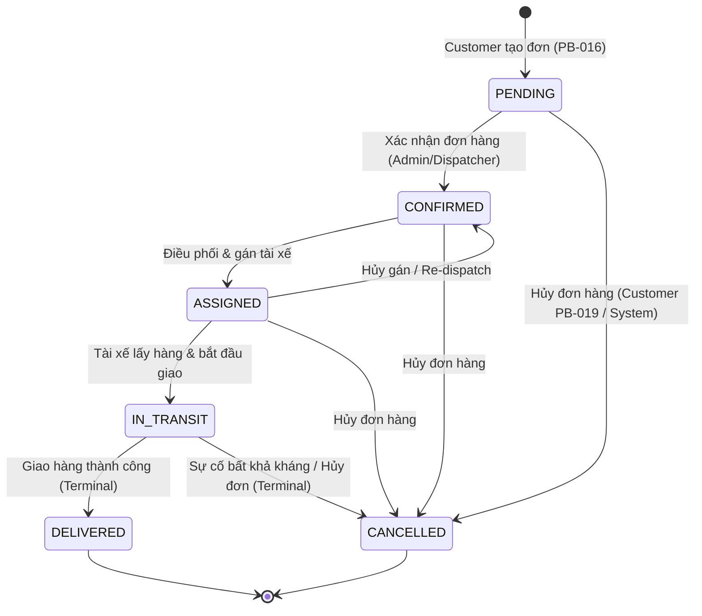
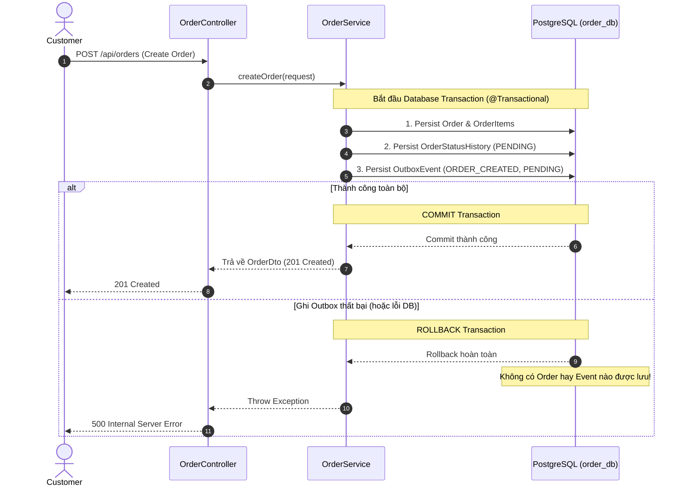

# Logistics Platform

A cloud-native **logistics management system** built on a microservice architecture.  
This repository is a Maven multi-module monorepo containing all platform services, shared libraries, local infrastructure orchestration, isolated persistence layers, event-driven messaging, and in-memory caching.

---

## Table of Contents

1. [Architecture Overview](#architecture-overview)  
2. [Service Decomposition](#service-decomposition)  
3. [Database-per-Service Architecture (PostgreSQL)](#database-per-service-architecture-postgresql)  
4. [Event-Driven Architecture (Apache Kafka)](#event-driven-architecture-apache-kafka)  
5. [In-Memory Store & Caching (Redis)](#in-memory-store--caching-redis)  
6. [Infrastructure Stack (Docker Compose)](#infrastructure-stack-docker-compose)  
7. [Repository Structure](#repository-structure)  
8. [Prerequisites](#prerequisites)  
9. [Build & Run](#build--run)  
10. [API Gateway](#api-gateway)  
11. [Testing](#testing)  
12. [Configuration](#configuration)  
13. [Architecture Decisions (ADRs)](#architecture-decisions-adrs)  
14. [Roadmap](#roadmap)

---

## Architecture Overview

```
┌───────────────────────────────────────────────────────────────────┐
│                        Client Applications                        │
│                 (Web / Mobile / Third-party APIs)                 │
└─────────────────────────────────┬─────────────────────────────────┘
                                  │  HTTP/REST  (port 8080)
                    ┌─────────────▼─────────────┐
                    │       API Gateway         │  ← PB-002 ✅
                    │   Quarkus & Vert.x Proxy  │
                    │   /api/<resource>/**      │
                    └──────┬──────┬──────┬──────┘
                           │      │      │
                 ┌─────────┘  ┌───┘  ┌──┘
                 ▼            ▼      ▼
           ┌──────────┐ ┌──────────┐ ┌──────────────┐ ┌──────────────────┐
           │  user-   │ │  order-  │ │  shipment-   │ │  notification-   │
           │ service  │ │ service  │ │   service    │ │     service      │
           │ :8081    │ │  :8082   │ │    :8083     │ │      :8084       │
           └────┬─────┘ └────┬─────┘ └──────┬───────┘ └────────┬─────────┘
                │            │              │                  │
════════════════╪════════════╪══════════════╪══════════════════╪═════════════════════════
   PERSISTENCE LAYER — Database-per-Service Isolation (PostgreSQL 16 — PB-004 ✅)
                │            │              │                  │
                ▼            ▼              ▼                  ▼
           ┌──────────┐ ┌──────────┐ ┌──────────────┐ ┌──────────────────┐
           │ user_db  │ │ order_db │ │ shipment_db  │ │ notification_db  │
           │ (user_   │ │ (order_  │ │ (shipment_   │ │ (notification_   │
           │  user)   │ │  user)   │ │  user)       │ │  user)           │
           └──────────┘ └──────────┘ └──────────────┘ └──────────────────┘
            [NO CROSS-DATABASE ACCESS ALLOWED — ENFORCED AT DB ROLE LEVEL]
═════════════════════════════════════════════════════════════════════════════════════════
   ASYNC EVENT BUS — Apache Kafka 3.8 KRaft (PB-005 ✅)
                │            │              │                  │
                └────────────┴──────────────┴──────────────────┘
                 ▲ (publish events)           │ (consume events)
                 │                            ▼
  ┌──────────────────────────────────────────────────────────────────────────┐
  │                 Apache Kafka 3.8 (KRaft Mode :9092)                      │
  │  Topics:                                                                 │
  │    • logistics.order.events        • logistics.shipment.events           │
  │    • logistics.notification.events • logistics.user.events               │
  │                   + Kafka UI Dashboard (:8090)                           │
  └──────────────────────────────────────────────────────────────────────────┘
═════════════════════════════════════════════════════════════════════════════════════════
   IN-MEMORY STORE & CACHE — Redis 7 (PB-006 ✅)
  ┌──────────────────────────────────────────────────────────────────────────┐
  │                 Redis 7 (Standalone, AOF Enabled :6379)                  │
  │  Used for session tokens, distributed caching, and rate limiting        │
  └──────────────────────────────────────────────────────────────────────────┘
═════════════════════════════════════════════════════════════════════════════════════════
   INFRASTRUCTURE LAYER (Docker Compose — PB-003 ✅)
  ┌──────────────────────────────────────────────────────────────────────────┐
  │                 Mailpit (SMTP :1025 | Web UI :8025)                      │
  └──────────────────────────────────────────────────────────────────────────┘
```

**External clients talk ONLY to the API Gateway (port 8080). Backend services are internal.**

Each service is **independently deployable**, has its own isolated database schema (Database-per-Service pattern), communicates asynchronously via Apache Kafka, and utilizes Redis for high-speed in-memory state.

---

## Service Decomposition

| Service | Port | Purpose | Database | Messaging | In-Memory Cache |
|---|---|---|---|---|---|
| **`api-gateway`** | **8080** | **Single entry point for all external clients. Routes requests to backend services by path prefix.** | – *(Stateless)* | – | Optional Rate Limiting |
| `user-service` | 8081 | User accounts, roles (`admin / dispatcher / driver / customer`), authentication identity | `user_db` (`user_service_user`) | Producer (`logistics.user.events`) | Session & Token Cache (`Redis 7`) |
| `order-service` | 8082 | Order lifecycle: create → assign → in-transit → delivered / cancelled | `order_db` (`order_service_user`) | Producer (`logistics.order.events`) | – |
| `shipment-service` | 8083 | Physical shipment runs: vehicle & driver assignment, real-time location, proof-of-delivery | `shipment_db` (`shipment_service_user`) | Producer / Consumer (`logistics.shipment.events`) | – |
| `notification-service` | 8084 | Outbound notifications (email, SMS, push) triggered by platform events | `notification_db` (`notification_service_user`) | Consumer (`logistics.*.events`) | – |
| `common-lib` | – | Shared library: `ApiResponse<T>`, `LogisticsPlatformException`, `DomainEvent<T>`, `KafkaTopics`, `CommonUtils`, `JwtTokenProvider` | – | Shared envelopes | – |

---

## Database-per-Service Architecture (PostgreSQL)

To preserve loose coupling and strict bounded contexts, the persistence layer implements the **Database-per-Service** pattern with physical and logical role isolation.

### Service Credentials & Access Isolation

| Service | Database Name | Dedicated Role | Default Password | Default JDBC URL |
|---|---|---|---|---|
| `user-service` | `user_db` | `user_service_user` | `user_password` | `jdbc:postgresql://localhost:5432/user_db` |
| `order-service` | `order_db` | `order_service_user` | `order_password` | `jdbc:postgresql://localhost:5432/order_db` |
| `shipment-service` | `shipment_db` | `shipment_service_user` | `shipment_password` | `jdbc:postgresql://localhost:5432/shipment_db` |
| `notification-service` | `notification_db` | `notification_service_user` | `notification_password` | `jdbc:postgresql://localhost:5432/notification_db` |

### Strict Cross-Service Access Control
- `REVOKE CONNECT ON DATABASE <db> FROM PUBLIC` is executed on all databases.
- Only the owning role is granted `CONNECT` privilege on its database.
- Attempting cross-service access (e.g. `user_service_user` trying to connect to `order_db`) results in an immediate PostgreSQL rejection:
  ```
  FATAL: permission denied for database "order_db"
  DETAIL: User does not have CONNECT privilege.
  ```

---

## Event-Driven Architecture (Apache Kafka)

Asynchronous inter-service communication and event broadcasting are managed via Apache Kafka 3.8 running in native **KRaft mode** (no ZooKeeper required).

### Foundation Topic Structure

All topic names follow the standard domain hierarchy convention defined in `KafkaTopics`:

| Topic Name | Purpose | Producers | Consumers |
|---|---|---|---|
| `logistics.order.events` | Order status changes (`OrderCreated`, `OrderCancelled`, etc.) | `order-service` | `shipment-service`, `notification-service` |
| `logistics.shipment.events` | Shipment tracking updates (`ShipmentDispatched`, `DeliveryCompleted`) | `shipment-service` | `order-service`, `notification-service` |
| `logistics.notification.events` | Notification triggers and audit records | Domain services | `notification-service` |
| `logistics.user.events` | User lifecycle events (`UserRegistered`, `DriverAssigned`) | `user-service` | `notification-service` |

### Standard Domain Event Envelope

All events share the universal `DomainEvent<T>` envelope defined in `common-lib`:
```json
{
  "eventId": "c86a7d55-7fc7-458b-967b-12d8a39a7b93",
  "eventType": "OrderCreated",
  "aggregateId": "ORD-10023",
  "timestamp": "2026-10-07T03:58:00Z",
  "payload": { ... }
}
```

---

## In-Memory Store & Caching (Redis)

Redis 7 is deployed as the foundational in-memory store for low-latency operations, temporary state, distributed session management, and upcoming rate-limiting capabilities.

### Redis Configuration & Port
- **Host Port**: `6379`
- **Internal Port**: `6379`
- **Volume**: `logistics_redis_data` (AOF persistence enabled: `redis-server --appendonly yes`)
- **Container Name**: `logistics-redis`

### Spring Boot Data Redis Integration
- Microservices connect via Spring Data Redis (`Lettuce` driver).
- Environment variables:
  - `spring.data.redis.host: ${REDIS_HOST:localhost}`
  - `spring.data.redis.port: ${REDIS_PORT:6379}`
  - `spring.data.redis.password: ${REDIS_PASSWORD:}`
- Actuator Health check enabled: `management.health.redis.enabled=true`.
- Bean `RedisTemplate<String, Object>` is pre-configured with JSON serialization (`GenericJackson2JsonRedisSerializer`).

### How to Inspect & Test Redis
```bash
# 1. Ping Redis container
docker exec logistics-redis redis-cli ping
# Output: PONG

# 2. Test SET & GET via CLI
docker exec logistics-redis redis-cli set sample_key "Hello Redis"
docker exec logistics-redis redis-cli get sample_key
# Output: Hello Redis

# 3. Check Redis Health via Actuator
curl http://localhost:8081/actuator/health | grep redis
```

---

## Infrastructure Stack (Docker Compose)

All foundational infrastructure required for local development is containerized using Docker Compose (`docker-compose.yml`) under the dedicated bridge network `logistics-network`.

### Services & Port Mappings

| Component | Container Name | Host Port | Internal Port | Persistent Volume | Description |
|---|---|---|---|---|---|
| **PostgreSQL 16** | `logistics-postgres` | `5432` | `5432` | `logistics_postgres_data` | Relational DB; auto-provisions `user_db`, `order_db`, `shipment_db`, `notification_db` |
| **Apache Kafka 3.8** | `logistics-kafka` | `9092` | `9092`, `29092` | `logistics_kafka_data` | Distributed event streaming in native **KRaft mode** (no ZooKeeper) |
| **Kafka UI** | `logistics-kafka-ui` | `8090` | `8080` | – | Web dashboard for managing Kafka topics, consumer groups & messages |
| **Redis 7** | `logistics-redis` | `6379` | `6379` | `logistics_redis_data` | High-performance in-memory cache and session store (AOF enabled) |
| **Mailpit** | `logistics-mailpit` | `1025` (SMTP)<br>`8025` (UI) | `1025`<br>`8025` | – | Mock SMTP server and webmail inspector for notification-service testing |

### Infrastructure Management Commands

```bash
# Start all infrastructure
docker compose up -d

# Check status & health
docker compose ps

# View logs
docker compose logs -f [service]

# Stop infrastructure
docker compose down

# Reset and delete all data
docker compose down -v
```

---

## Repository Structure

```
logistics-platform/
├── pom.xml                               # Parent POM (multi-module build root)
├── docker-compose.yml                    # Infrastructure orchestration (Postgres, Kafka KRaft, Redis, Mailpit)
├── .env.example                          # Environment variables template (no secrets)
├── .gitignore
├── README.md
│
├── docker/
│   └── postgres/
│       └── init-databases.sql            # Role & DB provisioning per service
│
├── shared/
│   └── common-lib/                       # Shared library
│       ├── pom.xml
│       └── src/
│           ├── main/java/com/logistics/common/
│           │   ├── dto/ApiResponse.java
│           │   ├── event/DomainEvent.java           # Universal event envelope
│           │   ├── event/KafkaTopics.java           # Foundation topic constants
│           │   ├── exception/LogisticsPlatformException.java
│           │   └── util/CommonUtils.java
│           └── test/java/com/logistics/common/
│               ├── event/DomainEventTest.java
│               └── util/CommonUtilsTest.java
│
└── services/
    ├── api-gateway/                      # API Gateway (Spring Cloud Gateway)
    │   ├── pom.xml
    │   └── src/
    │       ├── main/java/com/logistics/gateway/ApiGatewayApplication.java
    │       ├── main/resources/application.yml        ← route definitions
    │       ├── test/java/com/logistics/gateway/ApiGatewayApplicationTest.java
    │       ├── test/java/com/logistics/gateway/GatewayRoutesConfigTest.java
    │       └── test/resources/application-test.yml
    │
    ├── user-service/                     # PostgreSQL + Kafka + Redis 7 + Liquibase
    │   ├── pom.xml
    │   └── src/
    │       ├── main/java/com/logistics/user/
    │       │   ├── UserServiceApplication.java
    │       │   └── config/RedisConfig.java
    │       ├── main/resources/
    │       │   ├── application.yml
    │       │   └── db/changelog/
    │       │       ├── db.changelog-master.yaml
    │       │       └── changes/001-create-users-table.yaml
    │       └── test/
    │           ├── java/com/logistics/user/
    │           │   ├── UserServiceApplicationTest.java
    │           │   ├── UserDatabaseConnectionTest.java
    │           │   ├── UserLiquibaseMigrationTest.java
    │           │   └── RedisSmokeIntegrationTest.java
    │           └── resources/application-test.yml
    │
    ├── order-service/                    # order_db persistence + Kafka + Liquibase
    │   ├── pom.xml
    │   └── src/
    │       ├── main/java/com/logistics/order/
    │       │   ├── OrderServiceApplication.java
    │       │   └── config/KafkaTopicConfig.java
    │       ├── main/resources/
    │       │   ├── application.yml
    │       │   └── db/changelog/
    │       │       ├── db.changelog-master.yaml
    │       │       └── changes/001-create-orders-table.yaml
    │       └── test/
    │           ├── java/com/logistics/order/
    │           │   ├── OrderServiceApplicationTest.java
    │           │   ├── OrderDatabaseConnectionTest.java
    │           │   ├── OrderLiquibaseMigrationTest.java
    │           │   └── KafkaProducerConsumerIntegrationTest.java
    │           └── resources/application-test.yml
    │
    ├── shipment-service/                 # shipment_db persistence + Kafka + Liquibase
    │   ├── pom.xml
    │   └── src/  (includes db/changelog/ & ShipmentLiquibaseMigrationTest)
    │
    └── notification-service/             # notification_db persistence + Kafka + Liquibase
        ├── pom.xml
        └── src/  (includes db/changelog/ & NotificationLiquibaseMigrationTest)
```

---

## Prerequisites

| Tool | Minimum version | Purpose |
|---|---|---|
| Java (JDK) | 21 | Microservices runtime |
| Apache Maven | 3.9 | Multi-module build system |
| Docker & Docker Compose | Docker 24+, Compose v2+ | Local infrastructure orchestration |

---

## Build & Run

### Build all modules from the repository root

```bash
mvn clean package -DskipTests
```

### Run local development environment

1. **Start infrastructure (PostgreSQL, Kafka, Redis, Mailpit):**
   ```bash
   docker compose up -d
   ```
2. **Start microservices (in individual terminals or IDE):**
   ```bash
   mvn spring-boot:run -pl services/user-service
   mvn spring-boot:run -pl services/order-service
   mvn spring-boot:run -pl services/shipment-service
   mvn spring-boot:run -pl services/notification-service
   mvn spring-boot:run -pl services/api-gateway
   ```

---

## Database Migrations (Liquibase)

Every service with persistent storage manages its database schema migrations independently using Liquibase:

- **Isolated Master Changelog**: Located at `classpath:db/changelog/db.changelog-master.yaml`.
- **Modular Changeset Directory**: Granular changesets reside in `db/changelog/changes/<seq>-<description>.yaml` and are included by the master.
- **Automated Startup Migration**: Spring Boot runs pending migrations at service startup (`spring.liquibase.enabled: true`).
- **DDL Governance**: Hibernate `ddl-auto` is set to `validate` to guarantee Liquibase is the single source of truth for DDL changes.
- **Repeatable & Version Controlled**: Re-running migrations on fresh instances creates the exact schema with checksum tracking.

### Inspect Migration Status

1. **Via Spring Boot Actuator**:
   ```bash
   curl http://localhost:8081/actuator/liquibase | jq .
   ```
2. **Via PostgreSQL Metadata Tables**:
   ```bash
   docker exec -e PGPASSWORD=user_password logistics-postgres psql -U user_service_user -d user_db \
     -c "SELECT id, author, exectype, orderexecuted FROM databasechangelog;"
   ```

---

## Testing

### Run all tests from the root

```bash
mvn test
```

### Test coverage per module

| Module | Tests | Descriptions |
|---|---|---|
| `common-lib` | 12 unit tests | `CommonUtilsTest` (6) + `DomainEventTest` (1) + `JwtTokenProviderTest` (5) |
| `api-gateway` | 10 tests | 1 context smoke test + 6 route configuration tests + 3 routing integration tests (`GatewayAuthRoutingIntegrationTest`) |
| `user-service` | 17 tests | 1 context smoke test + 1 DB connection + 1 Redis smoke + 1 Liquibase migration (3 changesets) + 5 auth service unit tests + 8 auth controller integration tests |
| `order-service` | 4 tests | 1 context smoke test + 1 DB connection + 1 Kafka integration test + 1 Liquibase migration test |
| `shipment-service` | 3 tests | 1 context smoke test + 1 DB connection + 1 Liquibase migration test |
| `notification-service` | 3 tests | 1 context smoke test + 1 DB connection + 1 Liquibase migration test |

**Total: 49 tests passing 100%.**

---

## Continuous Integration (CI)

The repository is configured with an automated Continuous Integration pipeline using **GitHub Actions** ([`.github/workflows/ci.yml`](.github/workflows/ci.yml)):

- **Triggers**:
  - `push` to the `main` branch.
  - `pull_request` targeting the `main` branch.
  - `workflow_dispatch` for manual triggering from the GitHub Actions console.
- **Environment**:
  - Runner: `ubuntu-latest`.
  - Runtime: Eclipse Temurin JDK 21 LTS (`actions/setup-java@v4`).
  - Dependency Caching: Automated Maven cache (`cache: 'maven'`) for rapid feedback loops.
- **Pipeline Stages**:
  1. **Checkout Repository**: Full workspace fetch (`actions/checkout@v4`).
  2. **Environment Verification**: Verifies `java -version` and `mvn -version`.
  3. **Multi-module Reactor Build & Test**: Runs `mvn -B clean verify --file pom.xml`, ensuring clean builds and executing all unit/integration tests across all 7 modules (`parent`, `common-lib`, `api-gateway`, `user-service`, `order-service`, `shipment-service`, `notification-service`).
  4. **Strict Gating**: Any failure during compilation, package packaging, or test assertions exits with non-zero code, failing the CI run and blocking Pull Request merge.
  5. **Step Summary**: Automatically generates a Markdown summary of the build run in the GitHub Actions summary tab.

---

## Configuration

All configuration is managed via `application.yml` in each service's `src/main/resources/` and overridable via environment variables.  
**No secrets are hard-coded.** Every sensitive value uses safe local defaults or environment overrides.

Copy `.env.example` to `.env` and fill in your values:

```bash
cp .env.example .env
```

### Key environment variables

| Variable | Default | Description |
|---|---|---|
| `GATEWAY_PORT` | `8080` | HTTP port for the API Gateway |
| `USER_SERVICE_PORT` | `8081` | HTTP port for user-service |
| `ORDER_SERVICE_PORT` | `8082` | HTTP port for order-service |
| `SHIPMENT_SERVICE_PORT` | `8083` | HTTP port for shipment-service |
| `NOTIFICATION_SERVICE_PORT` | `8084` | HTTP port for notification-service |
| `POSTGRES_PORT` | `5432` | PostgreSQL host port |
| `REDIS_PORT` | `6379` | Redis host port |
| `REDIS_HOST` | `localhost` | Redis host address |
| `KAFKA_PORT` | `9092` | Kafka external broker port |
| `KAFKA_BOOTSTRAP_SERVERS` | `localhost:9092` | Kafka cluster bootstrap servers address |
| `MAILPIT_SMTP_PORT` | `1025` | Mailpit SMTP server port |
| `MAILPIT_UI_PORT` | `8025` | Mailpit Web inbox UI port |

---

## Architecture Decisions (ADRs)

### ADR-001: Maven Multi-module Monorepo
**Decision**: Use a single Git repository with Maven multi-module build.  
**Rationale**: Simplifies cross-service refactoring, enforces single dependency version governance, and enables atomic commits across services.

### ADR-002: Java 21 + Quarkus 3.15 LTS
**Decision**: All platform services use Java 21 LTS and Quarkus 3.15.x LTS.  
**Rationale**: Java 21 LTS provides modern language capabilities and virtual threads. Quarkus brings supersonic subatomic execution, near-instantaneous startup, minimal RSS memory footprint, and build-time optimization (ArC CDI synthesis, Panache ORM) ideal for high-density container environments.

### ADR-003: Quarkus & Vert.x Reactive Reverse Proxy for API Gateway
**Decision**: `api-gateway` is built on Quarkus with Vert.x Web Reactive Core and asynchronous streaming proxy.  
**Rationale**: Non-blocking asynchronous event loop delivers maximum throughput with minimal thread and memory overhead, offering superior efficiency over legacy servlet or Spring gateways. Dynamic path forwarding and prefix stripping are managed natively via Vert.x handlers.

### ADR-004: Path-prefix Routing with StripPrefix
**Decision**: Routes are defined by `/api/<resource>/**` prefix; `StripPrefix=1` removes `/api` before forwarding.  
**Rationale**: Clean, unified public namespace for clients. Backend microservices retain clean domain paths without gateway coupling.

### ADR-005: Local Infrastructure via Docker Compose
**Decision**: Centralize all backing infrastructure in a root `docker-compose.yml` with named volumes and dedicated bridge network.  
**Rationale**: Developers can spin up the full infrastructure stack (databases, message broker, cache, mock SMTP) with a single command without installing heavy native daemons on their host machines.

### ADR-006: Apache Kafka in Native KRaft Mode
**Decision**: Deploy Kafka 3.8 in KRaft (Kafka Raft Metadata) mode without ZooKeeper.  
**Rationale**: KRaft eliminates ZooKeeper management overhead, accelerates metadata propagation, reduces container footprint, and represents the modern production standard for Apache Kafka.

### ADR-007: Strict Database-per-Service Isolation & Role Access Control
**Decision**: Each microservice is assigned its own PostgreSQL database and dedicated database user with password. Direct access across services is explicitly revoked (`REVOKE CONNECT ON DATABASE FROM PUBLIC`).  
**Rationale**: Prevents data coupling, enforces domain boundary integrity, and eliminates hidden dependencies across bounded contexts.

### ADR-008: Kubernetes-ready Liveness & Readiness Probes
**Decision**: Actuator probes are enabled with database health verification attached to readiness state.  
**Rationale**: Ensures traffic is only routed to application instances when the database connection pool is healthy and responsive.

### ADR-009: Standard Event Envelope & Domain Topic Hierarchy
**Decision**: Microservices exchange asynchronous events using the typed `DomainEvent<T>` envelope across hierarchical topic channels (`logistics.<domain>.events`).  
**Rationale**: Standardizes event payload headers (`eventId`, `eventType`, `aggregateId`, `timestamp`) and simplifies auditing, tracing, and dead-letter queue routing without leaking service-internal data models.

### ADR-010: Redis In-Memory Store Foundation
**Decision**: Redis 7 is adopted as the dedicated in-memory key-value store using Lettuce client, JSON serializer, and Actuator health indicator.  
**Rationale**: Provides single-digit millisecond read/write latency for ephemeral session state, tokens, distributed cache, and rate-limiting counters.

### ADR-011: Liquibase Schema Versioning & Isolation
**Decision**: Each persistent service manages its own database schema versioning via Liquibase changelogs (`db.changelog-master.yaml` with modular changesets under `changes/`). Migrations run automatically on application startup, and Hibernate DDL generation is restricted to `validate`.  
**Rationale**: Guarantees reproducible, auditable database schemas, prevents cross-service schema coupling, enables zero-downtime evolutionary database design, and eliminates desynchronization between code and database state.

### ADR-012: Continuous Integration via GitHub Actions
**Decision**: Automate repository-level build and test execution via GitHub Actions (`ci.yml`) on Ubuntu runners with Temurin JDK 21 and Maven caching.  
**Rationale**: Guarantees that every Push and Pull Request triggers a clean reactor verification (`mvn clean verify`) covering all 7 modules without depending on developer-local machine state. Any regression or test failure immediately fails the CI pipeline.

### ADR-013: BCrypt Password Hashing & Stateless JWT Authentication
**Decision**: Authentication is implemented in `user-service` with BCrypt password hashing (`BCryptPasswordEncoder`, cost factor 10) and signed JSON Web Tokens (`io.jsonwebtoken` HMAC-SHA256). All authentication requests route through the API Gateway via `/api/auth/**` (stripped to `/auth/**`) or `/auth/**`.
**Rationale**:
- Passwords are never stored in plaintext and never leaked in responses or logs (`LoginRequest.toString()` masks credentials).
- Tokens are cryptographically signed with HMAC-SHA256 and include essential claims (`userId`, `username`, `email`, `role`, `issuedAt`, `expiration`) without requiring stateful session lookups on downstream services.
- Secret and expiration settings are externalized to environment variables (`JWT_SECRET`, `JWT_EXPIRATION_MS`, `JWT_ISSUER`) with safe local development defaults.
- Database-per-service isolation is preserved: `user_db` maintains user identity and credentials via Liquibase migrations (`001`, `002`, `003`), completely decoupled from other bounded contexts.

### ADR-014: Tech Stack Migration to Quarkus 3.x (Java 21 LTS)
**Decision**: Migrate the microservices architecture stack from Spring Boot to Quarkus 3.x (LTS) on Java 21, adopting a step-by-step phased approach starting with `common-lib` and `user-service`.  
**Rationale**:
- **Resource Footprint**: Quarkus reduces runtime heap memory consumption (typically ~40-80MB RSS on JVM vs ~250-400MB in Spring Boot), allowing multiple microservices to run efficiently on low-resource dev/prod nodes.
- **Fast Startup**: Near-instantaneous cold start (< 1-2s JVM, < 0.05s Native), ideal for containerized scaling and serverless workloads.
- **Build-Time Metadata**: Eliminates runtime reflection through build-time CDI synthesis (ArC), compile-time Panache ORM enhancements, and Ahead-Of-Time (AOT) optimizations.
- **Standards-Based**: Employs Jakarta EE 10 standards (Jakarta REST, CDI, Bean Validation, Hibernate Panache) avoiding heavy framework-specific lock-in.

---

## Authentication & Development Accounts (PB-009)

External clients send authentication requests to the API Gateway on port `8080`:

### Endpoints
- **Login**: `POST /api/auth/login` (or `POST /auth/login`)
  ```json
  {
    "username": "admin",
    "password": "Admin@123"
  }
  ```
  **Success Response (200 OK)**:
  ```json
  {
    "success": true,
    "message": "Login successful",
    "data": {
      "accessToken": "eyJhbGciOiJIUzI1NiIsIn...",
      "tokenType": "Bearer",
      "expiresIn": 86400,
      "user": {
        "id": "00000000-0000-0000-0000-000000000001",
        "username": "admin",
        "email": "admin@logistics.com",
        "role": "ADMIN",
        "status": "ACTIVE"
      }
    }
  }
  ```
  **Failure Response (401 Unauthorized)**:
  ```json
  {
    "success": false,
    "message": "Invalid username or password",
    "data": null
  }
  ```
- **Verify Token**: `GET /api/auth/verify` (Header: `Authorization: Bearer <token>`)
- **Get Current User Profile (PB-010)**: `GET /api/auth/me` or `GET /api/users/me` (Header: `Authorization: Bearer <token>`)  
  Extracts identity strictly from the cryptographically verified JWT claims without allowing arbitrary userId parameters.
  **Success Response (200 OK)**:
  ```json
  {
    "success": true,
    "message": "User profile retrieved successfully",
    "data": {
      "userId": "00000000-0000-0000-0000-000000000001",
      "username": "admin",
      "email": "admin@logistics.com",
      "role": "ADMIN",
      "status": "ACTIVE",
      "createdAt": "2026-10-09T08:00:51.670Z",
      "updatedAt": "2026-10-09T08:00:51.670Z"
    }
  }
  ```
  **Unauthenticated / Invalid Token Response (401 Unauthorized)**:
  ```json
  {
    "success": false,
    "message": "Missing or invalid Authorization header",
    "data": null
  }
  ```

### Seeded Sample Accounts for Local Development
Seeded automatically via Liquibase changeset `003-seed-sample-users.yaml`:

| Username | Email | Password | Role | Status |
|---|---|---|---|---|
| `admin` | `admin@logistics.com` | `Admin@123` | `ADMIN` | `ACTIVE` |
| `dispatcher` | `dispatcher@logistics.com` | `Dispatcher@123` | `DISPATCHER` | `ACTIVE` |
| `driver` | `driver@logistics.com` | `Driver@123` | `DRIVER` | `ACTIVE` |
| `customer` | `customer@logistics.com` | `Customer@123` | `CUSTOMER` | `ACTIVE` |

---

## User Management: Administrator APIs (PB-011)

All endpoints require an active `ADMIN` token (`Authorization: Bearer <token>`). Requests from non-admin roles are rejected with `403 Forbidden`. Requests without a token are rejected with `401 Unauthorized`.

| Method | Endpoint (via Gateway) | Description |
|---|---|---|
| `GET` | `/api/users?page=0&size=10&role=DRIVER&status=ACTIVE` | View user list with pagination & optional filtering |
| `GET` | `/api/users/{id}` | View user details (no password/hash exposed) |
| `POST` | `/api/users` | Create new user (body: `username`, `email`, `password`, `role`, optional `status`) |
| `PATCH` | `/api/users/{id}` | Update user fields (`email`, `role`, `status`) |
| `PATCH` | `/api/users/{id}/status` | Lock or unlock user account (`status`: `"LOCKED"` or `"ACTIVE"`) |

### Key Business Rules
- **BCrypt Hashing**: Passwords submitted via `POST /api/users` are hashed using BCrypt (cost factor 10) before persisting; plaintext is never saved or returned.
- **Uniqueness**: Duplicate `username` or `email` rejections return `409 Conflict`.
- **Locked Accounts Blocked**: Accounts set to `LOCKED` cannot log in (`403 Forbidden` on login attempt) and existing tokens cannot retrieve profiles.
- **Last Admin Protection**: The system strictly prevents locking, deactivating, or demoting the last remaining active Administrator (`400 Bad Request`).
- **No Hard Deletes**: User management enforces soft-lock / state deactivation rather than destructive row deletion.

## Role and Permission Management: RBAC (PB-012)

The logistics platform implements a robust, backend-enforced **Role-Based Access Control (RBAC)** mechanism designed to secure all administrative and business operations across all microservices.

### Supported Roles
The system defines 4 core roles tailored to logistics operations:
1. **`ADMIN` (Administrator)**: Toàn quyền quản trị hệ thống, quản lý người dùng, thay đổi vai trò, giám sát vận hành toàn diện.
2. **`DISPATCHER` (Điều phối viên)**: Quản lý và điều phối đơn hàng, gán tài xế, quản lý chuyến hàng, gửi thông báo.
3. **`DRIVER` (Tài xế giao vận)**: Xem chuyến hàng được phân công, cập nhật trạng thái giao hàng, chia sẻ tọa độ GPS thời gian thực.
4. **`CUSTOMER` (Khách hàng)**: Tạo đơn hàng, theo dõi hành trình đơn, hủy đơn và nhận thông báo trạng thái.

### Permission Matrix

| Permission Code | Permission Name | Description | ADMIN | DISPATCHER | DRIVER | CUSTOMER |
|---|---|---|:---:|:---:|:---:|:---:|
| `user:read` | `USER_READ` | Xem danh sách/chi tiết người dùng | ✅ | ✅ | ❌ | ❌ |
| `user:create` | `USER_CREATE` | Tạo tài khoản người dùng mới | ✅ | ❌ | ❌ | ❌ |
| `user:update` | `USER_UPDATE` | Sửa thông tin tài khoản | ✅ | ❌ | ❌ | ❌ |
| `user:status_change` | `USER_STATUS_CHANGE` | Khóa hoặc mở khóa tài khoản | ✅ | ❌ | ❌ | ❌ |
| `role:read` | `ROLE_READ` | Xem danh sách vai trò & quyền hạn | ✅ | ❌ | ❌ | ❌ |
| `role:update` | `ROLE_UPDATE` | Thay đổi vai trò người dùng | ✅ | ❌ | ❌ | ❌ |
| `order:create` | `ORDER_CREATE` | Tạo đơn hàng mới | ✅ | ❌ | ❌ | ✅ |
| `order:read` | `ORDER_READ` | Xem thông tin đơn hàng | ✅ | ✅ | ❌ | ✅ |
| `order:update` | `ORDER_UPDATE` | Cập nhật đơn hàng | ✅ | ✅ | ❌ | ❌ |
| `order:cancel` | `ORDER_CANCEL` | Hủy đơn hàng | ✅ | ❌ | ❌ | ✅ |
| `shipment:read` | `SHIPMENT_READ` | Xem thông tin chuyến hàng | ✅ | ✅ | ✅ | ❌ |
| `shipment:assign` | `SHIPMENT_ASSIGN` | Điều phối & phân công tài xế | ✅ | ✅ | ❌ | ❌ |
| `shipment:update_status` | `SHIPMENT_UPDATE_STATUS` | Cập nhật trạng thái giao hàng | ✅ | ✅ | ✅ | ❌ |
| `shipment:location_ping` | `SHIPMENT_LOCATION_PING` | Cập nhật GPS chuyến hàng | ✅ | ❌ | ✅ | ❌ |
| `notification:read` | `NOTIFICATION_READ` | Xem thông báo | ✅ | ✅ | ✅ | ✅ |
| `notification:send` | `NOTIFICATION_SEND` | Gửi thông báo hệ thống | ✅ | ✅ | ❌ | ❌ |

### Role Management APIs

| Method | Endpoint (via Gateway) | Direct Endpoint | Required Privilege | Description |
|---|---|---|---|---|
| `GET` | `/api/users/roles` | `/users/roles` | `ADMIN` / `ROLE_READ` | Xem danh sách 4 vai trò kèm toàn bộ quyền hạn chi tiết |
| `PATCH` | `/api/users/{id}/role` | `/users/{id}/role` | `ADMIN` / `ROLE_UPDATE` | Thay đổi vai trò của người dùng (`body`: `{"role": "DRIVER"}`) |

### Security & Invalidation Rules
- **Backend-Enforced**: Quyền và vai trò được kiểm tra nghiêm ngặt tại backend; không tin tưởng bất kỳ thông tin role/permission nào do client gửi lên.
- **Immediate Role Revocation Effect**: Khi một Administrator bị hạ quyền (demoted) trong cơ sở dữ liệu, token JWT cũ dù chưa hết hạn sẽ **ngay lập tức bị từ chối với mã lỗi `403 Forbidden`** ("Administrator privileges revoked"). Tránh hoàn toàn rủi ro token cũ giữ quyền cao hơn ngoài dự kiến.
- **Last Administrator Protection**: Hệ thống kiểm tra số lượng active admin trước khi cho phép hạ quyền (`demote`). Nếu tài khoản là Admin hoạt động duy nhất còn lại, thao tác bị từ chối ngay với `400 Bad Request` ("Cannot demote the last remaining active Administrator in the system").
- **Reusable Architecture**: Thư viện dùng chung `common-lib` cung cấp `Role`, `Permission`, `RolePermissions`, và `AuthPrincipal` giúp các microservices nghiệp vụ tiếp theo (`order-service`, `shipment-service`, `notification-service`) tái sử dụng thống nhất toàn bộ cơ chế xác thực và phân quyền.

---

## Driver Management: Driver Profiles (PB-013)

Chức năng quản lý hồ sơ tài xế liên kết 1-1 với tài khoản người dùng mang vai trò `DRIVER`. Dữ liệu identity (`username`, `email`, `role`, `status`) được quản lý tập trung và không bị nhân bản; hồ sơ tài xế lưu trữ các thông tin nghiệp vụ vận tải chuyên biệt (`full_name`, `phone_number`, `license_number`, `license_class`, `vehicle_type`, `vehicle_plate`, `address`, `status`).

### Driver Profile APIs

Tất cả các request đi qua API Gateway:

| Method | Endpoint (via Gateway) | Direct Endpoint | Required Privilege | Description |
|---|---|---|---|---|
| `GET` | `/api/drivers` | `/drivers` | `ADMIN`, `DISPATCHER` | Xem danh sách hồ sơ tài xế hỗ trợ phân trang & lọc status |
| `GET` | `/api/drivers/me` | `/drivers/me` | `DRIVER` | Tài xế xem thông tin hồ sơ của chính mình |
| `GET` | `/api/drivers/{id}` | `/drivers/{id}` | `ADMIN`, `DISPATCHER` (hoặc `DRIVER` chính chủ) | Xem chi tiết hồ sơ tài xế theo Driver ID hoặc User ID |
| `POST` | `/api/drivers` | `/drivers` | `ADMIN`, `DISPATCHER` | Tạo hồ sơ tài xế mới gắn với một user có role `DRIVER` |
| `PATCH` | `/api/drivers/{id}` | `/drivers/{id}` | `ADMIN`, `DISPATCHER` (hoặc `DRIVER` chính chủ) | Cập nhật thông tin hồ sơ tài xế |

### Business & Security Rules
- **Liên kết 1-1 duy nhất**: Mỗi user có role `DRIVER` chỉ được gắn duy nhất một hồ sơ tài xế (`user_id` unique). Cố tình tạo trùng lặp trả về `409 Conflict`.
- **Ràng buộc vai trò**: Chỉ cho phép tạo hồ sơ tài xế khi user mục tiêu mang vai trò `DRIVER`. Nếu user không tồn tại hoặc mang vai trò khác (`CUSTOMER`, `ADMIN`...) -> trả về `400 Bad Request`.
- **Duy nhất GPLX**: Số giấy phép lái xe (`license_number`) được kiểm tra tính duy nhất trên toàn hệ thống (`409 Conflict` nếu trùng).
- **Phân quyền truy cập tài xế (Self-Service vs Management)**:
  - Tài xế chỉ được xem và cập nhật hồ sơ của chính mình; cố tình truy cập hoặc sửa đổi hồ sơ của tài xế khác bị từ chối ngay với `403 Forbidden`.
  - Khách hàng (`CUSTOMER`) không có quyền truy cập API tài xế (`403 Forbidden`).
  - Tài xế không được phép tự thay đổi `status` hồ sơ (chỉ Admin/Dispatcher mới có quyền điều chỉnh trạng thái hồ sơ).
  - Client không thể sửa đổi `userId` trong cập nhật profile để tránh tấn công chiếm đoạt hoặc chuyển giao liên kết tài khoản.
- **Bảo mật dữ liệu**: Không trả về hoặc ghi log thông tin mật khẩu, passwordHash của tài khoản người dùng.

---

## Driver Management: Driver Availability (PB-014)

Chức năng cho phép tài xế (`DRIVER`) chủ động quản lý trạng thái sẵn sàng tiếp nhận công việc giao vận giữa `AVAILABLE` và `UNAVAILABLE`. Trạng thái được lưu trữ bền vững trong cơ sở dữ liệu và phục vụ như một thuộc tính đầu vào quan trọng cho quy tắc điều phối/eligibility ở PB-015.

### Driver Availability APIs

Tất cả các request đi qua API Gateway:

| Method | Endpoint (via Gateway) | Direct Endpoint | Required Privilege | Request Body | Description |
|---|---|---|---|---|---|
| `GET` | `/api/drivers/me/availability` | `/drivers/me/availability` | `DRIVER` | None | Tài xế xem trạng thái availability hiện tại của chính mình |
| `PATCH` | `/api/drivers/me/availability` | `/drivers/me/availability` | `DRIVER` | `{"availability": "AVAILABLE"}` | Tài xế chủ động cập nhật trạng thái availability của mình |
| `GET` | `/api/drivers/{id}/availability` | `/drivers/{id}/availability` | `ADMIN`, `DISPATCHER` (hoặc `DRIVER` chính chủ) | None | Xem trạng thái availability của một tài xế theo ID |
| `PATCH` | `/api/drivers/{id}/availability` | `/drivers/{id}/availability` | `ADMIN`, `DISPATCHER` (hoặc `DRIVER` chính chủ) | `{"availability": "UNAVAILABLE"}` | Admin/Dispatcher can thiệp cập nhật availability tài xế |

### Data Model & Persistence
- **Enum `DriverAvailability`**: Giới hạn nghiêm ngặt 2 giá trị `AVAILABLE` và `UNAVAILABLE` (định nghĩa trong `com.logistics.common.model.DriverAvailability`).
- **Database Schema**: Bổ sung cột `availability VARCHAR(20) DEFAULT 'UNAVAILABLE' NOT NULL` vào bảng `driver_profiles` trong `user_db` qua Liquibase changeset `005-add-driver-availability.yaml`.
- **Default Value An Toàn**: Khi một Driver profile mới được tạo, hệ thống luôn gán giá trị mặc định an toàn là `UNAVAILABLE`. Tài xế mới sẽ không tự động nhận việc cho đến khi chủ động kích hoạt chuyển sang `AVAILABLE`.
- **Độc lập trạng thái**: Availability là trạng thái sẵn sàng tác nghiệp độc lập, tách biệt hoàn toàn với trạng thái khóa tài khoản (`ACTIVE`, `LOCKED` trong `User`) và trạng thái hồ sơ nhân sự vận hành (`ACTIVE`, `SUSPENDED` trong `DriverProfile`).

### Security & RBAC Enforcement
- **Identity từ Token**: Endpoint `/drivers/me/availability` lấy định danh tài xế trực tiếp và duy nhất từ JWT claims của phiên đăng nhập (`resolveAuthenticatedUser`). Request không chấp nhận `userId` từ body hay path nhằm triệt tiêu hoàn toàn khả năng can thiệp tài xế khác.
- **Ràng buộc vai trò (Role DRIVER)**: Chỉ người dùng có role `DRIVER` mới có thể gọi endpoint cập nhật trạng thái cá nhân. Các tài khoản khác (`CUSTOMER`, v.v.) sẽ bị từ chối với mã lỗi `403 Forbidden`.
- **Authentication**: Mọi truy cập không mang token hoặc token không hợp lệ/hết hạn bị từ chối ngay với `401 Unauthorized`.
- **Input Validation**: Request body chỉ nhận giá trị availability hợp lệ (`AVAILABLE`, `UNAVAILABLE`). Nếu null hoặc chuỗi không xác định sẽ trả về lỗi `400 Bad Request`.
- **Phạm vi biên giới**: Không triển khai logic tự động tìm tài xế hay phân công đơn ở bước này (thuộc tính availability sẽ được sử dụng cho quy tắc eligibility ở PB-015).

---

## Driver Management: Driver Eligibility (PB-015)

Xây dựng quy tắc nghiệp vụ tập trung, có thể kiểm thử độc lập và tái sử dụng toàn diện (`DriverEligibilityPolicy` & `DriverEligibilityService`) để xác định Driver có đủ điều kiện xem xét nhận đơn hàng (`eligible`) hay không.

### Quy tắc Eligibility tối thiểu (Đánh giá đồng thời & Tích lũy Reason Code)

Một tài xế được đánh giá là **`ELIGIBLE`** khi và chỉ khi thỏa mãn **toàn bộ** các điều kiện sau:
1. **Tài khoản người dùng (`User`) tồn tại**: Phải tìm thấy bản ghi `User` tương ứng. (Vi phạm: `USER_NOT_FOUND`).
2. **Tài khoản không bị khóa và đang hoạt động**: `User.status == ACTIVE`. (Vi phạm: `USER_LOCKED` hoặc `USER_INACTIVE`).
3. **Vai trò bắt buộc là DRIVER**: `User.role == DRIVER`. (Vi phạm: `NOT_A_DRIVER_ROLE`).
4. **Hồ sơ tài xế (`DriverProfile`) tồn tại**: Phải có hồ sơ liên kết. (Vi phạm: `DRIVER_PROFILE_NOT_FOUND`).
5. **Trạng thái hồ sơ tài xế là ACTIVE**: `DriverProfile.status == "ACTIVE"`. (Vi phạm: `DRIVER_PROFILE_INACTIVE`).
6. **Trạng thái sẵn sàng là AVAILABLE**: `DriverProfile.availability == AVAILABLE`. (Vi phạm: `DRIVER_UNAVAILABLE`).
7. **Thông tin hồ sơ bắt buộc đầy đủ**: Các thông tin vận hành cốt lõi hiện có trong model (`fullName`, `phoneNumber`, `licenseNumber`, `licenseClass`, `vehicleType`, `vehiclePlate`) không được để trống hoặc rỗng. (Vi phạm: `DRIVER_INFO_INCOMPLETE`).

### Danh sách Reason Code có cấu trúc (`DriverIneligibilityReason`)

Được định nghĩa tập trung trong thư viện dùng chung `common-lib` (`com.logistics.common.model.DriverIneligibilityReason`):

| Reason Code | Mô tả | Nhóm kiểm tra |
|---|---|---|
| `USER_NOT_FOUND` | User account does not exist | User Identity |
| `USER_INACTIVE` | User account is inactive | User Status |
| `USER_LOCKED` | User account is locked | User Status |
| `NOT_A_DRIVER_ROLE` | User does not have DRIVER role | RBAC Role |
| `DRIVER_PROFILE_NOT_FOUND` | Driver profile does not exist | Profile Existence |
| `DRIVER_PROFILE_INACTIVE` | Driver profile status is not ACTIVE (e.g. SUSPENDED) | Profile Operation |
| `DRIVER_UNAVAILABLE` | Driver availability is currently UNAVAILABLE | Dispatching Availability |
| `DRIVER_INFO_INCOMPLETE` | Driver mandatory profile details are incomplete | Profile Data Quality |
| `SYSTEM_ERROR` | System or communication error while verifying driver eligibility | Technical / Fail-Safe |

### Cơ chế Fail-Safe & Lỗi kỹ thuật
Khi xảy ra lỗi kết nối cơ sở dữ liệu, lỗi timeout hoặc sự cố kỹ thuật không lường trước:
- Hệ thống **tuyệt đối không** mặc định cho phép (`fail-closed`).
- Trả về `eligible: false` kèm reason code `SYSTEM_ERROR` và mô tả chi tiết lỗi kỹ thuật để audit/logging.

### Driver Eligibility APIs

Tất cả các request đi qua API Gateway:

| Method | Endpoint (via Gateway) | Direct Endpoint | Required Privilege | Description |
|---|---|---|---|---|
| `GET` | `/api/drivers/me/eligibility` | `/drivers/me/eligibility` | `DRIVER` | Tài xế tự kiểm tra tính hợp lệ nhận đơn của chính mình |
| `GET` | `/api/drivers/{id}/eligibility` | `/drivers/{id}/eligibility` | `ADMIN`, `DISPATCHER` (hoặc `DRIVER` chính chủ) | Đánh giá tính hợp lệ nhận đơn của một tài xế theo ID |

**Response Format (`DriverEligibilityResultDto`)**:
```json
{
  "success": true,
  "message": "Driver eligibility evaluated successfully",
  "data": {
    "driverId": "00000000-0000-0000-0001-000000000001",
    "userId": "00000000-0000-0000-0000-000000000003",
    "eligible": false,
    "ineligibilityReasons": [
      "DRIVER_UNAVAILABLE"
    ],
    "reasonDescriptions": [
      "Driver availability is currently UNAVAILABLE"
    ],
    "evaluatedAt": "2026-10-09T11:06:00Z"
  }
}
```

### Các giả định & Giới hạn hiện tại
- **Giới hạn nghiệp vụ**: PB-015 thuần túy đánh giá điều kiện tiên quyết (eligibility). Chưa thực hiện tự động gán đơn, tìm tài xế gần nhất, tính toán trọng tải đơn hàng hay theo dõi GPS thời gian thực (sẽ được xây dựng trong các PB tiếp theo).
- **Giả định thông tin bổ sung**: Các thuộc tính như hạn giấy phép lái xe (expiration date), kiểm định xe, bán kính hoạt động hay chứng chỉ chuyên biệt hiện chưa có trường tương ứng trong schema `driver_profiles`. Theo đúng nguyên tắc thiết kế, hệ thống không tự ý phát sinh logic giả định phức tạp mà bám sát model hiện có.

---

## Order Management: Customer tạo Order (PB-016)

Cho phép khách hàng (`CUSTOMER`) tạo mới một đơn hàng (`Order`) hợp lệ với trạng thái khởi tạo bắt buộc luôn là `PENDING`.

### Order Creation APIs

Tất cả request được gửi qua API Gateway:

| Method | Endpoint (via Gateway) | Direct Endpoint | Required Privilege | Description |
|---|---|---|---|---|
| `POST` | `/api/orders` | `/orders` | `CUSTOMER` (hoặc `ORDER_CREATE`) | Khách hàng tạo mới một đơn hàng |

**Request Body (`CreateOrderRequest`)**:
```json
{
  "recipientName": "Nguyễn Văn B",
  "recipientPhone": "0987654321",
  "deliveryAddress": "123 Đường Nguyễn Trãi, Quận 1, TP. Hồ Chí Minh",
  "notes": "Giao giờ hành chính, gọi trước khi đến",
  "items": [
    {
      "productName": "Laptop Dell XPS",
      "quantity": 1,
      "unitPrice": 25000000.0
    },
    {
      "productName": "Chuột không dây Logitech",
      "quantity": 2,
      "unitPrice": 450000.0
    }
  ]
}
```

**Success Response (201 Created)**:
```json
{
  "success": true,
  "message": "Order created successfully",
  "data": {
    "id": "11111111-2222-3333-4444-555555555555",
    "orderNumber": "ORD-20261009112500-1234",
    "customerId": "00000000-0000-0000-0000-000000000004",
    "recipientName": "Nguyễn Văn B",
    "recipientPhone": "0987654321",
    "deliveryAddress": "123 Đường Nguyễn Trãi, Quận 1, TP. Hồ Chí Minh",
    "status": "PENDING",
    "totalAmount": 25900000.0,
    "notes": "Giao giờ hành chính, gọi trước khi đến",
    "items": [
      {
        "id": "22222222-3333-4444-5555-666666666666",
        "productName": "Laptop Dell XPS",
        "quantity": 1,
        "unitPrice": 25000000.0,
        "totalPrice": 25000000.0
      },
      {
        "id": "33333333-4444-5555-6666-777777777777",
        "productName": "Chuột không dây Logitech",
        "quantity": 2,
        "unitPrice": 450000.0,
        "totalPrice": 900000.0
      }
    ],
    "createdAt": "2026-10-09T11:25:00.123Z",
    "updatedAt": "2026-10-09T11:25:00.123Z"
  }
}
```

### Business Rules & Constraints
1. **Trạng thái ban đầu**: Bắt buộc luôn là `PENDING`. Không thể tạo đơn với trạng thái khác qua API này (được đảm bảo bằng cả `@PrePersist` và domain logic).
2. **Identity từ Token**: Định danh khách hàng (`customerId`) được trích xuất trực tiếp từ JWT token (`AuthPrincipal.getUserId()`). Request không nhận `customerId` tùy ý nhằm ngăn chặn hành vi tạo đơn mạo danh khách hàng khác.
3. **Phân quyền truy cập (RBAC)**: Chỉ người dùng có role `CUSTOMER` (hoặc quyền `ORDER_CREATE`) mới được phép tạo order. Các vai trò khác (`DRIVER`, `DISPATCHER`...) bị từ chối với `403 Forbidden`. Request không token hoặc token lỗi trả về `401 Unauthorized`.
4. **Validation dữ liệu đầu vào**:
   - `recipientName`, `recipientPhone`, `deliveryAddress`: Bắt buộc không để trống.
   - `items`: Bắt buộc phải có ít nhất 1 sản phẩm.
   - Mỗi item: `productName` bắt buộc; `quantity >= 1`; `unitPrice > 0`.
   - Nếu vi phạm validation -> trả về `400 Bad Request` kèm chi tiết lỗi.
5. **Tính toán tổng tiền tự động**: `totalPrice` của từng item và `totalAmount` của toàn bộ đơn hàng được backend tự động tính toán chính xác từ `quantity * unitPrice`, tránh client gian lận giá tiền.
6. **Lưu trữ bền vững**: Sử dụng bảng `orders` và `order_items` trong database `order_db` thông qua Liquibase migration (`002-add-order-details-and-items.yaml`).

### Giới hạn & Giả định hiện tại
- **Phạm vi biên giới**: Chỉ triển khai tạo Order ban đầu (PB-016). Chưa có API xem danh sách order, xem chi tiết order hay hủy order (thuộc các PB tiếp theo).
- **Thanh toán & Kho hàng**: Chưa tích hợp kiểm tra tồn kho (inventory check) hay cổng thanh toán (payment gateway). Đơn hàng tạo ra ghi nhận số tiền và trạng thái `PENDING` sẵn sàng cho quy trình xử lý kế tiếp.

---

## Order Management: Customer xem danh sách Order (PB-017)

Xây dựng tính năng cho phép khách hàng (`CUSTOMER`) truy xuất danh sách các đơn hàng của riêng mình với tính năng phân trang, bộ lọc trạng thái và đảm bảo bảo mật phân tách dữ liệu tuyệt đối (data isolation).

### Order Listing APIs

Tất cả request được gửi qua API Gateway:

| Method | Endpoint (via Gateway) | Direct Endpoint | Required Privilege | Query Parameters | Description |
|---|---|---|---|---|---|
| `GET` | `/api/orders` | `/orders` | `CUSTOMER` (hoặc `ORDER_READ`) | `page` (default 0), `size` (default 10), `status` (optional) | Khách hàng xem danh sách đơn hàng của chính mình |

**Success Response (200 OK)**:
```json
{
  "success": true,
  "message": "Orders retrieved successfully",
  "data": {
    "content": [
      {
        "id": "11111111-2222-3333-4444-555555555555",
        "orderNumber": "ORD-20261009112500-1234",
        "customerId": "00000000-0000-0000-0000-000000000004",
        "recipientName": "Nguyễn Văn B",
        "recipientPhone": "0987654321",
        "deliveryAddress": "123 Đường Nguyễn Trãi, Quận 1, TP. Hồ Chí Minh",
        "status": "PENDING",
        "totalAmount": 25900000.0,
        "notes": "Giao giờ hành chính, gọi trước khi đến",
        "items": [
          {
            "id": "22222222-3333-4444-5555-666666666666",
            "productName": "Laptop Dell XPS",
            "quantity": 1,
            "unitPrice": 25000000.0,
            "totalPrice": 25000000.0
          }
        ],
        "createdAt": "2026-10-09T11:25:00.123Z",
        "updatedAt": "2026-10-09T11:25:00.123Z"
      }
    ],
    "page": 0,
    "size": 10,
    "totalElements": 1,
    "totalPages": 1
  }
}
```

### Business Rules & Constraints
1. **Phân tách dữ liệu tuyệt đối (Data Isolation)**:
   - `customerId` được trích xuất hoàn toàn từ JWT Claims của `Authorization: Bearer <token>`.
   - Endpoint không nhận bất kỳ tham số `customerId` nào từ query param hay path param. Truy vấn SQL/HQL luôn bắt buộc điều kiện `WHERE customerId = :customerId`.
   - Khách hàng chỉ nhìn thấy đơn hàng của chính mình, tuyệt đối không thể thấy hoặc biết đến đơn hàng của khách hàng khác.
2. **Phân quyền truy cập (RBAC)**:
   - Chỉ tài khoản có vai trò `CUSTOMER` mới có quyền xem danh sách order của cá nhân.
   - Các vai trò khác (`DRIVER`, `ADMIN`, `DISPATCHER`) bị từ chối với `403 Forbidden` ("Access denied: Only customers are permitted to view orders").
   - Truy cập không có token hoặc token không hợp lệ bị từ chối với `401 Unauthorized`.
3. **Phân trang và sắp xếp (Pagination & Sorting)**:
   - Hỗ trợ tham số phân trang: `page` (0-indexed, default 0), `size` (default 10, giới hạn tối đa 100).
   - Thứ tự hiển thị mặc định: `createdAt DESC` (đơn hàng mới nhất lên đầu).
4. **Bộ lọc trạng thái (`status`)**:
   - Tùy chọn lọc theo trạng thái đơn hàng (`PENDING`, `CONFIRMED`, `IN_TRANSIT`, `DELIVERED`, `CANCELLED`).
   - Nếu truyền giá trị status không tồn tại trong hệ thống -> từ chối với `400 Bad Request` ("Invalid order status: <value>").

### Giới hạn & Giả định hiện tại
- **Phạm vi biên giới**: Chỉ triển khai xem danh sách Order của chính Customer (PB-017). Không thực hiện xem chi tiết đơn hàng đơn lẻ bằng Order ID, không cập nhật hay hủy đơn hàng (sẽ triển khai ở PB-018+).
- **Admin/Dispatcher View**: Đây là API tự phục vụ (self-service) của khách hàng. Giao diện quản trị của Admin/Dispatcher xem toàn bộ đơn hệ thống sẽ được xây dựng ở các task sau.

---

## Order Management: Customer xem chi tiết Order (PB-018)

Cung cấp API cho phép khách hàng (`CUSTOMER`) tra cứu thông tin chi tiết, danh sách sản phẩm và trạng thái hiện tại của một đơn hàng cụ thể, bảo đảm xác thực quyền sở hữu nghiêm ngặt (strict ownership verification).

### Order Details APIs

Tất cả request được gửi qua API Gateway:

| Method | Endpoint (via Gateway) | Direct Endpoint | Required Privilege | Path Parameter | Description |
|---|---|---|---|---|---|
| `GET` | `/api/orders/{id}` | `/orders/{id}` | `CUSTOMER` (hoặc `ORDER_READ`) | `id`: Order ID (UUID) hoặc `orderNumber` | Khách hàng xem chi tiết đơn hàng của chính mình |

**Success Response (200 OK)**:
```json
{
  "success": true,
  "message": "Order details retrieved successfully",
  "data": {
    "id": "11111111-2222-3333-4444-555555555555",
    "orderNumber": "ORD-20261009112500-1234",
    "customerId": "00000000-0000-0000-0000-000000000004",
    "recipientName": "Nguyễn Văn B",
    "recipientPhone": "0987654321",
    "deliveryAddress": "123 Đường Nguyễn Trãi, Quận 1, TP. Hồ Chí Minh",
    "status": "PENDING",
    "totalAmount": 25900000.0,
    "notes": "Giao giờ hành chính, gọi trước khi đến",
    "items": [
      {
        "id": "22222222-3333-4444-5555-666666666666",
        "productName": "Laptop Dell XPS",
        "quantity": 1,
        "unitPrice": 25000000.0,
        "totalPrice": 25000000.0
      }
    ],
    "createdAt": "2026-10-09T11:25:00.123Z",
    "updatedAt": "2026-10-09T11:25:00.123Z"
  }
}
```

### Business Rules & Constraints
1. **Kiểm tra quyền sở hữu nghiêm ngặt (Strict Ownership Verification)**:
   - Hệ thống so sánh `order.customerId` với `userId` được trích xuất từ JWT token của người gọi.
   - Nếu đơn hàng thuộc về khách hàng khác, hệ thống ngay lập tức từ chối với mã lỗi `403 Forbidden` ("Access denied: You do not have permission to view this order"). Tuyệt đối không để lộ dữ liệu cho người ngoài.
2. **Xử lý đơn hàng không tồn tại**:
   - Nếu không tìm thấy Order theo `id` hoặc `orderNumber`, hệ thống trả về mã lỗi `404 Not Found` ("Order not found with identifier: <id>").
3. **Phân quyền vai trò (RBAC)**:
   - Chỉ tài khoản có vai trò `CUSTOMER` mới có quyền tra cứu chi tiết đơn hàng qua API này.
   - Các vai trò khác (`DRIVER`, `ADMIN`, `DISPATCHER`) bị từ chối với `403 Forbidden` ("Access denied: Only customers are permitted to view order details").
   - Yêu cầu không có token hoặc token hỏng bị từ chối với `401 Unauthorized`.
4. **Hỗ trợ đa định danh tra cứu**:
   - Khách hàng có thể truyền UUID nội bộ (`id`) hoặc mã hiển thị thân thiện (`orderNumber` định dạng `ORD-...`).

---

## Order Management: Customer hủy Order (PB-019)

Cung cấp API cho phép khách hàng (`CUSTOMER`) thực hiện hủy đơn hàng do chính họ sở hữu khi đơn hàng đang ở trạng thái hợp lệ (`PENDING`), bảo đảm xác thực quyền sở hữu nghiêm ngặt và kiểm soát vòng đời trạng thái nhất quán.

### Order Cancellation APIs

Tất cả request được gửi qua API Gateway:

| Method | Endpoint (via Gateway) | Direct Endpoint | Required Privilege | Path Parameter | Request Body | Description |
|---|---|---|---|---|---|---|
| `POST` / `PUT` | `/api/orders/{id}/cancel` | `/orders/{id}/cancel` | `CUSTOMER` (hoặc `ORDER_CANCEL`) | `id`: Order ID (UUID) hoặc `orderNumber` | `CancelOrderRequest` (optional) | Khách hàng hủy đơn hàng của chính mình |

**Request Body (`CancelOrderRequest` - optional)**:
```json
{
  "reason": "Đặt nhầm địa chỉ giao hàng, muốn đặt lại"
}
```
> *Lưu ý*: Request body là tùy chọn (optional). Khách hàng có thể gửi request rỗng (no body) hoặc kèm lý do hủy.

**Success Response (200 OK)**:
```json
{
  "success": true,
  "message": "Order cancelled successfully",
  "data": {
    "id": "11111111-2222-3333-4444-555555555555",
    "orderNumber": "ORD-20261009112500-1234",
    "customerId": "00000000-0000-0000-0000-000000000004",
    "recipientName": "Nguyễn Văn B",
    "recipientPhone": "0987654321",
    "deliveryAddress": "123 Đường Nguyễn Trãi, Quận 1, TP. Hồ Chí Minh",
    "status": "CANCELLED",
    "totalAmount": 25900000.0,
    "notes": "Giao giờ hành chính, gọi trước khi đến [Cancelled: Đặt nhầm địa chỉ giao hàng, muốn đặt lại]",
    "items": [
      {
        "id": "22222222-3333-4444-5555-666666666666",
        "productName": "Laptop Dell XPS",
        "quantity": 1,
        "unitPrice": 25000000.0,
        "totalPrice": 25000000.0
      }
    ],
    "createdAt": "2026-10-09T11:25:00.123Z",
    "updatedAt": "2026-10-15T15:20:00.456Z"
  }
}
```

### Business Rules & Constraints
1. **Kiểm tra quyền sở hữu nghiêm ngặt (Strict Ownership Verification)**:
   - Hệ thống so sánh `order.customerId` với `userId` trích xuất từ JWT token của người gọi.
   - Nếu đơn hàng thuộc về khách hàng khác, hệ thống ngay lập tức từ chối với mã lỗi `403 Forbidden` ("Access denied: You do not have permission to cancel this order").
2. **Kiểm tra trạng thái cho phép hủy (Order Lifecycle Status Check)**:
   - Khách hàng chỉ được phép hủy đơn hàng khi đơn đang ở trạng thái `PENDING`.
   - Nếu đơn hàng đã ở trạng thái `CANCELLED`: từ chối với `400 Bad Request` ("Order is already cancelled").
   - Nếu đơn hàng đã qua trạng thái xử lý/vận chuyển (`CONFIRMED`, `ASSIGNED`, `IN_TRANSIT`, `DELIVERED`): từ chối với `400 Bad Request` ("Order cannot be cancelled in status: <status>. Only orders in PENDING status can be cancelled.").
3. **Xử lý đơn hàng không tồn tại**:
   - Nếu không tìm thấy Order theo `id` hoặc `orderNumber`, hệ thống trả về mã lỗi `404 Not Found` ("Order not found with identifier: <id>").
4. **Phân quyền vai trò (RBAC)**:
   - Chỉ tài khoản có vai trò `CUSTOMER` mới có quyền thực hiện thao tác hủy đơn qua API này.
   - Các vai trò khác (`DRIVER`, `ADMIN`, `DISPATCHER`) bị từ chối với `403 Forbidden` ("Access denied: Only customers are permitted to cancel orders").
   - Yêu cầu không có token hoặc token không hợp lệ bị từ chối với `401 Unauthorized`.
5. **Cập nhật dữ liệu an toàn & đồng bộ**:
   - Thao tác thực hiện trong một Database Transaction (`@Transactional`).
   - Cập nhật `status = CANCELLED`, đồng thời cập nhật timestamp `updatedAt = Instant.now()`.
   - Nếu client cung cấp lý do hủy (`reason`), nội dung này được ghi nhận bổ sung vào trường `notes` của đơn hàng.

### Giới hạn & Giả định hiện tại
- **Phạm vi biên giới**: Chỉ triển khai nghiệp vụ hủy Order từ phía Customer (PB-019).
- **Thanh toán & Kho**: Không tự động kích hoạt quy trình hoàn tiền tự động (auto-refund) hay điều chỉnh tồn kho phức tạp ngoài phạm vi task.

---

## Order Management: Quản lý Order Lifecycle (PB-020)

Cung cấp cơ chế kiểm soát vòng đời trạng thái (`Order Lifecycle State Machine`) một cách nghiêm ngặt, đảm bảo mọi chuyển dịch trạng thái đơn hàng đều tuân thủ luồng nghiệp vụ hợp lệ và ngăn chặn triệt để các bước nhảy trạng thái trái phép.

### Biểu đồ trạng thái Vòng đời Đơn hàng (State Machine Diagram)



### Ma trận chuyển dịch trạng thái hợp lệ (Allowed State Transitions)

| Trạng thái hiện tại (`from`) | Trạng thái tiếp theo cho phép (`to`) | Mô tả nghiệp vụ |
|---|---|---|
| **`PENDING`** | `CONFIRMED`, `CANCELLED` | Đơn mới tạo chỉ có thể được xác nhận hoặc hủy. |
| **`CONFIRMED`** | `ASSIGNED`, `CANCELLED` | Đơn đã xác nhận có thể điều phối tài xế hoặc hủy. |
| **`ASSIGNED`** | `IN_TRANSIT`, `CONFIRMED`, `CANCELLED` | Đơn đã gán có thể bắt đầu giao, hủy gán (re-dispatch) hoặc hủy. |
| **`IN_TRANSIT`** | `DELIVERED`, `CANCELLED` | Đơn đang giao có thể hoàn tất thành công hoặc hủy khi gặp sự cố. |
| **`DELIVERED`** | *Không có (Terminal)* | Đã giao hàng thành công, không thể chuyển sang trạng thái khác. |
| **`CANCELLED`** | *Không có (Terminal)* | Đã hủy đơn hàng, không thể chuyển sang trạng thái khác. |

> **Quy tắc chuyển đổi cùng trạng thái**: Chuyển đổi sang chính trạng thái hiện tại (`from == to`) bị từ chối với lỗi `400 Bad Request` ("Order is already in status <status>").

### Order Status Update APIs

Tất cả request được gửi qua API Gateway:

| Method | Endpoint (via Gateway) | Direct Endpoint | Required Privilege | Path Parameter | Request Body | Description |
|---|---|---|---|---|---|---|
| `PATCH` / `PUT` | `/api/orders/{id}/status` | `/orders/{id}/status` | `ADMIN` hoặc `DISPATCHER` (`ORDER_UPDATE`) | `id`: Order ID (UUID) hoặc `orderNumber` | `UpdateOrderStatusRequest` | Quản trị viên/Điều phối viên cập nhật trạng thái đơn hàng |

**Request Body (`UpdateOrderStatusRequest`)**:
```json
{
  "status": "CONFIRMED",
  "reason": "Đã kiểm tra thông tin kho và chấp nhận đơn hàng"
}
```

**Success Response (200 OK)**:
```json
{
  "success": true,
  "message": "Order status updated successfully",
  "data": {
    "id": "11111111-2222-3333-4444-555555555555",
    "orderNumber": "ORD-20261009112500-1234",
    "customerId": "00000000-0000-0000-0000-000000000004",
    "recipientName": "Nguyễn Văn B",
    "recipientPhone": "0987654321",
    "deliveryAddress": "123 Đường Nguyễn Trãi, Quận 1, TP. Hồ Chí Minh",
    "status": "CONFIRMED",
    "totalAmount": 25900000.0,
    "notes": "Giao giờ hành chính [Status: PENDING -> CONFIRMED: Đã kiểm tra thông tin kho và chấp nhận đơn hàng]",
    "items": [
      {
        "id": "22222222-3333-4444-5555-666666666666",
        "productName": "Laptop Dell XPS",
        "quantity": 1,
        "unitPrice": 25000000.0,
        "totalPrice": 25000000.0
      }
    ],
    "createdAt": "2026-10-09T11:25:00.123Z",
    "updatedAt": "2026-10-15T15:35:00.123Z"
  }
}
```

### Business Rules & Constraints
1. **Kiểm soát State Machine tập trung**:
   - Component `OrderLifecycleValidator` chịu trách nhiệm duy nhất cho việc thẩm định tính hợp lệ của mọi yêu cầu chuyển dịch trạng thái.
   - Nếu chuyển đổi không hợp lệ, hệ thống ném `InvalidStateTransitionException` và trả về `400 Bad Request` kèm thông điệp chi tiết giải thích rõ các trạng thái hợp lệ tiếp theo.
2. **Ngăn chặn chuyển đổi từ trạng thái kết thúc (Terminal States)**:
   - Các đơn hàng ở trạng thái `DELIVERED` hoặc `CANCELLED` là trạng thái kết thúc bất biến, bị chặn tuyệt đối mọi yêu cầu chuyển đổi tiếp theo.
3. **Phân quyền truy cập (RBAC)**:
   - Chỉ tài khoản có vai trò `ADMIN` hoặc `DISPATCHER` (sở hữu quyền `ORDER_UPDATE`) mới được phép cập nhật trạng thái đơn hàng qua API quản trị này.
   - Các vai trò `CUSTOMER` và `DRIVER` bị từ chối với `403 Forbidden` ("Access denied: Only administrators and dispatchers are permitted to update order status").
   - Yêu cầu không có token hoặc token không hợp lệ bị từ chối với `401 Unauthorized`.
4. **Tích hợp đồng bộ**:
   - API `cancelOrder` (PB-019) tích hợp trực tiếp kiểm tra từ `OrderLifecycleValidator` bên cạnh các quy tắc đặc thù của Customer.

### Giới hạn & Giả định hiện tại
- **Mở rộng vai trò tài xế**: Tài xế cập nhật trạng thái trong quá trình giao hàng sẽ được tích hợp cùng module Shipment & Dispatching.

---

## Order Management: Lưu Order Status History (PB-021)

Xây dựng hệ thống lưu vết (`audit trail` / `status history`) cho mọi chuyển dịch trạng thái của đơn hàng, đảm bảo tính toàn vẹn và minh bạch nghiệp vụ từ khi tạo đơn đến khi hoàn tất hoặc hủy.

### Cấu trúc Bảng Database (`order_status_history`)

Bảng lưu trữ lịch sử được thiết kế liên kết trực tiếp với bảng `orders` qua quan hệ 1-N kèm ràng buộc khóa ngoại (Foreign Key with CASCADE DELETE) và lập chỉ mục tối ưu truy vấn:

| Column Name | Data Type | Constraints | Description |
|---|---|---|---|
| `id` | `VARCHAR(36)` | `PRIMARY KEY` | Định danh UUID của bản ghi lịch sử |
| `order_id` | `VARCHAR(36)` | `NOT NULL`, `FOREIGN KEY (orders.id) ON DELETE CASCADE` | Khóa ngoại trỏ đến bảng `orders` |
| `order_number` | `VARCHAR(50)` | `NOT NULL` | Mã hiển thị đơn hàng (ví dụ: `ORD-20261015-ABCDEF`) |
| `previous_status`| `VARCHAR(30)` | `NULLABLE` | Trạng thái trước khi thay đổi (`null` đối với lần tạo đơn ban đầu) |
| `new_status` | `VARCHAR(30)` | `NOT NULL` | Trạng thái mới của đơn hàng |
| `changed_by` | `VARCHAR(100)`| `NOT NULL` | UUID hoặc User ID của người/hệ thống thực hiện |
| `changed_by_role`| `VARCHAR(50)` | `NULLABLE` | Vai trò thực hiện (`CUSTOMER`, `ADMIN`, `DISPATCHER`, `SYSTEM`, ...) |
| `reason` | `VARCHAR(500)`| `NULLABLE` | Lý do thay đổi trạng thái hoặc ghi chú hủy |
| `created_at` | `TIMESTAMP WITH TIME ZONE` | `NOT NULL` | Mốc thời gian ghi nhận thay đổi |

- **Indexes**:
  - `idx_order_status_history_order_id` trên `order_id` để tối ưu hóa tốc độ truy xuất toàn bộ lịch sử theo đơn hàng.
  - `idx_order_status_history_created_at` trên `created_at` phục vụ sắp xếp thứ tự dòng thời gian (chronological order).

### Cơ chế Ghi nhận Tự động & Transactional Consistency

Bản ghi lịch sử trạng thái được tự động tạo và lưu trữ bên trong cùng ranh giới transaction (`@Transactional`) với thao tác thay đổi trạng thái của đơn hàng:
1. **Khởi tạo đơn hàng (`createOrder` - PB-016)**:
   - Tự động ghi bản ghi đầu tiên: `previous_status = null`, `new_status = PENDING`, `changed_by = customerId`, `changed_by_role = CUSTOMER`, `reason = "Order created"`.
2. **Khách hàng hủy đơn (`cancelOrder` - PB-019)**:
   - Tự động ghi bản ghi: `previous_status = PENDING`, `new_status = CANCELLED`, `changed_by = customerId`, `changed_by_role = CUSTOMER`, `reason = <cancel_reason>`.
3. **Cập nhật vòng đời đơn hàng (`updateOrderStatus` - PB-020)**:
   - Thẩm định luồng chuyển dịch hợp lệ qua `OrderLifecycleValidator`.
   - Tự động ghi bản ghi: `previous_status = <old_status>`, `new_status = <new_status>`, `changed_by = actorId`, `changed_by_role = ADMIN/DISPATCHER`, `reason = <update_reason>`.
4. **Tính nhất quán dữ liệu (Transactional Guarantee)**:
   - Cả việc lưu thực thể `Order` và `OrderStatusHistory` đều được quản lý đồng thời trong cùng một Hibernate/JPA Panache transaction. Nếu việc ghi lịch sử gặp sự cố, toàn bộ thay đổi trạng thái của đơn hàng sẽ được rollback, ngăn chặn hoàn toàn hiện tượng lệch trạng thái (desync).

### Order Status History Retrieval API

Truy xuất danh sách dòng thời gian thay đổi trạng thái của một đơn hàng theo thứ tự thời gian tăng dần (`ASC`):

| Method | Endpoint (via Gateway) | Direct Endpoint | Required Privilege | Path Parameter | Description |
|---|---|---|---|---|---|
| `GET` | `/api/orders/{id}/history` | `/orders/{id}/history` | `CUSTOMER` (sở hữu đơn), `ADMIN`, hoặc `DISPATCHER` | `id`: Order ID (UUID) hoặc `orderNumber` | Truy xuất toàn bộ lịch sử thay đổi trạng thái của đơn hàng |

**Phân quyền truy cập (Access Control)**:
- **`CUSTOMER`**: Chỉ được phép xem lịch sử của các đơn hàng do chính mình sở hữu. Nếu truy cập đơn của khách hàng khác sẽ nhận lỗi `403 Forbidden` ("Access denied: You do not have permission to view history for this order").
- **`ADMIN` / `DISPATCHER`**: Được phép xem lịch sử của bất kỳ đơn hàng nào trong hệ thống.
- **Unauthenticated**: Trả về `401 Unauthorized` nếu thiếu hoặc token không hợp lệ.
- **Non-existent**: Trả về `404 Not Found` nếu order ID hoặc orderNumber không tồn tại.

**Sample Response (`200 OK`)**:
```json
{
  "success": true,
  "message": "Order history retrieved successfully",
  "data": [
    {
      "id": "c1f7a0b5-78e9-4e88-b210-9876543210ab",
      "orderId": "11111111-2222-3333-4444-555555555555",
      "orderNumber": "ORD-20261015-7D7405",
      "previousStatus": null,
      "newStatus": "PENDING",
      "changedBy": "00000000-0000-0000-0000-000000000004",
      "changedByRole": "CUSTOMER",
      "reason": "Order created",
      "createdAt": "2026-10-15T15:30:00.120Z"
    },
    {
      "id": "e890abcd-1234-5678-90ab-cdef12345678",
      "orderId": "11111111-2222-3333-4444-555555555555",
      "orderNumber": "ORD-20261015-7D7405",
      "previousStatus": "PENDING",
      "newStatus": "CONFIRMED",
      "changedBy": "admin-uuid-1",
      "changedByRole": "ADMIN",
      "reason": "Đã kiểm tra thông tin kho và duyệt đơn",
      "createdAt": "2026-10-15T15:35:12.450Z"
    },
    {
      "id": "f901bcde-2345-6789-01bc-def234567890",
      "orderId": "11111111-2222-3333-4444-555555555555",
      "orderNumber": "ORD-20261015-7D7405",
      "previousStatus": "CONFIRMED",
      "newStatus": "ASSIGNED",
      "changedBy": "dispatcher-uuid-1",
      "changedByRole": "DISPATCHER",
      "reason": "Gán cho tài xế Nguyễn Văn Tài (TX-01)",
      "createdAt": "2026-10-15T15:40:05.800Z"
    }
  ]
}
```

### Giới hạn & Giả định hiện tại
- **Giao diện người dùng (UI)**: Không tạo màn hình UI hiển thị lịch sử ở giai đoạn này; tập trung trọn vẹn vào audit trail backend logging và dữ liệu JSON API.
- **Sửa đổi bản ghi lịch sử**: Dữ liệu lịch sử là `Append-Only` (bất biến), không cung cấp bất kỳ API cập nhật hoặc xóa lịch sử nào ngoài việc xóa theo cascade khi toàn bộ Order bị xóa.

---

## Order Management: Transactional Outbox Pattern cho OrderCreated (PB-022)

Áp dụng mẫu thiết kế **Transactional Outbox Pattern** khi khách hàng tạo đơn hàng thành công, đảm bảo tính nhất quán tuyệt đối (Atomicity & ACID) giữa việc lưu dữ liệu nghiệp vụ (`Order`, `OrderItem`, `OrderStatusHistory`) và sự kiện miền (`ORDER_CREATED`).

### Cấu trúc Bảng Database (`outbox_events`)

Bảng lưu trữ sự kiện Outbox được khởi tạo qua Liquibase migration [004-create-outbox-events-table.yaml](file:///Users/ngkmsn/PRJ3/services/order-service/src/main/resources/db/changelog/changes/004-create-outbox-events-table.yaml):

| Column Name | Data Type | Constraints | Description |
|---|---|---|---|
| `id` | `VARCHAR(36)` | `PRIMARY KEY` | Định danh UUID của sự kiện (`eventId`) |
| `aggregate_type` | `VARCHAR(50)` | `NOT NULL` | Loại thực thể tập hợp (ví dụ: `ORDER`) |
| `aggregate_id` | `VARCHAR(36)` | `NOT NULL` | ID của đơn hàng (`orderId`) |
| `event_type` | `VARCHAR(100)`| `NOT NULL` | Loại sự kiện (ví dụ: `ORDER_CREATED`) |
| `payload` | `CLOB` / `TEXT` | `NOT NULL` | Dữ liệu sự kiện chi tiết được tuần tự hóa dạng JSON (`OrderCreatedEventPayload`) |
| `status` | `VARCHAR(30)` | `NOT NULL, DEFAULT 'PENDING'` | Trạng thái phát tán (`PENDING`, `PUBLISHED`, `FAILED`) |
| `retry_count` | `INT` | `NOT NULL, DEFAULT 0` | Số lần thử lại khi xuất bản ra Message Broker (Kafka) |
| `error_message` | `VARCHAR(500)`| `NULLABLE` | Ghi nhận nguyên nhân lỗi nếu việc phát tán thất bại |
| `occurred_at` | `TIMESTAMP WITH TIME ZONE` | `NOT NULL` | Thời điểm phát sinh sự kiện |
| `published_at`| `TIMESTAMP WITH TIME ZONE` | `NULLABLE` | Thời điểm sự kiện được phát tán thành công sang Kafka |
| `created_at` | `TIMESTAMP WITH TIME ZONE` | `NOT NULL` | Mốc thời gian tạo bản ghi |

- **Indexes**:
  - `idx_outbox_events_status` trên `status` để worker polling các sự kiện `PENDING` có hiệu năng cao nhất.
  - `idx_outbox_events_aggregate_id` trên `aggregate_id` để truy xuất nhanh lịch sử sự kiện theo đơn hàng.
  - `idx_outbox_events_occurred_at` trên `occurred_at` để bảo đảm thứ tự phát tán tuần tự theo thời gian.

### Cơ chế Đảm bảo Atomicity & Transaction Rollback



- **Quy tắc ACID nghiêm ngặt**:
  1. Thao tác lưu `Order`, `OrderStatusHistory`, và `OutboxEvent` được thực thi trong cùng một Narayana JTA boundary (`@Transactional`).
  2. Bất kỳ lỗi nào xảy ra trong quá trình tuần tự hóa payload JSON hoặc `outboxEventRepository.persist(...)` sẽ lập tức ném runtime exception làm kích hoạt **Transaction Rollback**.
  3. Tuyệt đối **không xảy ra tình trạng phân mảnh** (Order đã commit trong database nhưng event không được lưu).

### Cấu trúc Payload của Sự kiện (`OrderCreatedEventPayload`)
```json
{
  "orderId": "a160802e-8c07-4590-8e02-0fbbe4c23695",
  "orderNumber": "ORD-20261015-7D7405",
  "customerId": "aaaa1111-1111-1111-1111-aaaaaaaaaaaa",
  "recipientName": "Nguyễn Văn Nhận",
  "recipientPhone": "0988776655",
  "deliveryAddress": "123 Hoàng Hoa Thám, Ba Đình, Hà Nội",
  "status": "PENDING",
  "totalAmount": 500000.00,
  "notes": "Giao giờ hành chính",
  "items": [
    {
      "id": "22222222-3333-4444-5555-666666666666",
      "productName": "Kiện hàng A",
      "quantity": 2,
      "unitPrice": 150000.00,
      "totalPrice": 300000.00
    }
  ],
  "createdAt": "2026-10-15T15:30:00.120Z"
}
```

---

## Order Management: Publish OrderCreated từ Outbox (PB-023)

Xây dựng thành phần **Outbox Publisher** trong `Order Service` nhằm định kỳ quét và phát tán các sự kiện Outbox sang Kafka Message Broker theo chuẩn **At-Least-Once Delivery**, cam kết tính toàn vẹn và không thất thoát thông tin.

### Nguyên lý Hoạt động & Đảm bảo Tính Tin cậy

1. **Phân tách Ranh giới Transaction (Decoupled & Post-Commit)**:
   - Quá trình publish chạy bất đồng bộ tách biệt hoàn toàn khỏi luồng tạo đơn hàng của Customer.
   - Publisher chỉ truy vấn các bản ghi `outbox_events` có `status = 'PENDING'` đã được commit thành công vào database.
2. **Xác nhận Ack từ Kafka (Synchronous Broker Acknowledgment)**:
   - Sự kiện được gửi lên Kafka topic `logistics.order.events` (key là `orderId`, partition ordering per aggregate).
   - Bản ghi Outbox **chỉ được đánh dấu `PUBLISHED`** và lưu mốc thời gian `published_at` khi và chỉ khi Kafka broker phản hồi `RecordMetadata` xác nhận đã ghi đĩa thành công.
3. **Cơ chế Retry & Xử lý Lỗi (Fault-Tolerance)**:
   - Nếu Kafka bị mất kết nối, timeout, hoặc broker từ chối ghi:
     - Trạng thái bản ghi được giữ nguyên là `PENDING` (hoặc chuyển sang `FAILED` khi vượt quá `max-retries = 5`).
     - Tăng số lần thử lại `retry_count += 1` và lưu nguyên nhân lỗi vào `error_message`.
     - Tuyệt đối **không đánh dấu published** khi chưa gửi thành công. Sự kiện tiếp tục được lưu để retry trong chu kỳ quét kế tiếp.
4. **An toàn Concurrency & Chống Trùng lặp (Atomic State Claiming)**:
   - Khi có nhiều publisher node hoặc instance chạy song song, mỗi worker thực hiện **Atomic Claim** qua câu lệnh update trạng thái:
     ```sql
     UPDATE outbox_events SET status = 'PROCESSING' WHERE id = :id AND status = 'PENDING'
     ```
   - Chỉ worker nào cập nhật thành công (số dòng ảnh hưởng = 1) mới được quyền phát tán sự kiện. Các worker khác sẽ bỏ qua, loại bỏ nguy cơ race condition và publish trùng lặp không cần thiết.
5. **Khôi phục Khi Service Restart (Stale & Crash Recovery)**:
   - Khi service khởi động (`@Observes StartupEvent`), worker tự động rà soát và chuyển toàn bộ các sự kiện đang kẹt ở trạng thái `PROCESSING` do tiến trình cũ bị tắt đột ngột trở lại `PENDING`.
   - Định kỳ, worker tự động giải phóng các sự kiện `PROCESSING` quá hạn (`stale-timeout-minutes = 5m`) để retry, cam kết không bao giờ thất lạc event.

### Cấu hình Outbox Publisher (`application.properties`)

```properties
# Outbox Publisher Settings
outbox.publisher.enabled=${OUTBOX_PUBLISHER_ENABLED:true}
outbox.publisher.interval=${OUTBOX_PUBLISHER_INTERVAL:5s}
outbox.publisher.batch-size=${OUTBOX_PUBLISHER_BATCH_SIZE:50}
outbox.publisher.max-retries=${OUTBOX_PUBLISHER_MAX_RETRIES:5}
outbox.publisher.stale-timeout-minutes=${OUTBOX_PUBLISHER_STALE_TIMEOUT_MINUTES:5}
kafka.producer.timeout-seconds=${KAFKA_PRODUCER_TIMEOUT_SECONDS:5}
```

### Event Contract Phát tán lên Kafka (`DomainEvent<T>`)

Message phát tán tuân thủ cấu trúc envelope chuẩn `DomainEvent` của hệ thống:
```json
{
  "eventId": "ccc3bdc9-1d96-4096-a057-935ddc99d220",
  "eventType": "ORDER_CREATED",
  "aggregateId": "1f01f847-d1e1-4a67-bd3a-dbbc5c474d91",
  "timestamp": "2026-10-15T17:34:10.904Z",
  "payload": {
    "orderId": "1f01f847-d1e1-4a67-bd3a-dbbc5c474d91",
    "orderNumber": "ORD-20261015103410-188700",
    "customerId": "cust-outbox-uuid-1",
    "recipientName": "Phạm Minh Hoàng",
    "recipientPhone": "0944556677",
    "deliveryAddress": "Số 88 Cầu Giấy, Hà Nội",
    "status": "PENDING",
    "totalAmount": 5700000.0,
    "notes": "Giao sau 17h",
    "items": [
      {
        "id": "...",
        "productName": "Màn hình máy tính",
        "quantity": 1,
        "unitPrice": 4500000.0,
        "totalPrice": 4500000.0
      }
    ],
    "createdAt": "2026-10-15T17:34:10.904Z"
  }
}
```

---

## Roadmap

| PB Item | Scope | Status |
|---|---|---|
| **PB-001** | Repository initialization, monorepo structure, service skeletons | ✅ Completed |
| **PB-002** | API Gateway (Quarkus + Vert.x Reverse Proxy), routing to all backend services | ✅ Completed |
| **PB-003** | Docker Compose for infrastructure stack (Postgres, Kafka KRaft, Redis, Mailpit, Kafka UI) | ✅ Completed |
| **PB-004** | PostgreSQL Database-per-Service with strict role isolation & connection verification | ✅ Completed |
| **PB-005** | Kafka asynchronous event foundation, topic provisioning & integration tests | ✅ Completed |
| **PB-006** | Redis in-memory store foundation, configuration & set/get smoke tests | ✅ Completed |
| **PB-007** | Liquibase database migrations, changelog modularity, metadata verification | ✅ Completed |
| **PB-008** | Continuous Integration (CI) automated build/test pipeline via GitHub Actions | ✅ Completed |
| **PB-009** | Authentication / Đăng nhập: API Gateway routing, BCrypt hashing, JWT issuance & verification | ✅ Completed |
| **PB-010** | Lấy thông tin user hiện tại (`GET /auth/me`, `/users/me`) qua Bearer JWT token | ✅ Completed |
| **PB-011** | User Management: Administrator quản lý, phân trang, tạo, sửa, khóa/mở khóa tài khoản | ✅ Completed |
| **PB-012** | Role & Permission Management: Quản lý role/quyền, RBAC backend, thu hồi tức thì | ✅ Completed |
| **PB-013** | Driver Management: Quản lý Driver profile, liên kết 1-1 với User DRIVER, RBAC bảo vệ | ✅ Completed |
| **PB-014** | Driver Management: Driver cập nhật availability (`AVAILABLE` ↔ `UNAVAILABLE`), persistence & RBAC | ✅ Completed |
| **PB-015** | Driver Management: Định nghĩa eligibility của Driver, policy tập trung, reason codes & fail-safe | ✅ Completed |
| **PB-016** | Order Management: Customer tạo Order (`POST /api/orders`), validation, `PENDING` status, RBAC | ✅ Completed |
| **PB-017** | Order Management: Customer xem danh sách Order (`GET /api/orders`), phân trang, lọc status, data isolation | ✅ Completed |
| **PB-018** | Order Management: Customer xem chi tiết Order (`GET /api/orders/{id}`), kiểm tra ownership, 403/404 handling | ✅ Completed |
| **PB-019** | Order Management: Customer hủy Order (`POST /api/orders/{id}/cancel`), kiểm tra ownership & PENDING status | ✅ Completed |
| **PB-020** | Order Management: Quản lý Order Lifecycle State Machine (`PATCH /api/orders/{id}/status`), validation & RBAC | ✅ Completed |
| **PB-021** | Order Management: Lưu Order status history (Audit trail), tự động ghi nhận & API truy xuất history | ✅ Completed |
| **PB-022** | Order Management: Tạo Outbox event cho OrderCreated (`outbox_events`), transactional consistency & rollback test | ✅ Completed |
| **PB-023** | Order Management: Publish OrderCreated từ Outbox sang Kafka, ACK verification, retry & concurrency control | ✅ Completed |
| **PB-024+** | Dispatching & Shipment: Phân công chuyến hàng, tracking lộ trình thời gian thực | ⏳ Planned |


